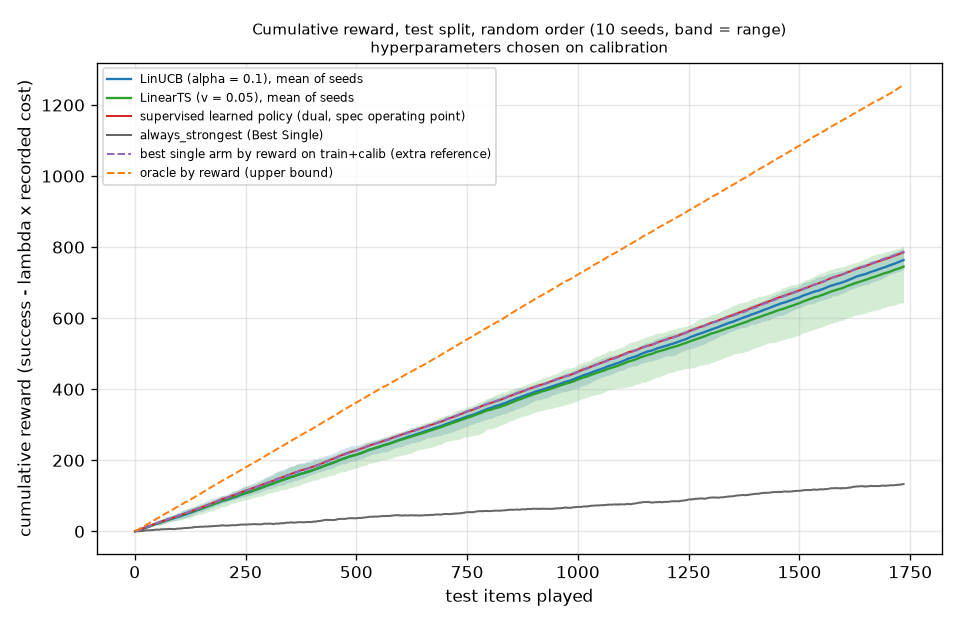
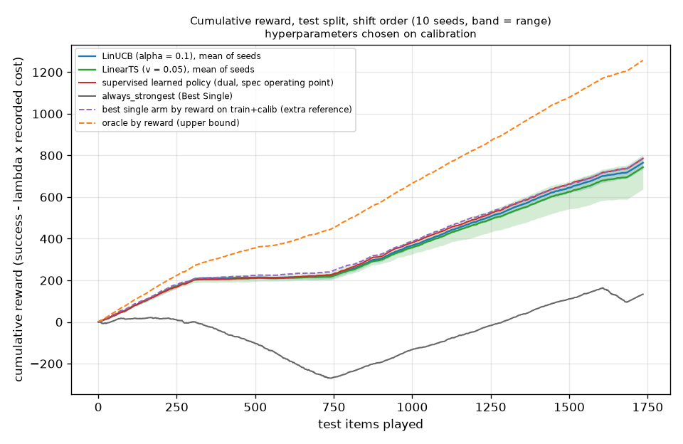

# bandits

Run `20261028T223648Z-1dadba6`.

**Labels:** costs are the recorded costs of each model on each item; no latency is measured or simulated in this experiment; reward = success - lambda * cost_usd with lambda = 6.719579687342048 per USD, the supervised policy's own lambda from the policy config; the bandits see only the reward of the arm they play, while the supervised policy was fitted on the train split with the outcomes of all models on every item; alpha and v are chosen on the calibration split (warm-up on train, random order, seed 0); the test split is read after, once per learner, order and seed; the supervised policy's calibrators were fitted on the calibration split, and its lambda was tuned there, before the test split was replayed; oracle by reward looks at the recorded outcomes: an upper bound, not a policy; the best single arm is an extra reference chosen on train and calibration rewards.

## Do the bandits beat the supervised policy? (test split, mean reward per item)

| statement |
| --- |
| LinUCB (alpha = 0.1), random order: does NOT consistently beat the supervised learned policy (mean reward per item 0.4401, seeds 0.4253 to 0.4586, against 0.4527; above it on 2 of 10 seeds; paired difference -0.0126 [-0.0252, +0.0004]). |
| LinUCB (alpha = 0.1), shift order: does NOT consistently beat the supervised learned policy (mean reward per item 0.4410, seeds 0.4238 to 0.4585, against 0.4527; above it on 2 of 10 seeds; paired difference -0.0117 [-0.0248, +0.0011]). |
| LinearTS (v = 0.05), random order: does NOT consistently beat the supervised learned policy (mean reward per item 0.4295, seeds 0.3717 to 0.4627, against 0.4527; above it on 2 of 10 seeds; paired difference -0.0232 [-0.0361, -0.0106]). |
| LinearTS (v = 0.05), shift order: does NOT consistently beat the supervised learned policy (mean reward per item 0.4286, seeds 0.3678 to 0.4629, against 0.4527; above it on 2 of 10 seeds; paired difference -0.0241 [-0.0370, -0.0115]). |

## Against the best single arm by reward, an extra reference (test split)

| statement |
| --- |
| LinUCB (alpha = 0.1), random order: does NOT consistently beat the best single arm by reward (extra reference) (mean reward per item 0.4401, seeds 0.4253 to 0.4586, against 0.4537; above it on 1 of 10 seeds; paired difference -0.0136 [-0.0253, -0.0015]). |
| LinUCB (alpha = 0.1), shift order: does NOT consistently beat the best single arm by reward (extra reference) (mean reward per item 0.4410, seeds 0.4238 to 0.4585, against 0.4537; above it on 2 of 10 seeds; paired difference -0.0127 [-0.0243, -0.0005]). |
| LinearTS (v = 0.05), random order: does NOT consistently beat the best single arm by reward (extra reference) (mean reward per item 0.4295, seeds 0.3717 to 0.4627, against 0.4537; above it on 2 of 10 seeds; paired difference -0.0242 [-0.0358, -0.0118]). |
| LinearTS (v = 0.05), shift order: does NOT consistently beat the best single arm by reward (extra reference) (mean reward per item 0.4286, seeds 0.3678 to 0.4629, against 0.4537; above it on 2 of 10 seeds; paired difference -0.0251 [-0.0363, -0.0130]). |

## Setup

| setting | value |
| --- | --- |
| pool | flagship |
| supervised artifact | dea4486d7575 |
| arms (models) | 12 |
| items (train / calibration / test) | 5185 / 1773 / 1735 |
| reward lambda (USD^-1) | 6.719579687342048 |
| context | 141 = 128 SVD components of the hashed features (dim 65536) + 12 standardized dense + 1 |
| variance of the hashed features kept by the SVD | 0.403884 |
| dense standardizer equals the artifact's | True (largest differences 0, 0) |
| seeds | 0 to 9 (10) |
| items per domain in the test split | {"knowledge": 1329, "code": 205, "reasoning": 78, "math": 72, "writing": 51} |
| wall time (s) | 118.7 |

## Hyperparameter choice (warm-up on train, evaluation on calibration, random order, seed 0)

| learner | parameter | value | calib mean reward | calib success | calib mean cost USD | chosen |
| --- | --- | --- | --- | --- | --- | --- |
| LinUCB | alpha | 0.1 | 0.428643 | 0.460801 | 0.00478569 | yes |
| LinUCB | alpha | 0.5 | 0.414746 | 0.452905 | 0.00567868 |  |
| LinUCB | alpha | 1 | 0.399703 | 0.438804 | 0.00581897 |  |
| LinUCB | alpha | 2 | 0.368715 | 0.416808 | 0.00715703 |  |
| LinearTS | v | 0.05 | 0.424221 | 0.450649 | 0.00393296 | yes |
| LinearTS | v | 0.1 | 0.412822 | 0.440496 | 0.00411853 |  |
| LinearTS | v | 0.5 | 0.377443 | 0.420756 | 0.00644571 |  |
| LinearTS | v | 1 | 0.333365 | 0.391991 | 0.00872459 |  |

## Test split, random order (10 seeds: mean [min, max])

| policy | mean reward per item [min, max over seeds] | success rate | mean cost USD | cumulative regret (total over the stream) | seeds above the supervised policy |
| --- | --- | --- | --- | --- | --- |
| LinUCB (alpha = 0.1) | 0.4401 [0.4253, 0.4586] | 0.4682 [0.4478, 0.4836] | 0.00418 [0.00289, 0.00529] | 493.3 [461.2, 519.0] | 2 of 10 |
| LinearTS (v = 0.05) | 0.4295 [0.3717, 0.4627] | 0.4616 [0.4127, 0.4974] | 0.00478 [0.00388, 0.00610] | 511.7 [454.1, 611.9] | 2 of 10 |
| supervised learned policy (dual, spec operating point) | 0.4527 | 0.4818 | 0.00434 | 471.4 |  |
| always_strongest (Best Single) | 0.0767 | 0.5274 | 0.06706 | 1123.7 |  |
| best single arm by reward on train+calib (extra reference) | 0.4537 | 0.4594 | 0.00084 | 469.7 |  |
| oracle by reward (upper bound) | 0.7244 | 0.7516 | 0.00405 | 0.0 |  |

## Test split, shift order (domains in sequence; 10 seeds: mean [min, max])

| policy | mean reward per item [min, max over seeds] | success rate | mean cost USD | cumulative regret (total over the stream) | seeds above the supervised policy |
| --- | --- | --- | --- | --- | --- |
| LinUCB (alpha = 0.1) | 0.4410 [0.4238, 0.4585] | 0.4699 [0.4444, 0.4853] | 0.00430 [0.00306, 0.00533] | 491.7 [461.3, 521.5] | 2 of 10 |
| LinearTS (v = 0.05) | 0.4286 [0.3678, 0.4629] | 0.4606 [0.4086, 0.4905] | 0.00477 [0.00397, 0.00608] | 513.2 [453.6, 618.7] | 2 of 10 |
| supervised learned policy (dual, spec operating point) | 0.4527 | 0.4818 | 0.00434 | 471.4 |  |
| always_strongest (Best Single) | 0.0767 | 0.5274 | 0.06706 | 1123.7 |  |
| best single arm by reward on train+calib (extra reference) | 0.4537 | 0.4594 | 0.00084 | 469.7 |  |
| oracle by reward (upper bound) | 0.7244 | 0.7516 | 0.00405 | 0.0 |  |

## Paired against the supervised policy (seed-averaged reward of each test item)

| learner | order | minus the supervised policy [95% CI] | seeds above the supervised policy | minus the best single arm [95% CI] | seeds above the best single arm |
| --- | --- | --- | --- | --- | --- |
| LinUCB | random | -0.0126 [-0.0252, +0.0004] | 2 of 10 | -0.0136 [-0.0253, -0.0015] | 1 of 10 |
| LinUCB | shift | -0.0117 [-0.0248, +0.0011] | 2 of 10 | -0.0127 [-0.0243, -0.0005] | 2 of 10 |
| LinearTS | random | -0.0232 [-0.0361, -0.0106] | 2 of 10 | -0.0242 [-0.0358, -0.0118] | 2 of 10 |
| LinearTS | shift | -0.0241 [-0.0370, -0.0115] | 2 of 10 | -0.0251 [-0.0363, -0.0130] | 2 of 10 |

## Share of steps each model was played, random order (mean over seeds)

| policy | claude-sonnet-4 | deepseek-r1-0528 | deepseek-v3-0324 | gemini-2.5-flash | gemini-2.5-pro | glm-4.6 | gpt-5 | gpt-5-chat | intern-s1 | kimi-k2-0905 | qwen3-235b-a22b-2507 | qwen3-235b-a22b-thinking-2507 |
| --- | --- | --- | --- | --- | --- | --- | --- | --- | --- | --- | --- | --- |
| LinUCB | 0.00605187 | 0.0182133 | 0.0766571 | 0.00962536 | 0.117003 | 0.015389 | 0.0292795 | 0.0229971 | 0.0521614 | 0.0817867 | 0.490778 | 0.0800576 |
| LinearTS | 0.0114121 | 0.0262248 | 0.0542939 | 0.0156772 | 0.075562 | 0.0257061 | 0.0609222 | 0.0232277 | 0.0487032 | 0.096196 | 0.425764 | 0.136311 |
| supervised learned policy (dual, spec operating point) | 0.00172911 | 0.0357349 | 0.0386167 | 0.00691643 | 0.0806916 | 0.0190202 | 0.0726225 | 0.0564841 | 0.0322767 | 0.0881844 | 0.556772 | 0.010951 |
| always_strongest (Best Single) | 0 | 0 | 0 | 0 | 1 | 0 | 0 | 0 | 0 | 0 | 0 | 0 |
| best single arm by reward on train+calib (extra reference) | 0 | 0 | 0 | 0 | 0 | 0 | 0 | 0 | 0 | 0 | 1 | 0 |
| oracle by reward (upper bound) | 0.00634006 | 0.0190202 | 0.0864553 | 0.0991354 | 0.0363112 | 0.0247839 | 0.0691643 | 0.0489914 | 0.0213256 | 0.0570605 | 0.450144 | 0.081268 |

## Share of steps each model was played, shift order (mean over seeds)

| policy | claude-sonnet-4 | deepseek-r1-0528 | deepseek-v3-0324 | gemini-2.5-flash | gemini-2.5-pro | glm-4.6 | gpt-5 | gpt-5-chat | intern-s1 | kimi-k2-0905 | qwen3-235b-a22b-2507 | qwen3-235b-a22b-thinking-2507 |
| --- | --- | --- | --- | --- | --- | --- | --- | --- | --- | --- | --- | --- |
| LinUCB | 0.00668588 | 0.0190202 | 0.0755043 | 0.00979827 | 0.118386 | 0.0157349 | 0.0293372 | 0.0243804 | 0.0531988 | 0.0831124 | 0.485706 | 0.0791354 |
| LinearTS | 0.0105476 | 0.0257061 | 0.0545245 | 0.0166571 | 0.0767147 | 0.0245533 | 0.0584438 | 0.0216138 | 0.0481844 | 0.100519 | 0.429914 | 0.132622 |
| supervised learned policy (dual, spec operating point) | 0.00172911 | 0.0357349 | 0.0386167 | 0.00691643 | 0.0806916 | 0.0190202 | 0.0726225 | 0.0564841 | 0.0322767 | 0.0881844 | 0.556772 | 0.010951 |
| always_strongest (Best Single) | 0 | 0 | 0 | 0 | 1 | 0 | 0 | 0 | 0 | 0 | 0 | 0 |
| best single arm by reward on train+calib (extra reference) | 0 | 0 | 0 | 0 | 0 | 0 | 0 | 0 | 0 | 0 | 1 | 0 |
| oracle by reward (upper bound) | 0.00634006 | 0.0190202 | 0.0864553 | 0.0991354 | 0.0363112 | 0.0247839 | 0.0691643 | 0.0489914 | 0.0213256 | 0.0570605 | 0.450144 | 0.081268 |

