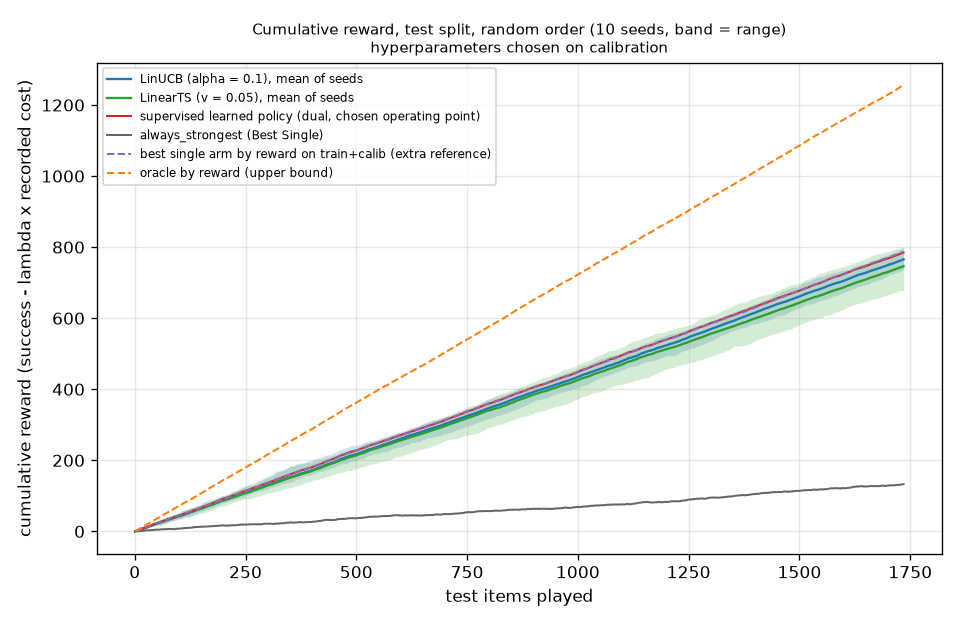
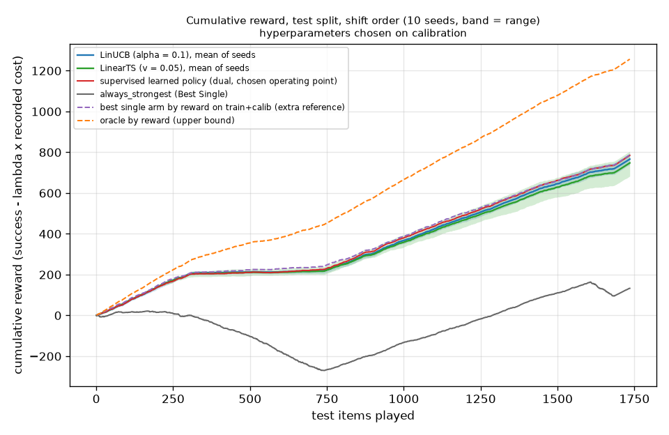

# bandits

Run `20261031T070500Z-f0429c6`.

**Labels:** costs are the recorded costs of each model on each item; no latency is measured or simulated in this experiment; reward = success - lambda * cost_usd with lambda = 6.721045792801306 per USD, the supervised policy's own lambda from the policy config; the bandits see only the reward of the arm they play, while the supervised policy was fitted on the train split with the outcomes of all models on every item; alpha and v are chosen on the calibration split (warm-up on train, random order, seed 0); the test split is read after, once per learner, order and seed; the supervised policy's calibrators were fitted on the calibration split, and its lambda was tuned there, before the test split was replayed; oracle by reward looks at the recorded outcomes: an upper bound, not a policy; the best single arm is an extra reference chosen on train and calibration rewards.

## Do the bandits beat the supervised policy? (test split, mean reward per item)

| statement |
| --- |
| LinUCB (alpha = 0.1), random order: does NOT consistently beat the supervised learned policy (mean reward per item 0.4413, seeds 0.4252 to 0.4586, against 0.4524; above it on 3 of 10 seeds; paired difference -0.0111 [-0.0240, +0.0014]). |
| LinUCB (alpha = 0.1), shift order: does NOT consistently beat the supervised learned policy (mean reward per item 0.4418, seeds 0.4261 to 0.4585, against 0.4524; above it on 2 of 10 seeds; paired difference -0.0106 [-0.0238, +0.0025]). |
| LinearTS (v = 0.05), random order: does NOT consistently beat the supervised learned policy (mean reward per item 0.4302, seeds 0.3921 to 0.4616, against 0.4524; above it on 2 of 10 seeds; paired difference -0.0221 [-0.0351, -0.0091]). |
| LinearTS (v = 0.05), shift order: does NOT consistently beat the supervised learned policy (mean reward per item 0.4310, seeds 0.3934 to 0.4640, against 0.4524; above it on 2 of 10 seeds; paired difference -0.0213 [-0.0340, -0.0089]). |

## Against the best single arm by reward, an extra reference (test split)

| statement |
| --- |
| LinUCB (alpha = 0.1), random order: does NOT consistently beat the best single arm by reward (extra reference) (mean reward per item 0.4413, seeds 0.4252 to 0.4586, against 0.4537; above it on 1 of 10 seeds; paired difference -0.0124 [-0.0239, -0.0001]). |
| LinUCB (alpha = 0.1), shift order: does NOT consistently beat the best single arm by reward (extra reference) (mean reward per item 0.4418, seeds 0.4261 to 0.4585, against 0.4537; above it on 2 of 10 seeds; paired difference -0.0119 [-0.0240, +0.0009]). |
| LinearTS (v = 0.05), random order: does NOT consistently beat the best single arm by reward (extra reference) (mean reward per item 0.4302, seeds 0.3921 to 0.4616, against 0.4537; above it on 2 of 10 seeds; paired difference -0.0235 [-0.0351, -0.0114]). |
| LinearTS (v = 0.05), shift order: does NOT consistently beat the best single arm by reward (extra reference) (mean reward per item 0.4310, seeds 0.3934 to 0.4640, against 0.4537; above it on 2 of 10 seeds; paired difference -0.0227 [-0.0342, -0.0102]). |

## Setup

| setting | value |
| --- | --- |
| pool | flagship |
| supervised artifact | dea4486d7575 |
| arms (models) | 12 |
| items (train / calibration / test) | 5185 / 1773 / 1735 |
| reward lambda (USD^-1) | 6.721045792801306 |
| context | 141 = 128 SVD components of the hashed features (dim 65536) + 12 standardized dense + 1 |
| variance of the hashed features kept by the SVD | 0.403884 |
| dense standardizer equals the artifact's | True (largest differences 0, 0) |
| seeds | 0 to 9 (10) |
| items per domain in the test split | {"knowledge": 1329, "code": 205, "reasoning": 78, "math": 72, "writing": 51} |
| wall time (s) | 95.3 |

## Hyperparameter choice (warm-up on train, evaluation on calibration, random order, seed 0)

| learner | parameter | value | calib mean reward | calib success | calib mean cost USD | chosen |
| --- | --- | --- | --- | --- | --- | --- |
| LinUCB | alpha | 0.1 | 0.428636 | 0.460801 | 0.00478569 | yes |
| LinUCB | alpha | 0.5 | 0.414738 | 0.452905 | 0.00567868 |  |
| LinUCB | alpha | 1 | 0.399695 | 0.438804 | 0.00581897 |  |
| LinUCB | alpha | 2 | 0.374853 | 0.423576 | 0.00724925 |  |
| LinearTS | v | 0.05 | 0.424755 | 0.451777 | 0.00402044 | yes |
| LinearTS | v | 0.1 | 0.412816 | 0.440496 | 0.00411853 |  |
| LinearTS | v | 0.5 | 0.377434 | 0.420756 | 0.00644571 |  |
| LinearTS | v | 1 | 0.333353 | 0.391991 | 0.00872459 |  |

## Test split, random order (10 seeds: mean [min, max])

| policy | mean reward per item [min, max over seeds] | success rate | mean cost USD | cumulative regret (total over the stream) | seeds above the supervised policy |
| --- | --- | --- | --- | --- | --- |
| LinUCB (alpha = 0.1) | 0.4413 [0.4252, 0.4586] | 0.4705 [0.4542, 0.4847] | 0.00435 [0.00370, 0.00529] | 491.2 [461.2, 519.0] | 3 of 10 |
| LinearTS (v = 0.05) | 0.4302 [0.3921, 0.4616] | 0.4632 [0.4277, 0.4974] | 0.00491 [0.00388, 0.00632] | 510.4 [455.8, 576.6] | 2 of 10 |
| supervised learned policy (dual, chosen operating point) | 0.4524 | 0.4818 | 0.00439 | 472.0 |  |
| always_strongest (Best Single) | 0.0766 | 0.5274 | 0.06706 | 1123.8 |  |
| best single arm by reward on train+calib (extra reference) | 0.4537 | 0.4594 | 0.00084 | 469.7 |  |
| oracle by reward (upper bound) | 0.7244 | 0.7516 | 0.00405 | 0.0 |  |

## Test split, shift order (domains in sequence; 10 seeds: mean [min, max])

| policy | mean reward per item [min, max over seeds] | success rate | mean cost USD | cumulative regret (total over the stream) | seeds above the supervised policy |
| --- | --- | --- | --- | --- | --- |
| LinUCB (alpha = 0.1) | 0.4418 [0.4261, 0.4585] | 0.4715 [0.4513, 0.4853] | 0.00442 [0.00354, 0.00536] | 490.3 [461.3, 517.6] | 2 of 10 |
| LinearTS (v = 0.05) | 0.4310 [0.3934, 0.4640] | 0.4640 [0.4288, 0.4916] | 0.00491 [0.00397, 0.00654] | 509.0 [451.7, 574.2] | 2 of 10 |
| supervised learned policy (dual, chosen operating point) | 0.4524 | 0.4818 | 0.00439 | 472.0 |  |
| always_strongest (Best Single) | 0.0766 | 0.5274 | 0.06706 | 1123.8 |  |
| best single arm by reward on train+calib (extra reference) | 0.4537 | 0.4594 | 0.00084 | 469.7 |  |
| oracle by reward (upper bound) | 0.7244 | 0.7516 | 0.00405 | 0.0 |  |

## Paired against the supervised policy (seed-averaged reward of each test item)

| learner | order | minus the supervised policy [95% CI] | seeds above the supervised policy | minus the best single arm [95% CI] | seeds above the best single arm |
| --- | --- | --- | --- | --- | --- |
| LinUCB | random | -0.0111 [-0.0240, +0.0014] | 3 of 10 | -0.0124 [-0.0239, -0.0001] | 1 of 10 |
| LinUCB | shift | -0.0106 [-0.0238, +0.0025] | 2 of 10 | -0.0119 [-0.0240, +0.0009] | 2 of 10 |
| LinearTS | random | -0.0221 [-0.0351, -0.0091] | 2 of 10 | -0.0235 [-0.0351, -0.0114] | 2 of 10 |
| LinearTS | shift | -0.0213 [-0.0340, -0.0089] | 2 of 10 | -0.0227 [-0.0342, -0.0102] | 2 of 10 |

## Share of steps each model was played, random order (mean over seeds)

| policy | claude-sonnet-4 | deepseek-r1-0528 | deepseek-v3-0324 | gemini-2.5-flash | gemini-2.5-pro | glm-4.6 | gpt-5 | gpt-5-chat | intern-s1 | kimi-k2-0905 | qwen3-235b-a22b-2507 | qwen3-235b-a22b-thinking-2507 |
| --- | --- | --- | --- | --- | --- | --- | --- | --- | --- | --- | --- | --- |
| LinUCB | 0.00651297 | 0.0190202 | 0.0736599 | 0.00910663 | 0.126571 | 0.0166571 | 0.0281268 | 0.0266282 | 0.0574063 | 0.0751009 | 0.48196 | 0.0792507 |
| LinearTS | 0.0105476 | 0.0217867 | 0.0551585 | 0.0163112 | 0.0723919 | 0.017464 | 0.0602882 | 0.0247839 | 0.0451873 | 0.0979251 | 0.435447 | 0.142709 |
| supervised learned policy (dual, chosen operating point) | 0.00172911 | 0.0357349 | 0.037464 | 0.00691643 | 0.0806916 | 0.0190202 | 0.0726225 | 0.0559078 | 0.032853 | 0.0864553 | 0.55562 | 0.0149856 |
| always_strongest (Best Single) | 0 | 0 | 0 | 0 | 1 | 0 | 0 | 0 | 0 | 0 | 0 | 0 |
| best single arm by reward on train+calib (extra reference) | 0 | 0 | 0 | 0 | 0 | 0 | 0 | 0 | 0 | 0 | 1 | 0 |
| oracle by reward (upper bound) | 0.00634006 | 0.0190202 | 0.0864553 | 0.0991354 | 0.0363112 | 0.0247839 | 0.0691643 | 0.0489914 | 0.0213256 | 0.0570605 | 0.450144 | 0.081268 |

## Share of steps each model was played, shift order (mean over seeds)

| policy | claude-sonnet-4 | deepseek-r1-0528 | deepseek-v3-0324 | gemini-2.5-flash | gemini-2.5-pro | glm-4.6 | gpt-5 | gpt-5-chat | intern-s1 | kimi-k2-0905 | qwen3-235b-a22b-2507 | qwen3-235b-a22b-thinking-2507 |
| --- | --- | --- | --- | --- | --- | --- | --- | --- | --- | --- | --- | --- |
| LinUCB | 0.00737752 | 0.02 | 0.0710663 | 0.00962536 | 0.125937 | 0.015562 | 0.0282997 | 0.0276081 | 0.0559654 | 0.0774063 | 0.478617 | 0.082536 |
| LinearTS | 0.0102594 | 0.0205187 | 0.0561383 | 0.0172334 | 0.0751009 | 0.0159078 | 0.0605764 | 0.0218444 | 0.0443228 | 0.103458 | 0.435274 | 0.139366 |
| supervised learned policy (dual, chosen operating point) | 0.00172911 | 0.0357349 | 0.037464 | 0.00691643 | 0.0806916 | 0.0190202 | 0.0726225 | 0.0559078 | 0.032853 | 0.0864553 | 0.55562 | 0.0149856 |
| always_strongest (Best Single) | 0 | 0 | 0 | 0 | 1 | 0 | 0 | 0 | 0 | 0 | 0 | 0 |
| best single arm by reward on train+calib (extra reference) | 0 | 0 | 0 | 0 | 0 | 0 | 0 | 0 | 0 | 0 | 1 | 0 |
| oracle by reward (upper bound) | 0.00634006 | 0.0190202 | 0.0864553 | 0.0991354 | 0.0363112 | 0.0247839 | 0.0691643 | 0.0489914 | 0.0213256 | 0.0570605 | 0.450144 | 0.081268 |

