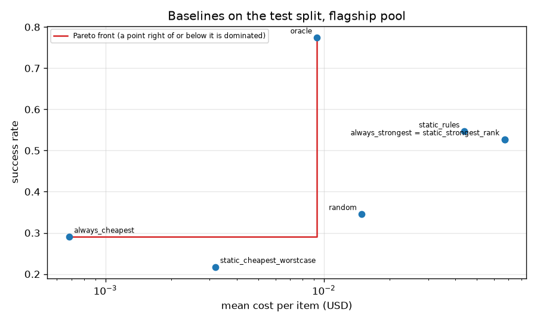

# baselines

Run `20261028T004934Z-bec7b21`.

**Labels:** costs are the recorded costs of each model on each item; no latency is measured or simulated in this experiment; Best Single, the cheapest model and the rules mapping are chosen on train+calib; this table is the test split, read once per policy; oracle looks at the recorded outcomes: an upper bound, not a policy.

## Setup

| setting | value |
| --- | --- |
| pool | flagship |
| split | test |
| items | 1735 |
| Best Single (always_strongest) | gemini-2.5-pro |
| cheapest (always_cheapest) | deepseek-v3-0324 |
| bootstrap | 1000 resamples, percentile 95% intervals, seed 0 |
| rules default model | gemini-2.5-pro |
| rule code | gpt-5 |
| rule math | gpt-5 |
| rule choices | gpt-5 |
| rule long | gpt-5 |
| static rules Go/Python parity (all items) | 0 mismatches of 12067 |

## Quality and cost on the test split

| policy | n | errors | success_rate [95% CI] | mean_cost_usd [95% CI] | cost_per_success_usd |
| --- | --- | --- | --- | --- | --- |
| always_strongest | 1735 | 0 | 0.5274 [0.5049, 0.5516] | 0.0670642 [0.0629193, 0.0712717] | 0.127165 |
| always_cheapest | 1735 | 0 | 0.2905 [0.2697, 0.3112] | 0.000682562 [0.000632164, 0.000735013] | 0.00234969 |
| random | 1735 | 0 | 0.3458 [0.3210, 0.3666] | 0.0149205 [0.0131064, 0.0169426] | 0.0431451 |
| static_rules | 1735 | 0 | 0.5464 [0.5245, 0.5695] | 0.0439707 [0.0407292, 0.0471802] | 0.0804738 |
| oracle | 1735 | 0 | 0.7746 [0.7550, 0.7954] | 0.00928426 [0.00750113, 0.0110288] | 0.0119853 |
| static_strongest_rank | 1735 | 0 | 0.5274 [0.5049, 0.5516] | 0.0670642 [0.0629193, 0.0712717] | 0.127165 |
| static_cheapest_worstcase | 1735 | 0 | 0.2173 [0.1988, 0.2380] | 0.00317929 [0.00301287, 0.00335731] | 0.0146315 |

## Against always_strongest (paired by item)

| policy | success_delta [95% CI] | cost_reduction [95% CI] |
| --- | --- | --- |
| always_strongest | 0.0000 [0.0000, 0.0000] | 0.0000 [0.0000, 0.0000] |
| always_cheapest | -0.2369 [-0.2611, -0.2138] | 0.9898 [0.9891, 0.9905] |
| random | -0.1816 [-0.2064, -0.1602] | 0.7775 [0.7496, 0.8036] |
| static_rules | 0.0190 [0.0069, 0.0317] | 0.3443 [0.3091, 0.3797] |
| oracle | 0.2473 [0.2265, 0.2674] | 0.8616 [0.8369, 0.8859] |
| static_strongest_rank | 0.0000 [0.0000, 0.0000] | 0.0000 [0.0000, 0.0000] |
| static_cheapest_worstcase | -0.3101 [-0.3349, -0.2865] | 0.9526 [0.9502, 0.9546] |

## Random policy over seeds 0 to 4

| seed | success_rate | mean_cost_usd |
| --- | --- | --- |
| 0 | 0.345821 | 0.0149205 |
| 1 | 0.36196 | 0.0147134 |
| 2 | 0.363112 | 0.0141224 |
| 3 | 0.361383 | 0.0148714 |
| 4 | 0.362536 | 0.0149149 |
| mean | 0.358963 | 0.0147085 |
| min | 0.345821 | 0.0141224 |
| max | 0.363112 | 0.0149205 |

## Success rate by dataset

| dataset | n | always_strongest | always_cheapest | random | static_rules | oracle | static_strongest_rank | static_cheapest_worstcase |
| --- | --- | --- | --- | --- | --- | --- | --- | --- |
| aime | 14 | 0.714286 | 0.428571 | 0.642857 | 0.714286 | 0.857143 | 0.714286 | 0.428571 |
| arc-agi | 78 | 0.461538 | 0.0897436 | 0.166667 | 0.525641 | 0.679487 | 0.461538 | 0.0384615 |
| arenahard_creative_writing | 51 | 0.960784 | 0.862745 | 0.882353 | 0.960784 | 1 | 0.960784 | 0.882353 |
| arenahard_math | 58 | 0.793103 | 0.655172 | 0.637931 | 0.775862 | 0.965517 | 0.793103 | 0.706897 |
| gpqa | 33 | 0.818182 | 0.484848 | 0.636364 | 0.757576 | 0.969697 | 0.818182 | 0.606061 |
| hle | 432 | 0.215278 | 0.0138889 | 0.0949074 | 0.247685 | 0.511574 | 0.215278 | 0.0787037 |
| livecodebench | 205 | 0.809756 | 0.678049 | 0.687805 | 0.892683 | 0.926829 | 0.809756 | 0.473171 |
| simpleqa | 864 | 0.564815 | 0.287037 | 0.33912 | 0.564815 | 0.84375 | 0.564815 | 0.15162 |

## Mean cost per item (USD) by dataset

| dataset | n | always_strongest | always_cheapest | random | static_rules | oracle | static_strongest_rank | static_cheapest_worstcase |
| --- | --- | --- | --- | --- | --- | --- | --- | --- |
| aime | 14 | 0.175073 | 0.00238905 | 0.0400356 | 0.137157 | 0.00386713 | 0.175073 | 0.0080635 |
| arc-agi | 78 | 0.199776 | 0.00311082 | 0.0328549 | 0.176886 | 0.0396237 | 0.199776 | 0.00858951 |
| arenahard_creative_writing | 51 | 0.0320819 | 0.000668021 | 0.0124954 | 0.0332387 | 0.000580736 | 0.0320819 | 0.00122059 |
| arenahard_math | 58 | 0.055223 | 0.00160306 | 0.0208456 | 0.0475303 | 0.00125186 | 0.055223 | 0.00411456 |
| gpqa | 33 | 0.105842 | 0.000856703 | 0.0371747 | 0.0463651 | 0.00778079 | 0.105842 | 0.00448886 |
| hle | 432 | 0.124528 | 0.000858192 | 0.0285596 | 0.0841582 | 0.0206345 | 0.124528 | 0.00501875 |
| livecodebench | 205 | 0.137131 | 0.0014084 | 0.0249892 | 0.0493466 | 0.0144394 | 0.137131 | 0.00658698 |
| simpleqa | 864 | 0.00935572 | 0.000108074 | 0.00258137 | 0.00939519 | 0.000845171 | 0.00935572 | 0.000886273 |

