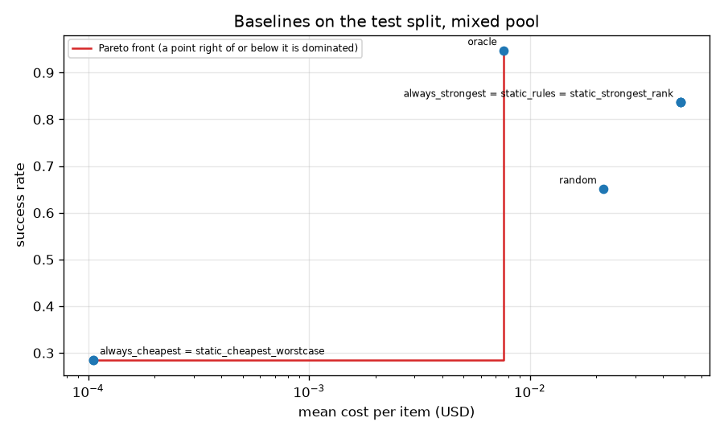

# baselines

Run `20261031T064750Z-d02bb26`.

**Labels:** costs of the four small models are fitted from recorded costs and applied to their recorded token counts; flagship costs are recorded; no latency is measured or simulated in this experiment; Best Single, the cheapest model and the rules mapping are chosen on train+calib; this table is the test split, read once per policy; oracle looks at the recorded outcomes: an upper bound, not a policy.

## Setup

| setting | value |
| --- | --- |
| pool | mixed |
| split | test |
| items | 361 |
| Best Single (always_strongest) | gpt-5 |
| cheapest (always_cheapest) | Llama-3.1-Nemotron-Nano-8B-v1 |
| bootstrap | 1000 resamples, percentile 95% intervals, seed 0 |
| rules default model | gpt-5 |
| rule code | gpt-5 |
| rule math | gpt-5 |
| rule choices | gpt-5 |
| rule long | gpt-5 |
| static rules Go/Python parity (all items) | 0 mismatches of 3182 |

## Quality and cost on the test split

| policy | n | errors | success_rate [95% CI] | mean_cost_usd [95% CI] | cost_per_success_usd |
| --- | --- | --- | --- | --- | --- |
| always_strongest | 361 | 0 | 0.8366 [0.7978, 0.8726] | 0.0478513 [0.0413765, 0.0543659] | 0.0571997 |
| always_cheapest | 361 | 0 | 0.2853 [0.2382, 0.3297] | 0.000105301 [9.93498e-05, 0.000111624] | 0.000369065 |
| random | 361 | 0 | 0.6510 [0.6039, 0.7008] | 0.0215605 [0.0163241, 0.0270881] | 0.0331206 |
| static_rules | 361 | 0 | 0.8366 [0.7978, 0.8726] | 0.0478513 [0.0413765, 0.0543659] | 0.0571997 |
| oracle | 361 | 0 | 0.9474 [0.9252, 0.9695] | 0.00757798 [0.00413359, 0.0118652] | 0.00799897 |
| static_strongest_rank | 361 | 0 | 0.8366 [0.7978, 0.8726] | 0.0478513 [0.0413765, 0.0543659] | 0.0571997 |
| static_cheapest_worstcase | 361 | 0 | 0.2853 [0.2382, 0.3297] | 0.000105301 [9.93498e-05, 0.000111624] | 0.000369065 |

## Against always_strongest (paired by item)

| policy | success_delta [95% CI] | cost_reduction [95% CI] |
| --- | --- | --- |
| always_strongest | 0.0000 [0.0000, 0.0000] | 0.0000 [0.0000, 0.0000] |
| always_cheapest | -0.5512 [-0.6039, -0.4958] | 0.9978 [0.9975, 0.9981] |
| random | -0.1856 [-0.2382, -0.1357] | 0.5494 [0.4381, 0.6501] |
| static_rules | 0.0000 [0.0000, 0.0000] | 0.0000 [0.0000, 0.0000] |
| oracle | 0.1108 [0.0803, 0.1468] | 0.8416 [0.7626, 0.9071] |
| static_strongest_rank | 0.0000 [0.0000, 0.0000] | 0.0000 [0.0000, 0.0000] |
| static_cheapest_worstcase | -0.5512 [-0.6039, -0.4958] | 0.9978 [0.9975, 0.9981] |

## Random policy over seeds 0 to 4

| seed | success_rate | mean_cost_usd |
| --- | --- | --- |
| 0 | 0.65097 | 0.0215605 |
| 1 | 0.65928 | 0.013566 |
| 2 | 0.634349 | 0.014185 |
| 3 | 0.639889 | 0.0127632 |
| 4 | 0.67313 | 0.0133991 |
| mean | 0.651524 | 0.0150947 |
| min | 0.634349 | 0.0127632 |
| max | 0.67313 | 0.0215605 |

## Success rate by dataset

| dataset | n | always_strongest | always_cheapest | random | static_rules | oracle | static_strongest_rank | static_cheapest_worstcase |
| --- | --- | --- | --- | --- | --- | --- | --- | --- |
| aime | 14 | 0.642857 | 0.357143 | 0.642857 | 0.642857 | 0.857143 | 0.642857 | 0.357143 |
| arenahard_creative_writing | 51 | 0.941176 | 0 | 0.784314 | 0.941176 | 1 | 0.941176 | 0 |
| arenahard_math | 58 | 0.637931 | 0.0517241 | 0.534483 | 0.637931 | 0.965517 | 0.637931 | 0.0517241 |
| gpqa | 33 | 0.757576 | 0.181818 | 0.636364 | 0.757576 | 0.969697 | 0.757576 | 0.181818 |
| livecodebench | 205 | 0.892683 | 0.434146 | 0.653659 | 0.892683 | 0.931707 | 0.892683 | 0.434146 |

## Mean cost per item (USD) by dataset

| dataset | n | always_strongest | always_cheapest | random | static_rules | oracle | static_strongest_rank | static_cheapest_worstcase |
| --- | --- | --- | --- | --- | --- | --- | --- | --- |
| aime | 14 | 0.120317 | 0.000137414 | 0.0398641 | 0.120317 | 0.00321335 | 0.120317 | 0.000137414 |
| arenahard_creative_writing | 51 | 0.0328031 | 5.45887e-05 | 0.00891381 | 0.0328031 | 0.000280151 | 0.0328031 | 5.45887e-05 |
| arenahard_math | 58 | 0.0391519 | 0.000108918 | 0.0185383 | 0.0391519 | 0.000933991 | 0.0391519 | 0.000108918 |
| gpqa | 33 | 0.0463651 | 0.000104355 | 0.0346008 | 0.0463651 | 0.00103196 | 0.0463651 | 0.000104355 |
| livecodebench | 205 | 0.0493466 | 0.000114853 | 0.0222126 | 0.0493466 | 0.0126251 | 0.0493466 | 0.000114853 |

