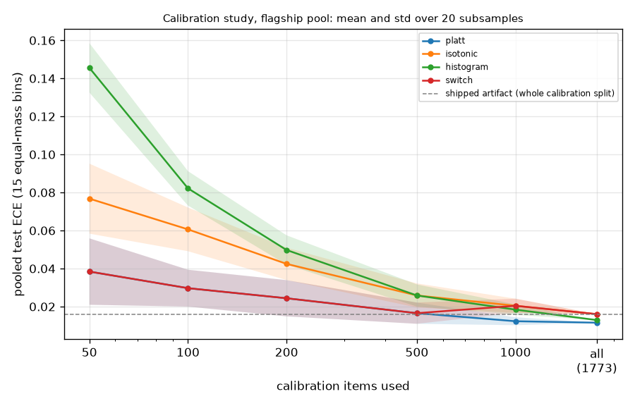

# calibration

Run `20261028T203251Z-028d6b4`.

**Labels:** no latency, price or cost is involved in this experiment; the quality weights are those of the shipped artifact; raw scores are recomputed in Python from its float32 weights; test ECE uses 15 equal-mass bins; every configuration is reported and none is chosen from the test numbers; histogram binning is an experiment only and is never exported; calibration items are subsampled without replacement; the 'all' rows use the whole calibration split for every seed, so their spread is zero.

## Setup

| setting | value |
| --- | --- |
| pool | flagship |
| artifact version | dea4486d7575 |
| models | 12 |
| calibration / test items | 1773 / 1735 |
| sizes run | 50, 100, 200, 500, 1000, all |
| methods | platt, isotonic, histogram, switch |
| seeds per size | 20 |
| ECE bins | 15 equal-mass |
| switch rule | isotonic from 1000 samples, else Platt |
| shipped calibrators | {"isotonic": 12} |
| wall time (s) | 27 |
| skipped size 2000 | 2000 is not below the 1773 calibration items; 'all' is the full split |
| optimizer convergence warnings (all fits) | 0 |

## Pooled test ECE (mean +/- std over seeds)

| calibration items | platt | isotonic | histogram | switch |
| --- | --- | --- | --- | --- |
| 50 | 0.0384 +/- 0.0175 | 0.0768 +/- 0.0184 | 0.1455 +/- 0.0130 | 0.0384 +/- 0.0175 |
| 100 | 0.0297 +/- 0.0097 | 0.0606 +/- 0.0115 | 0.0822 +/- 0.0090 | 0.0297 +/- 0.0097 |
| 200 | 0.0244 +/- 0.0095 | 0.0425 +/- 0.0085 | 0.0498 +/- 0.0077 | 0.0244 +/- 0.0095 |
| 500 | 0.0165 +/- 0.0056 | 0.0259 +/- 0.0063 | 0.0259 +/- 0.0058 | 0.0165 +/- 0.0056 |
| 1000 | 0.0123 +/- 0.0021 | 0.0204 +/- 0.0037 | 0.0184 +/- 0.0027 | 0.0204 +/- 0.0037 |
| all (1773) | 0.0115 +/- 0.0000 | 0.0160 +/- 0.0000 | 0.0129 +/- 0.0000 | 0.0160 +/- 0.0000 |
| shipped artifact (whole split) |  |  |  | 0.0160 |

## Test ECE per model, 50 calibration items (mean +/- std over seeds)

| model | platt | isotonic | histogram | switch | shipped artifact |
| --- | --- | --- | --- | --- | --- |
| claude-sonnet-4 | 0.0587 +/- 0.0237 | 0.0785 +/- 0.0208 | 0.1394 +/- 0.0437 | 0.0587 +/- 0.0237 | 0.0342 |
| deepseek-r1-0528 | 0.0741 +/- 0.0333 | 0.0968 +/- 0.0323 | 0.1770 +/- 0.0379 | 0.0741 +/- 0.0333 | 0.0343 |
| deepseek-v3-0324 | 0.0761 +/- 0.0326 | 0.1001 +/- 0.0290 | 0.1613 +/- 0.0261 | 0.0761 +/- 0.0326 | 0.0466 |
| gemini-2.5-flash | 0.0759 +/- 0.0193 | 0.1028 +/- 0.0310 | 0.1682 +/- 0.0367 | 0.0759 +/- 0.0193 | 0.0364 |
| gemini-2.5-pro | 0.0770 +/- 0.0253 | 0.1210 +/- 0.0235 | 0.1914 +/- 0.0263 | 0.0770 +/- 0.0253 | 0.0499 |
| glm-4.6 | 0.0788 +/- 0.0257 | 0.1082 +/- 0.0229 | 0.1803 +/- 0.0370 | 0.0788 +/- 0.0257 | 0.0490 |
| gpt-5 | 0.0701 +/- 0.0299 | 0.1190 +/- 0.0303 | 0.1795 +/- 0.0371 | 0.0701 +/- 0.0299 | 0.0537 |
| gpt-5-chat | 0.0728 +/- 0.0232 | 0.1117 +/- 0.0295 | 0.1803 +/- 0.0336 | 0.0728 +/- 0.0232 | 0.0327 |
| intern-s1 | 0.0724 +/- 0.0257 | 0.0842 +/- 0.0240 | 0.1617 +/- 0.0290 | 0.0724 +/- 0.0257 | 0.0263 |
| kimi-k2-0905 | 0.0698 +/- 0.0326 | 0.1051 +/- 0.0283 | 0.1745 +/- 0.0396 | 0.0698 +/- 0.0326 | 0.0340 |
| qwen3-235b-a22b-2507 | 0.0696 +/- 0.0252 | 0.0985 +/- 0.0270 | 0.1679 +/- 0.0330 | 0.0696 +/- 0.0252 | 0.0319 |
| qwen3-235b-a22b-thinking-2507 | 0.0720 +/- 0.0353 | 0.1035 +/- 0.0316 | 0.1788 +/- 0.0308 | 0.0720 +/- 0.0353 | 0.0434 |
| pooled (all models) | 0.0384 +/- 0.0175 | 0.0768 +/- 0.0184 | 0.1455 +/- 0.0130 | 0.0384 +/- 0.0175 | 0.0160 |

## Test ECE per model, 100 calibration items (mean +/- std over seeds)

| model | platt | isotonic | histogram | switch | shipped artifact |
| --- | --- | --- | --- | --- | --- |
| claude-sonnet-4 | 0.0429 +/- 0.0077 | 0.0648 +/- 0.0138 | 0.0956 +/- 0.0175 | 0.0429 +/- 0.0077 | 0.0342 |
| deepseek-r1-0528 | 0.0494 +/- 0.0147 | 0.0723 +/- 0.0202 | 0.1136 +/- 0.0267 | 0.0494 +/- 0.0147 | 0.0343 |
| deepseek-v3-0324 | 0.0554 +/- 0.0197 | 0.0770 +/- 0.0133 | 0.1011 +/- 0.0216 | 0.0554 +/- 0.0197 | 0.0466 |
| gemini-2.5-flash | 0.0595 +/- 0.0127 | 0.0909 +/- 0.0227 | 0.1139 +/- 0.0208 | 0.0595 +/- 0.0127 | 0.0364 |
| gemini-2.5-pro | 0.0630 +/- 0.0280 | 0.0981 +/- 0.0226 | 0.1438 +/- 0.0255 | 0.0630 +/- 0.0280 | 0.0499 |
| glm-4.6 | 0.0626 +/- 0.0181 | 0.0908 +/- 0.0186 | 0.1246 +/- 0.0231 | 0.0626 +/- 0.0181 | 0.0490 |
| gpt-5 | 0.0580 +/- 0.0223 | 0.1089 +/- 0.0257 | 0.1337 +/- 0.0224 | 0.0580 +/- 0.0223 | 0.0537 |
| gpt-5-chat | 0.0643 +/- 0.0159 | 0.0847 +/- 0.0211 | 0.1305 +/- 0.0292 | 0.0643 +/- 0.0159 | 0.0327 |
| intern-s1 | 0.0530 +/- 0.0248 | 0.0707 +/- 0.0212 | 0.1140 +/- 0.0291 | 0.0530 +/- 0.0248 | 0.0263 |
| kimi-k2-0905 | 0.0544 +/- 0.0186 | 0.0827 +/- 0.0209 | 0.1203 +/- 0.0273 | 0.0544 +/- 0.0186 | 0.0340 |
| qwen3-235b-a22b-2507 | 0.0492 +/- 0.0182 | 0.0785 +/- 0.0209 | 0.1082 +/- 0.0194 | 0.0492 +/- 0.0182 | 0.0319 |
| qwen3-235b-a22b-thinking-2507 | 0.0621 +/- 0.0166 | 0.0871 +/- 0.0250 | 0.1182 +/- 0.0278 | 0.0621 +/- 0.0166 | 0.0434 |
| pooled (all models) | 0.0297 +/- 0.0097 | 0.0606 +/- 0.0115 | 0.0822 +/- 0.0090 | 0.0297 +/- 0.0097 | 0.0160 |

## Test ECE per model, 200 calibration items (mean +/- std over seeds)

| model | platt | isotonic | histogram | switch | shipped artifact |
| --- | --- | --- | --- | --- | --- |
| claude-sonnet-4 | 0.0423 +/- 0.0082 | 0.0572 +/- 0.0105 | 0.0740 +/- 0.0131 | 0.0423 +/- 0.0082 | 0.0342 |
| deepseek-r1-0528 | 0.0436 +/- 0.0136 | 0.0567 +/- 0.0147 | 0.0878 +/- 0.0173 | 0.0436 +/- 0.0136 | 0.0343 |
| deepseek-v3-0324 | 0.0431 +/- 0.0115 | 0.0578 +/- 0.0120 | 0.0761 +/- 0.0189 | 0.0431 +/- 0.0115 | 0.0466 |
| gemini-2.5-flash | 0.0562 +/- 0.0097 | 0.0694 +/- 0.0155 | 0.0822 +/- 0.0185 | 0.0562 +/- 0.0097 | 0.0364 |
| gemini-2.5-pro | 0.0515 +/- 0.0157 | 0.0712 +/- 0.0155 | 0.0981 +/- 0.0162 | 0.0515 +/- 0.0157 | 0.0499 |
| glm-4.6 | 0.0460 +/- 0.0133 | 0.0687 +/- 0.0150 | 0.0881 +/- 0.0177 | 0.0460 +/- 0.0133 | 0.0490 |
| gpt-5 | 0.0501 +/- 0.0192 | 0.0835 +/- 0.0173 | 0.0894 +/- 0.0183 | 0.0501 +/- 0.0192 | 0.0537 |
| gpt-5-chat | 0.0551 +/- 0.0119 | 0.0727 +/- 0.0155 | 0.0921 +/- 0.0146 | 0.0551 +/- 0.0119 | 0.0327 |
| intern-s1 | 0.0434 +/- 0.0132 | 0.0533 +/- 0.0131 | 0.0764 +/- 0.0194 | 0.0434 +/- 0.0132 | 0.0263 |
| kimi-k2-0905 | 0.0443 +/- 0.0116 | 0.0609 +/- 0.0128 | 0.0756 +/- 0.0159 | 0.0443 +/- 0.0116 | 0.0340 |
| qwen3-235b-a22b-2507 | 0.0444 +/- 0.0158 | 0.0647 +/- 0.0164 | 0.0798 +/- 0.0187 | 0.0444 +/- 0.0158 | 0.0319 |
| qwen3-235b-a22b-thinking-2507 | 0.0498 +/- 0.0135 | 0.0674 +/- 0.0156 | 0.0823 +/- 0.0159 | 0.0498 +/- 0.0135 | 0.0434 |
| pooled (all models) | 0.0244 +/- 0.0095 | 0.0425 +/- 0.0085 | 0.0498 +/- 0.0077 | 0.0244 +/- 0.0095 | 0.0160 |

## Test ECE per model, 500 calibration items (mean +/- std over seeds)

| model | platt | isotonic | histogram | switch | shipped artifact |
| --- | --- | --- | --- | --- | --- |
| claude-sonnet-4 | 0.0336 +/- 0.0053 | 0.0406 +/- 0.0084 | 0.0508 +/- 0.0084 | 0.0336 +/- 0.0053 | 0.0342 |
| deepseek-r1-0528 | 0.0362 +/- 0.0046 | 0.0450 +/- 0.0084 | 0.0589 +/- 0.0145 | 0.0362 +/- 0.0046 | 0.0343 |
| deepseek-v3-0324 | 0.0346 +/- 0.0068 | 0.0505 +/- 0.0090 | 0.0546 +/- 0.0092 | 0.0346 +/- 0.0068 | 0.0466 |
| gemini-2.5-flash | 0.0528 +/- 0.0053 | 0.0514 +/- 0.0093 | 0.0571 +/- 0.0104 | 0.0528 +/- 0.0053 | 0.0364 |
| gemini-2.5-pro | 0.0422 +/- 0.0084 | 0.0579 +/- 0.0118 | 0.0658 +/- 0.0097 | 0.0422 +/- 0.0084 | 0.0499 |
| glm-4.6 | 0.0395 +/- 0.0051 | 0.0543 +/- 0.0074 | 0.0631 +/- 0.0104 | 0.0395 +/- 0.0051 | 0.0490 |
| gpt-5 | 0.0359 +/- 0.0046 | 0.0625 +/- 0.0060 | 0.0657 +/- 0.0093 | 0.0359 +/- 0.0046 | 0.0537 |
| gpt-5-chat | 0.0485 +/- 0.0029 | 0.0494 +/- 0.0092 | 0.0574 +/- 0.0102 | 0.0485 +/- 0.0029 | 0.0327 |
| intern-s1 | 0.0332 +/- 0.0046 | 0.0389 +/- 0.0091 | 0.0501 +/- 0.0093 | 0.0332 +/- 0.0046 | 0.0263 |
| kimi-k2-0905 | 0.0353 +/- 0.0071 | 0.0455 +/- 0.0107 | 0.0548 +/- 0.0094 | 0.0353 +/- 0.0071 | 0.0340 |
| qwen3-235b-a22b-2507 | 0.0376 +/- 0.0071 | 0.0480 +/- 0.0093 | 0.0578 +/- 0.0105 | 0.0376 +/- 0.0071 | 0.0319 |
| qwen3-235b-a22b-thinking-2507 | 0.0417 +/- 0.0077 | 0.0511 +/- 0.0099 | 0.0583 +/- 0.0107 | 0.0417 +/- 0.0077 | 0.0434 |
| pooled (all models) | 0.0165 +/- 0.0056 | 0.0259 +/- 0.0063 | 0.0259 +/- 0.0058 | 0.0165 +/- 0.0056 | 0.0160 |

## Test ECE per model, 1000 calibration items (mean +/- std over seeds)

| model | platt | isotonic | histogram | switch | shipped artifact |
| --- | --- | --- | --- | --- | --- |
| claude-sonnet-4 | 0.0298 +/- 0.0029 | 0.0375 +/- 0.0053 | 0.0430 +/- 0.0093 | 0.0375 +/- 0.0053 | 0.0342 |
| deepseek-r1-0528 | 0.0323 +/- 0.0019 | 0.0365 +/- 0.0058 | 0.0443 +/- 0.0057 | 0.0365 +/- 0.0058 | 0.0343 |
| deepseek-v3-0324 | 0.0309 +/- 0.0039 | 0.0440 +/- 0.0058 | 0.0497 +/- 0.0078 | 0.0440 +/- 0.0058 | 0.0466 |
| gemini-2.5-flash | 0.0508 +/- 0.0030 | 0.0458 +/- 0.0088 | 0.0479 +/- 0.0074 | 0.0458 +/- 0.0088 | 0.0364 |
| gemini-2.5-pro | 0.0339 +/- 0.0048 | 0.0511 +/- 0.0057 | 0.0532 +/- 0.0074 | 0.0511 +/- 0.0057 | 0.0499 |
| glm-4.6 | 0.0370 +/- 0.0028 | 0.0475 +/- 0.0050 | 0.0534 +/- 0.0067 | 0.0475 +/- 0.0050 | 0.0490 |
| gpt-5 | 0.0346 +/- 0.0035 | 0.0548 +/- 0.0059 | 0.0485 +/- 0.0053 | 0.0548 +/- 0.0059 | 0.0537 |
| gpt-5-chat | 0.0464 +/- 0.0008 | 0.0440 +/- 0.0062 | 0.0456 +/- 0.0104 | 0.0440 +/- 0.0062 | 0.0327 |
| intern-s1 | 0.0292 +/- 0.0020 | 0.0316 +/- 0.0046 | 0.0388 +/- 0.0067 | 0.0316 +/- 0.0046 | 0.0263 |
| kimi-k2-0905 | 0.0314 +/- 0.0031 | 0.0416 +/- 0.0076 | 0.0378 +/- 0.0077 | 0.0416 +/- 0.0076 | 0.0340 |
| qwen3-235b-a22b-2507 | 0.0314 +/- 0.0014 | 0.0359 +/- 0.0065 | 0.0420 +/- 0.0085 | 0.0359 +/- 0.0065 | 0.0319 |
| qwen3-235b-a22b-thinking-2507 | 0.0370 +/- 0.0042 | 0.0410 +/- 0.0078 | 0.0446 +/- 0.0083 | 0.0410 +/- 0.0078 | 0.0434 |
| pooled (all models) | 0.0123 +/- 0.0021 | 0.0204 +/- 0.0037 | 0.0184 +/- 0.0027 | 0.0204 +/- 0.0037 | 0.0160 |

## Test ECE per model, all 1773 calibration items (mean +/- std over seeds)

| model | platt | isotonic | histogram | switch | shipped artifact |
| --- | --- | --- | --- | --- | --- |
| claude-sonnet-4 | 0.0278 +/- 0.0000 | 0.0342 +/- 0.0000 | 0.0431 +/- 0.0000 | 0.0342 +/- 0.0000 | 0.0342 |
| deepseek-r1-0528 | 0.0297 +/- 0.0000 | 0.0343 +/- 0.0000 | 0.0446 +/- 0.0000 | 0.0343 +/- 0.0000 | 0.0343 |
| deepseek-v3-0324 | 0.0304 +/- 0.0000 | 0.0466 +/- 0.0000 | 0.0466 +/- 0.0000 | 0.0466 +/- 0.0000 | 0.0466 |
| gemini-2.5-flash | 0.0508 +/- 0.0000 | 0.0364 +/- 0.0000 | 0.0460 +/- 0.0000 | 0.0364 +/- 0.0000 | 0.0364 |
| gemini-2.5-pro | 0.0341 +/- 0.0000 | 0.0499 +/- 0.0000 | 0.0449 +/- 0.0000 | 0.0499 +/- 0.0000 | 0.0499 |
| glm-4.6 | 0.0350 +/- 0.0000 | 0.0490 +/- 0.0000 | 0.0559 +/- 0.0000 | 0.0490 +/- 0.0000 | 0.0490 |
| gpt-5 | 0.0326 +/- 0.0000 | 0.0537 +/- 0.0000 | 0.0413 +/- 0.0000 | 0.0537 +/- 0.0000 | 0.0537 |
| gpt-5-chat | 0.0461 +/- 0.0000 | 0.0327 +/- 0.0000 | 0.0377 +/- 0.0000 | 0.0327 +/- 0.0000 | 0.0327 |
| intern-s1 | 0.0271 +/- 0.0000 | 0.0263 +/- 0.0000 | 0.0367 +/- 0.0000 | 0.0263 +/- 0.0000 | 0.0263 |
| kimi-k2-0905 | 0.0317 +/- 0.0000 | 0.0340 +/- 0.0000 | 0.0306 +/- 0.0000 | 0.0340 +/- 0.0000 | 0.0340 |
| qwen3-235b-a22b-2507 | 0.0312 +/- 0.0000 | 0.0319 +/- 0.0000 | 0.0415 +/- 0.0000 | 0.0319 +/- 0.0000 | 0.0319 |
| qwen3-235b-a22b-thinking-2507 | 0.0338 +/- 0.0000 | 0.0434 +/- 0.0000 | 0.0335 +/- 0.0000 | 0.0434 +/- 0.0000 | 0.0434 |
| pooled (all models) | 0.0115 +/- 0.0000 | 0.0160 +/- 0.0000 | 0.0129 +/- 0.0000 | 0.0160 +/- 0.0000 | 0.0160 |

## Calibrator types and optimizer warnings

| calibration items | method | fits by calibrator type (models x seeds) | convergence warnings |
| --- | --- | --- | --- |
| 50 | platt | {"platt": 240} | 0 |
| 50 | isotonic | {"isotonic": 240} | 0 |
| 50 | histogram | {"histogram": 240} | 0 |
| 50 | switch | {"platt": 240} | 0 |
| 100 | platt | {"platt": 240} | 0 |
| 100 | isotonic | {"isotonic": 240} | 0 |
| 100 | histogram | {"histogram": 240} | 0 |
| 100 | switch | {"platt": 240} | 0 |
| 200 | platt | {"platt": 240} | 0 |
| 200 | isotonic | {"isotonic": 240} | 0 |
| 200 | histogram | {"histogram": 240} | 0 |
| 200 | switch | {"platt": 240} | 0 |
| 500 | platt | {"platt": 240} | 0 |
| 500 | isotonic | {"isotonic": 240} | 0 |
| 500 | histogram | {"histogram": 240} | 0 |
| 500 | switch | {"platt": 240} | 0 |
| 1000 | platt | {"platt": 240} | 0 |
| 1000 | isotonic | {"isotonic": 240} | 0 |
| 1000 | histogram | {"histogram": 240} | 0 |
| 1000 | switch | {"isotonic": 240} | 0 |
| all | platt | {"platt": 240} | 0 |
| all | isotonic | {"isotonic": 240} | 0 |
| all | histogram | {"histogram": 240} | 0 |
| all | switch | {"isotonic": 240} | 0 |

