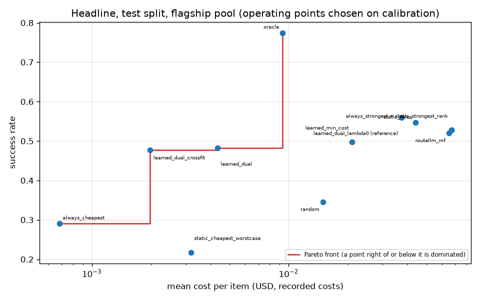
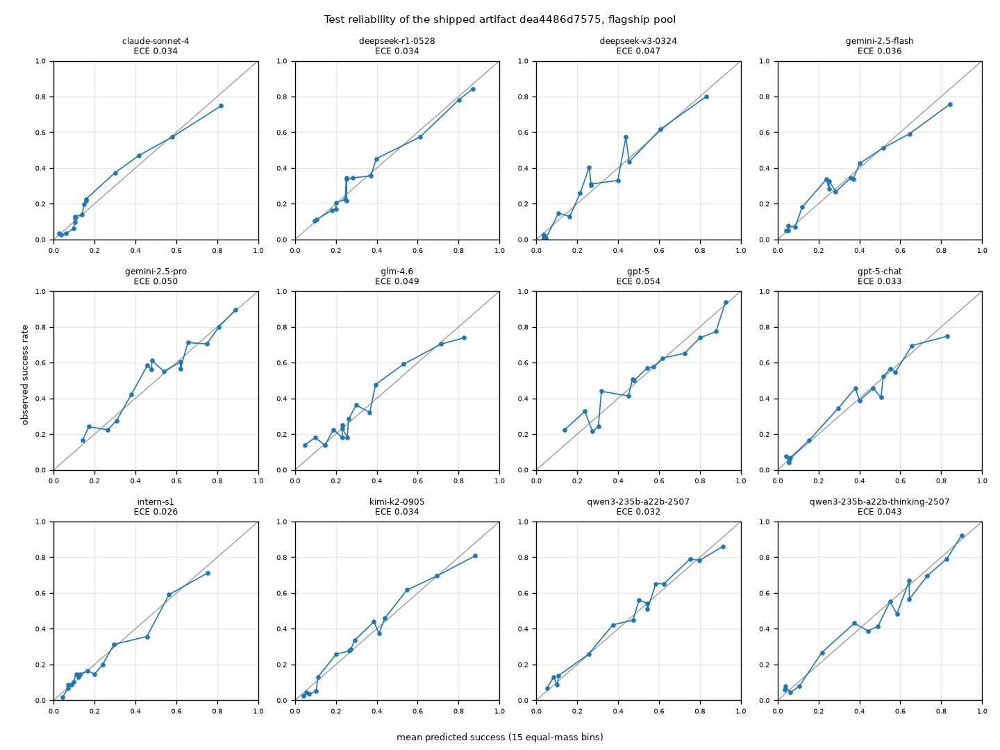

# headline

Run `20261028T203202Z-028d6b4`.

**Labels:** costs are the recorded costs of each model on each item; no latency is measured or simulated in this experiment; operating points (lambda, the floor, the RouteLLM threshold) are chosen on the calibration split only; the test split is read once per reported point; the calibrators and lower-bound tables of the learned policy were fitted on the calibration split, so the learned policy's calibration success is in-sample and optimistic; oracle looks at the recorded outcomes: an upper bound, not a policy; the lambda = 0 dual row is a reference, not an operating point; the cross-fitted row refits calibrators and lower-bound tables on half A of the calibration items and tunes lambda on half B; its artifact is temporary and not committed.

## Were the targets met?

| statement (test split, against always_strongest) |
| --- |
| learned dual (spec operating point): cost reduction 93.5% (meets the 25% target), success -4.55 points against always_strongest (outside the 1 point target): targets NOT met. |
| learned min_cost: cost reduction 68.7% (meets the 25% target), success -3.00 points against always_strongest (outside the 1 point target): targets NOT met. |
| RouteLLM MF: cost reduction 2.7% (misses the 25% target), success -0.69 points against always_strongest (within the 1 point target): targets NOT met. |
| learned dual, cross-fitted: cost reduction 97.1% (meets the 25% target), success -5.07 points against always_strongest (outside the 1 point target): targets NOT met. |

## Setup

| setting | value |
| --- | --- |
| pool | flagship |
| artifact version | dea4486d7575 |
| calibrators in the artifact | {"isotonic": 12} |
| items (calibration / test) | 1773 / 1735 |
| Best Single (always_strongest) | gemini-2.5-pro |
| cheapest (RouteLLM weak model) | deepseek-v3-0324 |
| Best Single calibration success | 0.50141 |
| target Q_bar (that minus the margin) | 0.49141 (0.01) |
| lambda (USD^-1) | 6.719579687342048 (config) |
| calibration success at that lambda / at lambda 0 | 0.491822 / 0.560068 |
| policy config (other than lambda) | {"mode": "dual", "default_floor": 0, "epsilon": 0, "ood_action": "conservative", "on_infeasible": "best_effort"} |
| RouteLLM MF weights SHA-256 | 8216c85e5965401a4735493d04f70863982fc5475a207bc851cd399eb466accc |
| bootstrap | 1000 resamples, percentile 95% intervals, seed 0 |
| replays run (calibration / test) | 107 / 12 |
| wall time (s) | 34.2 |

## Headline: test split, paired against always_strongest

| policy | kind | parameter (chosen on calibration) | calib success | test success [95% CI] | test cost USD [95% CI] | success delta [95% CI] | cost reduction [95% CI] |
| --- | --- | --- | --- | --- | --- | --- | --- |
| always_strongest | baseline |  | n/a | 0.5274 [0.5049, 0.5516] | 0.0670642 [0.0629193, 0.0712717] | 0.0000 [0.0000, 0.0000] | 0.0000 [0.0000, 0.0000] |
| always_cheapest | baseline |  | n/a | 0.2905 [0.2697, 0.3112] | 0.000682562 [0.000632164, 0.000735013] | -0.2369 [-0.2611, -0.2138] | 0.9898 [0.9891, 0.9905] |
| random | baseline |  | n/a | 0.3458 [0.3210, 0.3666] | 0.0149205 [0.0131064, 0.0169426] | -0.1816 [-0.2064, -0.1602] | 0.7775 [0.7496, 0.8036] |
| static_rules | baseline |  | n/a | 0.5464 [0.5245, 0.5695] | 0.0439707 [0.0407292, 0.0471802] | 0.0190 [0.0069, 0.0317] | 0.3443 [0.3091, 0.3797] |
| oracle | baseline |  | n/a | 0.7746 [0.7550, 0.7954] | 0.00928426 [0.00750113, 0.0110288] | 0.2473 [0.2265, 0.2674] | 0.8616 [0.8369, 0.8859] |
| static_strongest_rank | baseline |  | n/a | 0.5274 [0.5049, 0.5516] | 0.0670642 [0.0629193, 0.0712717] | 0.0000 [0.0000, 0.0000] | 0.0000 [0.0000, 0.0000] |
| static_cheapest_worstcase | baseline |  | n/a | 0.2173 [0.1988, 0.2380] | 0.00317929 [0.00301287, 0.00335731] | -0.3101 [-0.3349, -0.2865] | 0.9526 [0.9502, 0.9546] |
| learned_dual | operating point (spec) | lambda = 6.719579687342048 | 0.491822 | 0.4818 [0.4599, 0.5055] | 0.00433716 [0.00377782, 0.00490005] | -0.0455 [-0.0697, -0.0225] | 0.9353 [0.9259, 0.9439] |
| learned_min_cost | operating point | floor = 0.2 | 0.485618 | 0.4974 [0.4732, 0.5211] | 0.020996 [0.0183883, 0.02338] | -0.0300 [-0.0536, -0.0063] | 0.6869 [0.6568, 0.7222] |
| routellm_mf | operating point (baseline) | threshold = 0.7547044239276802 | 0.49295 | 0.5205 [0.4974, 0.5458] | 0.0652611 [0.0611199, 0.0694388] | -0.0069 [-0.0121, -0.0023] | 0.0269 [0.0195, 0.0354] |
| learned_dual_lambda0 (reference) | reference, not an operating point | lambda = 0.0 | 0.560068 | 0.5597 [0.5372, 0.5827] | 0.0373738 [0.0343019, 0.0404539] | 0.0323 [0.0110, 0.0519] | 0.4427 [0.4069, 0.4771] |
| learned_dual_crossfit | sensitivity (cross-fitted) | lambda = 10.267364814353641 | 0.465877 | 0.4767 [0.4536, 0.5003] | 0.001972 [0.00177805, 0.00220206] | -0.0507 [-0.0732, -0.0294] | 0.9706 [0.9670, 0.9738] |

## Targets (cost reduction >= 25%, success within 1 point of always_strongest)

| policy | cost reduction | cost target (>= 25%) | success delta | success target (>= -0.01) | both |
| --- | --- | --- | --- | --- | --- |
| learned_dual | 0.935328 | met | -0.0455331 | NOT met | NOT met |
| learned_min_cost | 0.686927 | met | -0.0299712 | NOT met | NOT met |
| routellm_mf | 0.0268865 | NOT met | -0.00691643 | met | NOT met |
| learned_dual_lambda0 (reference) | 0.442717 | met | 0.0322767 | met | met |
| learned_dual_crossfit | 0.970595 | met | -0.0507205 | NOT met | NOT met |

## Cross-fitted sensitivity (calibration halves)

| setting | value |
| --- | --- |
| cross-fit artifact version | 34094acf7297 |
| salt | routepilot-crossfit-v1 |
| items in half A (refit) / half B (tuning) | 906 / 867 |
| calibrators fitted on A (the spec rule) | {"platt": 12} |
| Best Single success on B | 0.49481 |
| target Q_bar on B | 0.48481 |
| success on B at lambda 0 | 0.553633 |
| status | tuned |
| lambda tuned on B (USD^-1) | 10.267364814353641 |
| success on B at that lambda | 0.485582 |

## Per dataset on the test split (operating point against always_strongest)

| dataset | n | always_strongest success | always_strongest cost USD | learned_dual success | learned_dual cost USD | learned_dual success delta | learned_dual cost reduction | learned_dual_crossfit success | learned_dual_crossfit cost USD | learned_dual_crossfit success delta | learned_dual_crossfit cost reduction |
| --- | --- | --- | --- | --- | --- | --- | --- | --- | --- | --- | --- |
| aime | 14 | 0.714286 | 0.175073 | 0.642857 | 0.0079499 | -0.0714286 | 0.954591 | 0.714286 | 0.00589232 | 0 | 0.966344 |
| arc-agi | 78 | 0.461538 | 0.199776 | 0.25641 | 0.00310211 | -0.205128 | 0.984472 | 0.269231 | 0.00231625 | -0.192308 | 0.988406 |
| arenahard_creative_writing | 51 | 0.960784 | 0.0320819 | 0.980392 | 0.00229422 | 0.0196078 | 0.928489 | 0.960784 | 0.00135805 | 0 | 0.957669 |
| arenahard_math | 58 | 0.793103 | 0.055223 | 0.758621 | 0.0111255 | -0.0344828 | 0.798534 | 0.827586 | 0.00461971 | 0.0344828 | 0.916345 |
| gpqa | 33 | 0.818182 | 0.105842 | 0.69697 | 0.00919564 | -0.121212 | 0.913119 | 0.666667 | 0.00297248 | -0.151515 | 0.971916 |
| hle | 432 | 0.215278 | 0.124528 | 0.0902778 | 0.00534151 | -0.125 | 0.957106 | 0.0833333 | 0.00219031 | -0.131944 | 0.982411 |
| livecodebench | 205 | 0.809756 | 0.137131 | 0.702439 | 0.00681893 | -0.107317 | 0.950274 | 0.717073 | 0.00305702 | -0.0926829 | 0.977707 |
| simpleqa | 864 | 0.564815 | 0.00935572 | 0.586806 | 0.00277841 | 0.0219907 | 0.703025 | 0.571759 | 0.00133108 | 0.00694444 | 0.857725 |

## Test calibration quality of the shipped artifact (15 bins)

| model | n | base rate | mean p | ECE equal-mass | ECE equal-width | Brier | log-loss |
| --- | --- | --- | --- | --- | --- | --- | --- |
| claude-sonnet-4 | 1735 | 0.228818 | 0.215838 | 0.03418 | 0.0289101 | 0.130736 | 0.422011 |
| deepseek-r1-0528 | 1735 | 0.348127 | 0.340451 | 0.0343024 | 0.0190462 | 0.178194 | 0.536333 |
| deepseek-v3-0324 | 1735 | 0.29049 | 0.27717 | 0.0466397 | 0.0277899 | 0.153717 | 0.461035 |
| gemini-2.5-flash | 1735 | 0.307205 | 0.299894 | 0.036406 | 0.0352158 | 0.17548 | 0.553945 |
| gemini-2.5-pro | 1735 | 0.527378 | 0.503598 | 0.0498569 | 0.0377838 | 0.207006 | 0.600537 |
| glm-4.6 | 1735 | 0.333141 | 0.320869 | 0.0490293 | 0.0350722 | 0.186569 | 0.568145 |
| gpt-5 | 1735 | 0.51585 | 0.514821 | 0.05372 | 0.0399663 | 0.212344 | 0.615408 |
| gpt-5-chat | 1735 | 0.3683 | 0.369199 | 0.0326573 | 0.0384616 | 0.181557 | 0.545525 |
| intern-s1 | 1735 | 0.217291 | 0.226656 | 0.0263218 | 0.0232238 | 0.132702 | 0.436874 |
| kimi-k2-0905 | 1735 | 0.321614 | 0.317785 | 0.0340271 | 0.0321224 | 0.161127 | 0.497112 |
| qwen3-235b-a22b-2507 | 1735 | 0.459366 | 0.446669 | 0.0318544 | 0.0277493 | 0.179275 | 0.584412 |
| qwen3-235b-a22b-thinking-2507 | 1735 | 0.428242 | 0.441943 | 0.0434058 | 0.0395621 | 0.172895 | 0.526311 |
| pooled (all models) | 20820 | 0.362152 | 0.356241 | 0.0160356 | 0.0150998 | 0.172634 | 0.528971 |

## Python recomputation against the Go predictor

| check | value |
| --- | --- |
| decisions compared (out-of-distribution and errors skipped) | 1713 |
| skipped | 22 |
| largest absolute difference in p | 5.60663e-15 |

