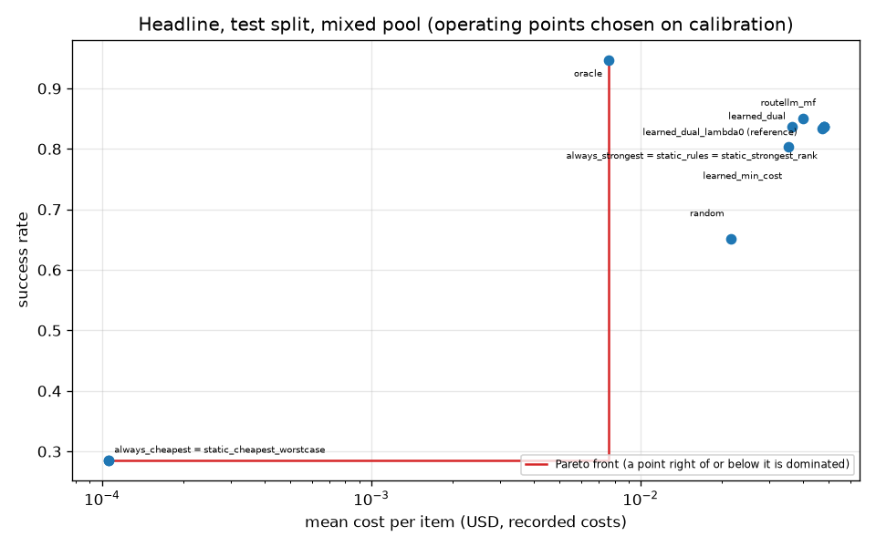
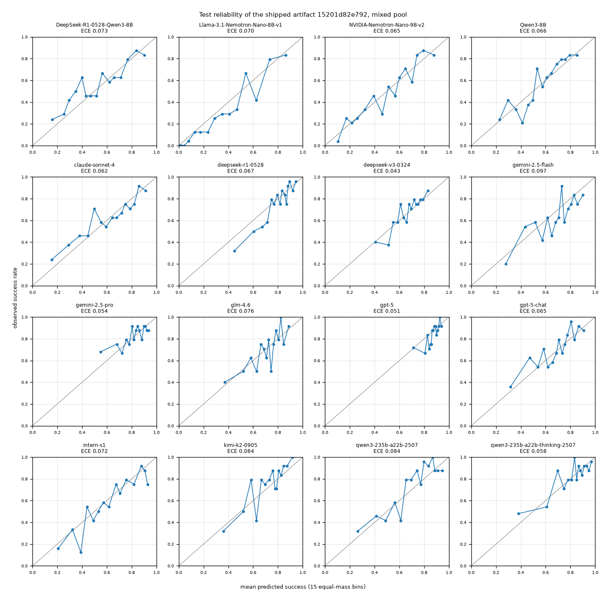

# headline

Run `20261028T203239Z-028d6b4`.

**Labels:** sensitivity pool; the four small models' costs are fitted from their recorded costs and applied to their recorded token counts (7B costs fitted from recorded costs); flagship costs are recorded; no latency is measured or simulated in this experiment; operating points (lambda, the floor, the RouteLLM threshold) are chosen on the calibration split only; the test split is read once per reported point; the calibrators and lower-bound tables of the learned policy were fitted on the calibration split, so the learned policy's calibration success is in-sample and optimistic; oracle looks at the recorded outcomes: an upper bound, not a policy; the lambda = 0 dual row is a reference, not an operating point.

## Were the targets met?

| statement (test split, against always_strongest) |
| --- |
| learned dual (spec operating point): cost reduction 23.9% (misses the 25% target), success +0.00 points against always_strongest (within the 1 point target): targets NOT met. |
| learned min_cost: cost reduction 26.2% (meets the 25% target), success -3.32 points against always_strongest (outside the 1 point target): targets NOT met. |
| RouteLLM MF: cost reduction 1.3% (misses the 25% target), success -0.28 points against always_strongest (within the 1 point target): targets NOT met. |

## Setup

| setting | value |
| --- | --- |
| pool | mixed |
| artifact version | 15201d82e792 |
| calibrators in the artifact | {"platt": 16} |
| items (calibration / test) | 382 / 361 |
| Best Single (always_strongest) | gpt-5 |
| cheapest (RouteLLM weak model) | Llama-3.1-Nemotron-Nano-8B-v1 |
| Best Single calibration success | 0.866492 |
| target Q_bar (that minus the margin) | 0.856492 (0.01) |
| lambda (USD^-1) | 0.7027674655546434 (tune) |
| calibration success at that lambda / at lambda 0 | 0.858639 / 0.866492 |
| policy config (other than lambda) | {"mode": "dual", "default_floor": 0, "epsilon": 0, "ood_action": "conservative", "on_infeasible": "best_effort"} |
| RouteLLM MF weights SHA-256 | d3fba3d30ed140c8af2e92afe4de18a097507ddf7cecbd8b0d52837f9c8ec5e5 |
| bootstrap | 1000 resamples, percentile 95% intervals, seed 0 |
| replays run (calibration / test) | 105 / 11 |
| wall time (s) | 9.5 |

## Headline: test split, paired against always_strongest

| policy | kind | parameter (chosen on calibration) | calib success | test success [95% CI] | test cost USD [95% CI] | success delta [95% CI] | cost reduction [95% CI] |
| --- | --- | --- | --- | --- | --- | --- | --- |
| always_strongest | baseline |  | n/a | 0.8366 [0.7978, 0.8726] | 0.0478513 [0.0413765, 0.0543659] | 0.0000 [0.0000, 0.0000] | 0.0000 [0.0000, 0.0000] |
| always_cheapest | baseline |  | n/a | 0.2853 [0.2382, 0.3297] | 0.000105301 [9.93498e-05, 0.000111624] | -0.5512 [-0.6039, -0.4958] | 0.9978 [0.9975, 0.9981] |
| random | baseline |  | n/a | 0.6510 [0.6039, 0.7008] | 0.0215605 [0.0163241, 0.0270881] | -0.1856 [-0.2382, -0.1357] | 0.5494 [0.4381, 0.6501] |
| static_rules | baseline |  | n/a | 0.8366 [0.7978, 0.8726] | 0.0478513 [0.0413765, 0.0543659] | 0.0000 [0.0000, 0.0000] | 0.0000 [0.0000, 0.0000] |
| oracle | baseline |  | n/a | 0.9474 [0.9252, 0.9695] | 0.00757798 [0.00413359, 0.0118652] | 0.1108 [0.0803, 0.1468] | 0.8416 [0.7626, 0.9071] |
| static_strongest_rank | baseline |  | n/a | 0.8366 [0.7978, 0.8726] | 0.0478513 [0.0413765, 0.0543659] | 0.0000 [0.0000, 0.0000] | 0.0000 [0.0000, 0.0000] |
| static_cheapest_worstcase | baseline |  | n/a | 0.2853 [0.2382, 0.3297] | 0.000105301 [9.93498e-05, 0.000111624] | -0.5512 [-0.6039, -0.4958] | 0.9978 [0.9975, 0.9981] |
| learned_dual | operating point (spec) | lambda = 0.7027674655546434 | 0.858639 | 0.8366 [0.8006, 0.8726] | 0.0363981 [0.0302556, 0.0426991] | 0.0000 [-0.0332, 0.0305] | 0.2394 [0.1744, 0.3065] |
| learned_min_cost | operating point | floor = 0.8 | 0.866492 | 0.8033 [0.7618, 0.8422] | 0.0353157 [0.0285197, 0.0425925] | -0.0332 [-0.0720, 0.0084] | 0.2620 [0.1519, 0.3701] |
| routellm_mf | operating point (baseline) | threshold = 0.3999995904247668 | 0.866492 | 0.8338 [0.7950, 0.8698] | 0.0472144 [0.0407135, 0.0536481] | -0.0028 [-0.0083, 0.0000] | 0.0133 [0.0000, 0.0424] |
| learned_dual_lambda0 (reference) | reference, not an operating point | lambda = 0.0 | 0.866492 | 0.8504 [0.8144, 0.8864] | 0.0401909 [0.033762, 0.0468388] | 0.0139 [-0.0194, 0.0416] | 0.1601 [0.0889, 0.2315] |

## Targets (cost reduction >= 25%, success within 1 point of always_strongest)

| policy | cost reduction | cost target (>= 25%) | success delta | success target (>= -0.01) | both |
| --- | --- | --- | --- | --- | --- |
| learned_dual | 0.23935 | NOT met | 0 | met | NOT met |
| learned_min_cost | 0.261968 | met | -0.033241 | NOT met | NOT met |
| routellm_mf | 0.0133099 | NOT met | -0.00277008 | met | NOT met |
| learned_dual_lambda0 (reference) | 0.160087 | NOT met | 0.0138504 | met | NOT met |

## Per dataset on the test split (operating point against always_strongest)

| dataset | n | always_strongest success | always_strongest cost USD | learned_dual success | learned_dual cost USD | learned_dual success delta | learned_dual cost reduction |
| --- | --- | --- | --- | --- | --- | --- | --- |
| aime | 14 | 0.642857 | 0.120317 | 0.642857 | 0.0783258 | 0 | 0.349004 |
| arenahard_creative_writing | 51 | 0.941176 | 0.0328031 | 0.960784 | 0.00380834 | 0.0196078 | 0.883903 |
| arenahard_math | 58 | 0.637931 | 0.0391519 | 0.655172 | 0.0142427 | 0.0172414 | 0.63622 |
| gpqa | 33 | 0.757576 | 0.0463651 | 0.727273 | 0.041286 | -0.030303 | 0.109546 |
| livecodebench | 205 | 0.892683 | 0.0493466 | 0.887805 | 0.0471239 | -0.00487805 | 0.0450428 |

## Test calibration quality of the shipped artifact (15 bins)

| model | n | base rate | mean p | ECE equal-mass | ECE equal-width | Brier | log-loss |
| --- | --- | --- | --- | --- | --- | --- | --- |
| DeepSeek-R1-0528-Qwen3-8B | 361 | 0.562327 | 0.527416 | 0.0733569 | 0.0592478 | 0.220687 | 0.631014 |
| Llama-3.1-Nemotron-Nano-8B-v1 | 361 | 0.285319 | 0.330419 | 0.0695966 | 0.0605169 | 0.137911 | 0.420328 |
| NVIDIA-Nemotron-Nano-9B-v2 | 361 | 0.484765 | 0.490571 | 0.0645502 | 0.0547959 | 0.192532 | 0.565874 |
| Qwen3-8B | 361 | 0.567867 | 0.561574 | 0.0659241 | 0.0585731 | 0.206449 | 0.601198 |
| claude-sonnet-4 | 361 | 0.617729 | 0.6044 | 0.0615259 | 0.0719324 | 0.210115 | 0.611166 |
| deepseek-r1-0528 | 361 | 0.747922 | 0.783963 | 0.0671548 | 0.0474549 | 0.160987 | 0.493183 |
| deepseek-v3-0324 | 361 | 0.67313 | 0.661154 | 0.0428351 | 0.0296205 | 0.202131 | 0.591274 |
| gemini-2.5-flash | 361 | 0.626039 | 0.673039 | 0.0966321 | 0.0647497 | 0.21352 | 0.61744 |
| gemini-2.5-pro | 361 | 0.825485 | 0.8132 | 0.0538317 | 0.0565528 | 0.142488 | 0.457386 |
| glm-4.6 | 361 | 0.698061 | 0.70182 | 0.0760777 | 0.0416986 | 0.19327 | 0.571767 |
| gpt-5 | 361 | 0.836565 | 0.866097 | 0.0508709 | 0.0423306 | 0.134418 | 0.433301 |
| gpt-5-chat | 361 | 0.706371 | 0.682894 | 0.0652007 | 0.0482636 | 0.18853 | 0.559558 |
| intern-s1 | 361 | 0.578947 | 0.614727 | 0.0722604 | 0.0567431 | 0.197485 | 0.583708 |
| kimi-k2-0905 | 361 | 0.745152 | 0.71769 | 0.0838504 | 0.0699193 | 0.165659 | 0.504151 |
| qwen3-235b-a22b-2507 | 361 | 0.725762 | 0.695756 | 0.0843642 | 0.0715233 | 0.160848 | 0.499594 |
| qwen3-235b-a22b-thinking-2507 | 361 | 0.817175 | 0.806697 | 0.0576835 | 0.0349047 | 0.133385 | 0.435508 |
| pooled (all models) | 5776 | 0.656163 | 0.658214 | 0.0143275 | 0.0178232 | 0.178776 | 0.536028 |

## Python recomputation against the Go predictor

| check | value |
| --- | --- |
| decisions compared (out-of-distribution and errors skipped) | 361 |
| skipped | 0 |
| largest absolute difference in p | 3.33067e-16 |

