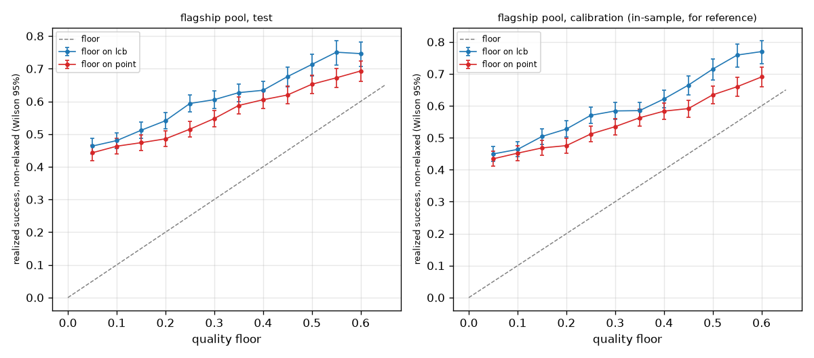

# lcb_vs_point

Run `20261028T203321Z-028d6b4`.

**Labels:** no latency is measured or simulated in this experiment; costs are the recorded costs of each model on each item; the floors are fixed in advance and nothing is chosen from these results; a decision whose floor the router relaxed made no promise and is left out of the realized success; the calibration rows are in-sample for the calibrators and lower-bound tables, so only the test rows are evidence of compliance; the point arm is an experiment switch (--floor-on point); the gateway always compares the lower confidence bound.

## Setup

| setting | value |
| --- | --- |
| pool | flagship |
| artifact version | dea4486d7575 |
| items (test / calibration) | 1735 / 1773 |
| floors | 0.05, 0.1, 0.15, 0.2, 0.25, 0.3, 0.35, 0.4, 0.45, 0.5, 0.55, 0.6 |
| policy versions | {"lcb": "dea4486d7575+de8069d4", "point": "dea4486d7575+de8069d4+floor-point"} |
| policy config (other than lambda) | {"mode": "dual", "default_floor": 0, "epsilon": 0, "ood_action": "conservative", "on_infeasible": "best_effort"} |
| wall time (s) | 4.2 |

## Floors met (realized success among non-relaxed decisions at least the floor)

| split | arm | floors | floors with decisions | floors met | floors missed |
| --- | --- | --- | --- | --- | --- |
| test | lcb | 12 | 12 | 12 | none |
| test | point | 12 | 12 | 12 | none |
| calib | lcb | 12 | 12 | 12 | none |
| calib | point | 12 | 12 | 12 | none |

## Test split: floor compliance and cost per floor

| floor | lcb: not relaxed | lcb: realized success [95% CI] | lcb: >= floor | lcb: mean cost USD | lcb: relaxed | point: not relaxed | point: realized success [95% CI] | point: >= floor | point: mean cost USD | point: relaxed |
| --- | --- | --- | --- | --- | --- | --- | --- | --- | --- | --- |
| 0.05 | 1 | 0.463 [0.440, 0.487] | yes | 0.00781688 | 0 | 0.999424 | 0.443 [0.420, 0.466] | yes | 0.00110626 | 0.000576369 |
| 0.1 | 1 | 0.480 [0.457, 0.504] | yes | 0.0134132 | 0 | 0.988473 | 0.463 [0.439, 0.487] | yes | 0.00641863 | 0.0115274 |
| 0.15 | 0.937176 | 0.512 [0.487, 0.536] | yes | 0.0172337 | 0.0628242 | 0.987896 | 0.474 [0.450, 0.497] | yes | 0.0126451 | 0.0121037 |
| 0.2 | 0.85879 | 0.541 [0.516, 0.566] | yes | 0.020996 | 0.14121 | 0.976945 | 0.486 [0.462, 0.509] | yes | 0.0137635 | 0.0230548 |
| 0.25 | 0.765994 | 0.594 [0.567, 0.620] | yes | 0.0251619 | 0.234006 | 0.917579 | 0.515 [0.491, 0.540] | yes | 0.0178467 | 0.0824207 |
| 0.3 | 0.755043 | 0.605 [0.579, 0.631] | yes | 0.0257992 | 0.244957 | 0.853602 | 0.548 [0.522, 0.573] | yes | 0.0224615 | 0.146398 |
| 0.35 | 0.731988 | 0.627 [0.600, 0.653] | yes | 0.0265525 | 0.268012 | 0.770029 | 0.588 [0.561, 0.614] | yes | 0.0245241 | 0.229971 |
| 0.4 | 0.629971 | 0.634 [0.605, 0.662] | yes | 0.0276177 | 0.370029 | 0.748703 | 0.605 [0.578, 0.631] | yes | 0.0256911 | 0.251297 |
| 0.45 | 0.524496 | 0.676 [0.645, 0.705] | yes | 0.0282618 | 0.475504 | 0.73487 | 0.620 [0.593, 0.646] | yes | 0.0263594 | 0.26513 |
| 0.5 | 0.405764 | 0.713 [0.679, 0.745] | yes | 0.0301645 | 0.594236 | 0.636888 | 0.652 [0.624, 0.680] | yes | 0.0275255 | 0.363112 |
| 0.55 | 0.304899 | 0.750 [0.712, 0.785] | yes | 0.0317496 | 0.695101 | 0.565994 | 0.672 [0.642, 0.701] | yes | 0.0289725 | 0.434006 |
| 0.6 | 0.304323 | 0.746 [0.707, 0.781] | yes | 0.0319689 | 0.695677 | 0.495677 | 0.693 [0.661, 0.723] | yes | 0.0297309 | 0.504323 |

## Calibration split, for reference (in-sample): floor compliance and cost per floor

| floor | lcb: not relaxed | lcb: realized success [95% CI] | lcb: >= floor | lcb: mean cost USD | lcb: relaxed | point: not relaxed | point: realized success [95% CI] | point: >= floor | point: mean cost USD | point: relaxed |
| --- | --- | --- | --- | --- | --- | --- | --- | --- | --- | --- |
| 0.05 | 1 | 0.450 [0.426, 0.473] | yes | 0.00830448 | 0 | 1 | 0.434 [0.411, 0.457] | yes | 0.00100428 | 0 |
| 0.1 | 1 | 0.464 [0.441, 0.487] | yes | 0.0128417 | 0 | 0.990976 | 0.452 [0.429, 0.475] | yes | 0.00762666 | 0.00902425 |
| 0.15 | 0.938522 | 0.504 [0.480, 0.528] | yes | 0.0182457 | 0.0614777 | 0.989848 | 0.468 [0.445, 0.492] | yes | 0.0132918 | 0.0101523 |
| 0.2 | 0.860688 | 0.528 [0.502, 0.552] | yes | 0.0224007 | 0.139312 | 0.978567 | 0.476 [0.452, 0.499] | yes | 0.0136335 | 0.0214326 |
| 0.25 | 0.773266 | 0.570 [0.544, 0.596] | yes | 0.0251293 | 0.226734 | 0.915398 | 0.512 [0.488, 0.536] | yes | 0.0191757 | 0.0846024 |
| 0.3 | 0.758037 | 0.584 [0.558, 0.610] | yes | 0.026108 | 0.241963 | 0.856176 | 0.535 [0.510, 0.560] | yes | 0.0239664 | 0.143824 |
| 0.35 | 0.729836 | 0.585 [0.558, 0.612] | yes | 0.0271164 | 0.270164 | 0.77383 | 0.563 [0.536, 0.589] | yes | 0.0248989 | 0.22617 |
| 0.4 | 0.63339 | 0.622 [0.593, 0.649] | yes | 0.0282096 | 0.36661 | 0.750141 | 0.583 [0.557, 0.610] | yes | 0.0259047 | 0.249859 |
| 0.45 | 0.525099 | 0.665 [0.634, 0.694] | yes | 0.0293553 | 0.474901 | 0.737169 | 0.591 [0.565, 0.618] | yes | 0.0267833 | 0.262831 |
| 0.5 | 0.407783 | 0.715 [0.681, 0.747] | yes | 0.0315342 | 0.592217 | 0.635646 | 0.634 [0.606, 0.662] | yes | 0.0281642 | 0.364354 |
| 0.55 | 0.299492 | 0.759 [0.721, 0.793] | yes | 0.033737 | 0.700508 | 0.557248 | 0.660 [0.630, 0.689] | yes | 0.0297329 | 0.442752 |
| 0.6 | 0.298928 | 0.770 [0.732, 0.804] | yes | 0.0338626 | 0.701072 | 0.49013 | 0.690 [0.659, 0.720] | yes | 0.0310605 | 0.50987 |

## Test split: realized success per decile of L, pooled over the floors

| arm | decile of L | decisions | mean L | realized success |
| --- | --- | --- | --- | --- |
| lcb | 1 | 1426 | 0.135328 | 0.197055 |
| lcb | 2 | 1426 | 0.249721 | 0.379383 |
| lcb | 3 | 1426 | 0.341588 | 0.475456 |
| lcb | 4 | 1426 | 0.395881 | 0.546985 |
| lcb | 5 | 1426 | 0.423576 | 0.600281 |
| lcb | 6 | 1425 | 0.483864 | 0.628772 |
| lcb | 7 | 1426 | 0.514704 | 0.638149 |
| lcb | 8 | 1426 | 0.546222 | 0.720898 |
| lcb | 9 | 1426 | 0.67906 | 0.793829 |
| lcb | 10 | 1426 | 0.784059 | 0.807854 |
| point | 1 | 1679 | 0.0815466 | 0.141751 |
| point | 2 | 1679 | 0.196878 | 0.284098 |
| point | 3 | 1679 | 0.296644 | 0.440143 |
| point | 4 | 1678 | 0.372694 | 0.52205 |
| point | 5 | 1679 | 0.395881 | 0.547945 |
| point | 6 | 1679 | 0.436918 | 0.633711 |
| point | 7 | 1678 | 0.487903 | 0.63826 |
| point | 8 | 1679 | 0.525838 | 0.653961 |
| point | 9 | 1679 | 0.578991 | 0.752233 |
| point | 10 | 1679 | 0.771576 | 0.845742 |

