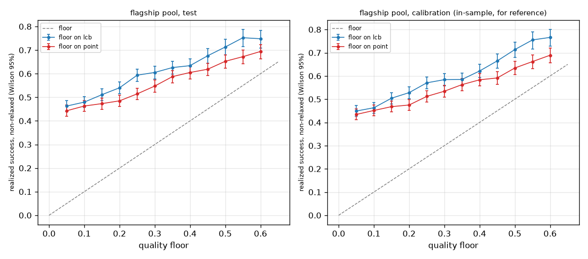

# lcb_vs_point

Run `20261031T070419Z-f0429c6`.

**Labels:** no latency is measured or simulated in this experiment; costs are the recorded costs of each model on each item; the floors are fixed in advance and nothing is chosen from these results; a decision whose floor the router relaxed made no promise and is left out of the realized success; the calibration rows are in-sample for the calibrators and lower-bound tables, so only the test rows are evidence of compliance; the point arm is an experiment switch (--floor-on point); the gateway always compares the lower confidence bound.

## Setup

| setting | value |
| --- | --- |
| pool | flagship |
| artifact version | dea4486d7575 |
| items (test / calibration) | 1735 / 1773 |
| floors | 0.05, 0.1, 0.15, 0.2, 0.25, 0.3, 0.35, 0.4, 0.45, 0.5, 0.55, 0.6 |
| policy versions | {"lcb": "dea4486d7575+f99adab8", "point": "dea4486d7575+f99adab8+floor-point"} |
| policy config (other than lambda) | {"mode": "dual", "default_floor": 0, "epsilon": 0, "ood_action": "conservative", "on_infeasible": "best_effort"} |
| wall time (s) | 3.9 |

## Floors met (realized success among non-relaxed decisions at least the floor)

| split | arm | floors | floors with decisions | floors met | floors missed |
| --- | --- | --- | --- | --- | --- |
| test | lcb | 12 | 12 | 12 | none |
| test | point | 12 | 12 | 12 | none |
| calib | lcb | 12 | 12 | 12 | none |
| calib | point | 12 | 12 | 12 | none |

## Test split: floor compliance and cost per floor

| floor | lcb: not relaxed | lcb: realized success [95% CI] | lcb: >= floor | lcb: mean cost USD | lcb: relaxed | point: not relaxed | point: realized success [95% CI] | point: >= floor | point: mean cost USD | point: relaxed |
| --- | --- | --- | --- | --- | --- | --- | --- | --- | --- | --- |
| 0.05 | 1 | 0.463 [0.439, 0.486] | yes | 0.00781493 | 0 | 0.999424 | 0.443 [0.420, 0.466] | yes | 0.00109824 | 0.000576369 |
| 0.1 | 1 | 0.480 [0.456, 0.503] | yes | 0.0134122 | 0 | 0.988473 | 0.463 [0.439, 0.487] | yes | 0.00641518 | 0.0115274 |
| 0.15 | 0.937176 | 0.511 [0.487, 0.535] | yes | 0.0172328 | 0.0628242 | 0.987896 | 0.473 [0.450, 0.497] | yes | 0.0126441 | 0.0121037 |
| 0.2 | 0.85879 | 0.540 [0.515, 0.565] | yes | 0.020995 | 0.14121 | 0.976945 | 0.485 [0.461, 0.509] | yes | 0.0137625 | 0.0230548 |
| 0.25 | 0.765994 | 0.594 [0.567, 0.620] | yes | 0.0251625 | 0.234006 | 0.917579 | 0.514 [0.490, 0.539] | yes | 0.0178457 | 0.0824207 |
| 0.3 | 0.755043 | 0.605 [0.579, 0.631] | yes | 0.0257998 | 0.244957 | 0.853602 | 0.548 [0.522, 0.573] | yes | 0.0224625 | 0.146398 |
| 0.35 | 0.731988 | 0.626 [0.599, 0.652] | yes | 0.0265386 | 0.268012 | 0.770029 | 0.588 [0.561, 0.614] | yes | 0.0245251 | 0.229971 |
| 0.4 | 0.629971 | 0.634 [0.605, 0.662] | yes | 0.0276041 | 0.370029 | 0.748703 | 0.605 [0.578, 0.631] | yes | 0.0256917 | 0.251297 |
| 0.45 | 0.524496 | 0.676 [0.645, 0.705] | yes | 0.0282592 | 0.475504 | 0.73487 | 0.619 [0.592, 0.645] | yes | 0.02636 | 0.26513 |
| 0.5 | 0.405764 | 0.713 [0.679, 0.745] | yes | 0.0301461 | 0.594236 | 0.636888 | 0.652 [0.624, 0.680] | yes | 0.027519 | 0.363112 |
| 0.55 | 0.304899 | 0.752 [0.714, 0.787] | yes | 0.0317216 | 0.695101 | 0.565994 | 0.672 [0.642, 0.701] | yes | 0.0289731 | 0.434006 |
| 0.6 | 0.304323 | 0.748 [0.709, 0.783] | yes | 0.0319442 | 0.695677 | 0.495677 | 0.694 [0.663, 0.724] | yes | 0.029708 | 0.504323 |

## Calibration split, for reference (in-sample): floor compliance and cost per floor

| floor | lcb: not relaxed | lcb: realized success [95% CI] | lcb: >= floor | lcb: mean cost USD | lcb: relaxed | point: not relaxed | point: realized success [95% CI] | point: >= floor | point: mean cost USD | point: relaxed |
| --- | --- | --- | --- | --- | --- | --- | --- | --- | --- | --- |
| 0.05 | 1 | 0.449 [0.426, 0.472] | yes | 0.0083084 | 0 | 1 | 0.434 [0.411, 0.457] | yes | 0.00104444 | 0 |
| 0.1 | 1 | 0.463 [0.440, 0.486] | yes | 0.0128447 | 0 | 0.990976 | 0.451 [0.428, 0.475] | yes | 0.00763023 | 0.00902425 |
| 0.15 | 0.938522 | 0.504 [0.480, 0.528] | yes | 0.0182487 | 0.0614777 | 0.989848 | 0.468 [0.445, 0.491] | yes | 0.0132948 | 0.0101523 |
| 0.2 | 0.860688 | 0.528 [0.503, 0.553] | yes | 0.0224036 | 0.139312 | 0.978567 | 0.475 [0.452, 0.498] | yes | 0.0136365 | 0.0214326 |
| 0.25 | 0.773266 | 0.570 [0.544, 0.596] | yes | 0.025131 | 0.226734 | 0.915398 | 0.512 [0.488, 0.536] | yes | 0.0191787 | 0.0846024 |
| 0.3 | 0.758037 | 0.584 [0.558, 0.610] | yes | 0.0261097 | 0.241963 | 0.856176 | 0.534 [0.509, 0.559] | yes | 0.0239751 | 0.143824 |
| 0.35 | 0.729836 | 0.585 [0.558, 0.612] | yes | 0.0271173 | 0.270164 | 0.77383 | 0.563 [0.536, 0.589] | yes | 0.0249014 | 0.22617 |
| 0.4 | 0.63339 | 0.622 [0.593, 0.649] | yes | 0.0282145 | 0.36661 | 0.750141 | 0.583 [0.557, 0.610] | yes | 0.0259064 | 0.249859 |
| 0.45 | 0.525099 | 0.665 [0.634, 0.694] | yes | 0.0293533 | 0.474901 | 0.737169 | 0.591 [0.565, 0.618] | yes | 0.0267846 | 0.262831 |
| 0.5 | 0.407783 | 0.714 [0.680, 0.745] | yes | 0.0315221 | 0.592217 | 0.635646 | 0.634 [0.606, 0.662] | yes | 0.0281423 | 0.364354 |
| 0.55 | 0.299492 | 0.755 [0.717, 0.790] | yes | 0.0335226 | 0.700508 | 0.557248 | 0.662 [0.632, 0.691] | yes | 0.0297038 | 0.442752 |
| 0.6 | 0.298928 | 0.766 [0.728, 0.800] | yes | 0.0336294 | 0.701072 | 0.49013 | 0.689 [0.658, 0.719] | yes | 0.0310485 | 0.50987 |

## Test split: realized success per decile of L, pooled over the floors

| arm | decile of L | decisions | mean L | realized success |
| --- | --- | --- | --- | --- |
| lcb | 1 | 1426 | 0.135222 | 0.197055 |
| lcb | 2 | 1426 | 0.24951 | 0.386396 |
| lcb | 3 | 1426 | 0.340565 | 0.472651 |
| lcb | 4 | 1426 | 0.395881 | 0.547686 |
| lcb | 5 | 1426 | 0.424005 | 0.595372 |
| lcb | 6 | 1425 | 0.484071 | 0.628772 |
| lcb | 7 | 1426 | 0.514943 | 0.640252 |
| lcb | 8 | 1426 | 0.545908 | 0.718794 |
| lcb | 9 | 1426 | 0.677363 | 0.78892 |
| lcb | 10 | 1426 | 0.783622 | 0.810659 |
| point | 1 | 1679 | 0.0814802 | 0.142942 |
| point | 2 | 1679 | 0.196908 | 0.285289 |
| point | 3 | 1679 | 0.296451 | 0.443716 |
| point | 4 | 1678 | 0.371713 | 0.519666 |
| point | 5 | 1679 | 0.395881 | 0.553306 |
| point | 6 | 1679 | 0.437666 | 0.626563 |
| point | 7 | 1678 | 0.487903 | 0.638856 |
| point | 8 | 1679 | 0.525856 | 0.656343 |
| point | 9 | 1679 | 0.577497 | 0.745682 |
| point | 10 | 1679 | 0.771378 | 0.845742 |

