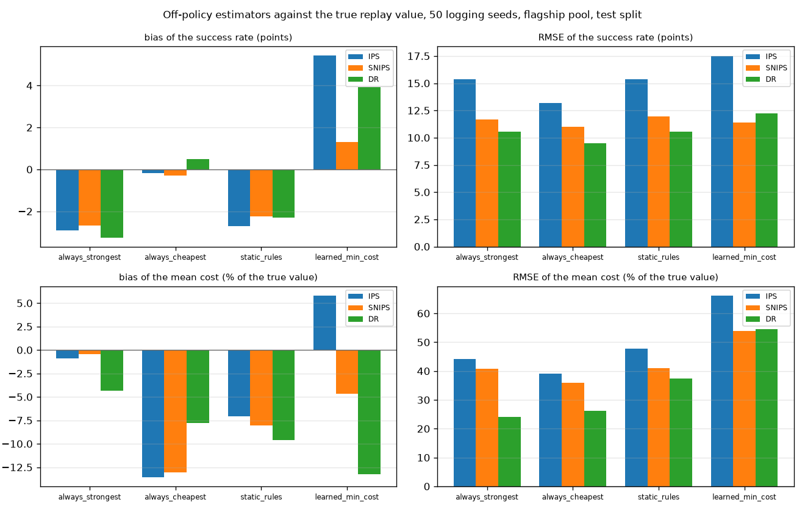

# ope_validation

Run `20261028T210706Z-86f6519`.

**Labels:** no latency is measured or simulated in this experiment; costs are the recorded costs of each model on each item; the true value of a target policy is its own deterministic full-information replay on the same test items the estimators see (success rate and mean recorded cost); each interval is a 95% percentile bootstrap with 500 bootstrap resamples of the items, seeded by the logging seed; the SNIPS interval resamples the weighted ratio; the logging seed changes only the exploration draws: the test items are fixed, so the spread across seeds is exploration noise while each interval also resamples the items and is wider than that spread; coverage is measured against the in-sample true value; Ruling V1-R36: the learned target is min_cost at floor 0.3; the plan's 0.8 relaxes nearly every flagship decision to quality; support coverage is the share of items where the target's action had positive logging propensity; epsilon exploration covers only the safe set and a decision that relaxed a constraint does not explore, so IPS cannot estimate an action outside it; DR uses one outcome model, the logging policy's own predictions (Ruling V1-R32), so its bias includes that model's calibration error.

## Setup

| setting | value |
| --- | --- |
| pool | flagship |
| artifact version | dea4486d7575 |
| logging policy version (last seed's replay) | dea4486d7575+a2e15f9b |
| test items | 1735 |
| logging policy | learned dual, lambda 6.719579687342048, epsilon 0.1 |
| OOD action of the logging policy | conservative |
| logging seeds | 50 (0 to 49) |
| learned target floor (Ruling V1-R36) | 0.3 |
| bootstrap | 500 bootstrap resamples per estimate, percentile 95% intervals |
| wall time (s) | 34.7 |
| replays (s) / estimation (s) | 8.0 / 24.0 |

## Targets: true value, support coverage and importance weights

| target | policy | true success | true cost USD per item | support coverage | logged action = target action (mean items) | ESS of the IPS weights, mean [min, max] | items used (min over seeds) | items left out (all seeds) | target routing errors |
| --- | --- | --- | --- | --- | --- | --- | --- | --- | --- |
| always_strongest | fixed gemini-2.5-pro (Best Single) | 0.527378 | 0.0670642 | 1 | 140.52 | 15.9 [6.6, 28.3] | 1735 | 0 | 0 |
| always_cheapest | fixed deepseek-v3-0324 | 0.29049 | 0.000682562 | 1 | 74.88 | 15.2 [8.1, 25.1] | 1735 | 0 | 0 |
| static_rules | the pool config's keyword and length rules, mapped on train+calib | 0.546398 | 0.0439707 | 1 | 163.08 | 16.0 [8.0, 22.9] | 1735 | 0 | 0 |
| learned_min_cost | learned min_cost at floor 0.3, no exploration (Ruling V1-R36) | 0.511816 | 0.0257992 | 1 | 651.2 | 25.3 [22.7, 29.7] | 1735 | 0 | 0 |

## Success: bias, RMSE and CI coverage over 50 logging seeds

| target | estimator | true value | mean estimate | bias | bias / true value | RMSE | RMSE / true value | SD across seeds | CI coverage | mean CI width | seeds with an estimate |
| --- | --- | --- | --- | --- | --- | --- | --- | --- | --- | --- | --- |
| always_strongest | IPS | 0.527378 | 0.4983 | -0.0290775 | -0.0551361 | 0.153402 | 0.290877 | 0.15215 | 0.940 | 0.661007 | 50 |
| always_strongest | SNIPS | 0.527378 | 0.500526 | -0.0268511 | -0.0509143 | 0.116697 | 0.221277 | 0.114718 | 0.940 | 0.500658 | 50 |
| always_strongest | DR | 0.527378 | 0.494912 | -0.0324655 | -0.0615603 | 0.10564 | 0.200313 | 0.101549 | 0.960 | 0.44328 | 50 |
| always_cheapest | IPS | 0.29049 | 0.288726 | -0.00176401 | -0.00607252 | 0.131708 | 0.453401 | 0.133034 | 0.900 | 0.505851 | 50 |
| always_cheapest | SNIPS | 0.29049 | 0.287427 | -0.00306279 | -0.0105435 | 0.110054 | 0.378858 | 0.111129 | 0.940 | 0.453919 | 50 |
| always_cheapest | DR | 0.29049 | 0.295452 | 0.00496237 | 0.0170828 | 0.094654 | 0.325843 | 0.0954835 | 0.940 | 0.404752 | 50 |
| static_rules | IPS | 0.546398 | 0.519265 | -0.0271327 | -0.0496574 | 0.15392 | 0.281699 | 0.153048 | 0.900 | 0.689795 | 50 |
| static_rules | SNIPS | 0.546398 | 0.523937 | -0.0224607 | -0.0411069 | 0.119577 | 0.218846 | 0.118641 | 0.940 | 0.487815 | 50 |
| static_rules | DR | 0.546398 | 0.523301 | -0.0230971 | -0.0422716 | 0.105465 | 0.193019 | 0.10395 | 0.960 | 0.441014 | 50 |
| learned_min_cost | IPS | 0.511816 | 0.566068 | 0.0542527 | 0.106 | 0.174899 | 0.341722 | 0.167959 | 0.840 | 0.535616 | 50 |
| learned_min_cost | SNIPS | 0.511816 | 0.524982 | 0.0131666 | 0.0257253 | 0.113912 | 0.222564 | 0.114297 | 0.880 | 0.356342 | 50 |
| learned_min_cost | DR | 0.511816 | 0.551183 | 0.0393674 | 0.0769172 | 0.122084 | 0.238531 | 0.116736 | 0.860 | 0.388296 | 50 |

## Cost (USD per item): bias, RMSE and CI coverage over 50 logging seeds

| target | estimator | true value | mean estimate | bias | bias / true value | RMSE | RMSE / true value | SD across seeds | CI coverage | mean CI width | seeds with an estimate |
| --- | --- | --- | --- | --- | --- | --- | --- | --- | --- | --- | --- |
| always_strongest | IPS | 0.0670642 | 0.0664448 | -0.000619452 | -0.00923671 | 0.0296034 | 0.441418 | 0.0298974 | 0.860 | 0.105662 | 50 |
| always_strongest | SNIPS | 0.0670642 | 0.0667469 | -0.000317314 | -0.0047315 | 0.0273302 | 0.407523 | 0.0276058 | 0.920 | 0.0876763 | 50 |
| always_strongest | DR | 0.0670642 | 0.0641559 | -0.00290833 | -0.0433664 | 0.0162004 | 0.241566 | 0.016099 | 0.880 | 0.0632898 | 50 |
| always_cheapest | IPS | 0.000682562 | 0.000589929 | -9.26327e-05 | -0.135713 | 0.000266519 | 0.390469 | 0.000252441 | 0.820 | 0.000936759 | 50 |
| always_cheapest | SNIPS | 0.000682562 | 0.000593326 | -8.92358e-05 | -0.130737 | 0.000244542 | 0.35827 | 0.00022999 | 0.780 | 0.000795073 | 50 |
| always_cheapest | DR | 0.000682562 | 0.000629303 | -5.3259e-05 | -0.0780281 | 0.000178519 | 0.261543 | 0.000172119 | 0.700 | 0.000522518 | 50 |
| static_rules | IPS | 0.0439707 | 0.040868 | -0.00310268 | -0.0705625 | 0.0210276 | 0.478219 | 0.0210086 | 0.780 | 0.066887 | 50 |
| static_rules | SNIPS | 0.0439707 | 0.0404349 | -0.00353574 | -0.0804113 | 0.0180431 | 0.410344 | 0.0178729 | 0.760 | 0.0559294 | 50 |
| static_rules | DR | 0.0439707 | 0.0397427 | -0.00422803 | -0.0961556 | 0.016415 | 0.373317 | 0.0160222 | 0.880 | 0.0481642 | 50 |
| learned_min_cost | IPS | 0.0257992 | 0.0272984 | 0.00149919 | 0.05811 | 0.0170453 | 0.660691 | 0.0171516 | 0.880 | 0.0576636 | 50 |
| learned_min_cost | SNIPS | 0.0257992 | 0.0245895 | -0.00120965 | -0.0468871 | 0.0139135 | 0.5393 | 0.0140016 | 0.860 | 0.0456093 | 50 |
| learned_min_cost | DR | 0.0257992 | 0.0223758 | -0.00342342 | -0.132695 | 0.0140793 | 0.545727 | 0.0137954 | 0.920 | 0.0455023 | 50 |

