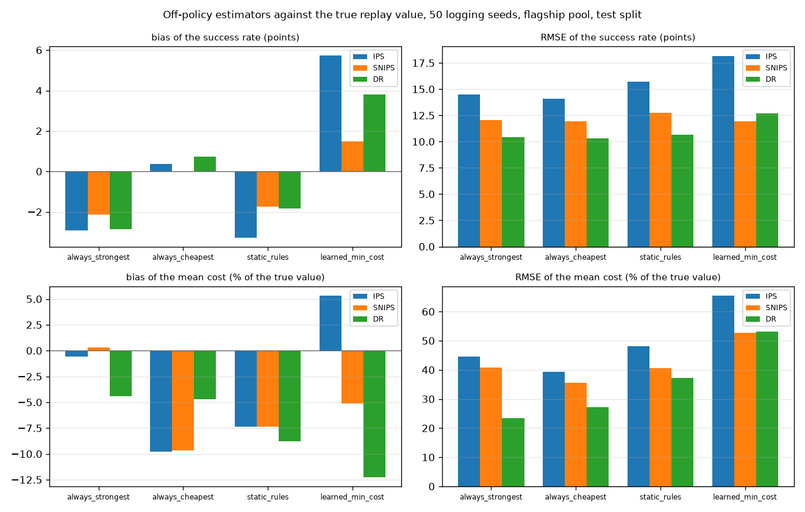

# ope_validation

Run `20261031T070430Z-f0429c6`.

**Labels:** no latency is measured or simulated in this experiment; costs are the recorded costs of each model on each item; the true value of a target policy is its own deterministic full-information replay on the same test items the estimators see (success rate and mean recorded cost); each interval is a 95% percentile bootstrap with 500 bootstrap resamples of the items, seeded by the logging seed; the SNIPS interval resamples the weighted ratio; the logging seed changes only the exploration draws: the test items are fixed, so the spread across seeds is exploration noise while each interval also resamples the items and is wider than that spread; coverage is measured against the in-sample true value; the learned target is min_cost at floor 0.3; a floor of 0.8 relaxes nearly every flagship decision to quality; support coverage is the share of items where the target's action had positive logging propensity; epsilon exploration covers only the safe set and a decision that relaxed a constraint does not explore, so IPS cannot estimate an action outside it; DR uses one outcome model, the logging policy's own predictions, so its bias includes that model's calibration error.

## Setup

| setting | value |
| --- | --- |
| pool | flagship |
| artifact version | dea4486d7575 |
| logging policy version (last seed's replay) | dea4486d7575+dcb19170 |
| test items | 1735 |
| logging policy | learned dual, lambda 6.721045792801306, epsilon 0.1 |
| OOD action of the logging policy | conservative |
| logging seeds | 50 (0 to 49) |
| learned target floor | 0.3 |
| bootstrap | 500 bootstrap resamples per estimate, percentile 95% intervals |
| wall time (s) | 27.3 |
| replays (s) / estimation (s) | 4.6 / 22.2 |

## Targets: true value, support coverage and importance weights

| target | policy | true success | true cost USD per item | support coverage | logged action = target action (mean items) | ESS of the IPS weights, mean [min, max] | items used (min over seeds) | items left out (all seeds) | target routing errors |
| --- | --- | --- | --- | --- | --- | --- | --- | --- | --- |
| always_strongest | fixed gemini-2.5-pro (Best Single) | 0.527378 | 0.0670642 | 1 | 140.44 | 15.8 [5.7, 28.3] | 1735 | 0 | 0 |
| always_cheapest | fixed deepseek-v3-0324 | 0.29049 | 0.000682562 | 1 | 73.16 | 15.2 [8.1, 25.1] | 1735 | 0 | 0 |
| static_rules | the pool config's keyword and length rules, mapped on train+calib | 0.546398 | 0.0439707 | 1 | 162.84 | 15.7 [7.1, 21.9] | 1735 | 0 | 0 |
| learned_min_cost | learned min_cost at floor 0.3, no exploration | 0.511816 | 0.0257998 | 1 | 647.66 | 25.2 [22.6, 30.5] | 1735 | 0 | 0 |

## Success: bias, RMSE and CI coverage over 50 logging seeds

| target | estimator | true value | mean estimate | bias | bias / true value | RMSE | RMSE / true value | SD across seeds | CI coverage | mean CI width | seeds with an estimate |
| --- | --- | --- | --- | --- | --- | --- | --- | --- | --- | --- | --- |
| always_strongest | IPS | 0.527378 | 0.4983 | -0.0290775 | -0.0551361 | 0.144965 | 0.274879 | 0.143461 | 0.960 | 0.663601 | 50 |
| always_strongest | SNIPS | 0.527378 | 0.505952 | -0.0214258 | -0.040627 | 0.120624 | 0.228723 | 0.119911 | 0.940 | 0.497177 | 50 |
| always_strongest | DR | 0.527378 | 0.498903 | -0.0284746 | -0.0539929 | 0.104507 | 0.198164 | 0.101574 | 0.980 | 0.439008 | 50 |
| always_cheapest | IPS | 0.29049 | 0.294259 | 0.00376914 | 0.0129751 | 0.14089 | 0.485009 | 0.14227 | 0.900 | 0.505154 | 50 |
| always_cheapest | SNIPS | 0.29049 | 0.290591 | 0.000101259 | 0.000348579 | 0.119237 | 0.410468 | 0.120447 | 0.920 | 0.449924 | 50 |
| always_cheapest | DR | 0.29049 | 0.297818 | 0.00732771 | 0.0252254 | 0.103039 | 0.354709 | 0.103822 | 0.920 | 0.406941 | 50 |
| static_rules | IPS | 0.546398 | 0.513732 | -0.0326658 | -0.059784 | 0.157262 | 0.287815 | 0.155393 | 0.900 | 0.681048 | 50 |
| static_rules | SNIPS | 0.546398 | 0.529047 | -0.017351 | -0.0317552 | 0.127271 | 0.232928 | 0.127363 | 0.940 | 0.487435 | 50 |
| static_rules | DR | 0.546398 | 0.527946 | -0.0184514 | -0.0337691 | 0.106484 | 0.194884 | 0.105938 | 0.940 | 0.432625 | 50 |
| learned_min_cost | IPS | 0.511816 | 0.569051 | 0.057235 | 0.111827 | 0.181483 | 0.354586 | 0.173969 | 0.800 | 0.541115 | 50 |
| learned_min_cost | SNIPS | 0.511816 | 0.526775 | 0.0149599 | 0.0292291 | 0.119133 | 0.232765 | 0.11939 | 0.880 | 0.354297 | 50 |
| learned_min_cost | DR | 0.511816 | 0.549756 | 0.0379406 | 0.0741295 | 0.126647 | 0.247447 | 0.122057 | 0.860 | 0.390972 | 50 |

## Cost (USD per item): bias, RMSE and CI coverage over 50 logging seeds

| target | estimator | true value | mean estimate | bias | bias / true value | RMSE | RMSE / true value | SD across seeds | CI coverage | mean CI width | seeds with an estimate |
| --- | --- | --- | --- | --- | --- | --- | --- | --- | --- | --- | --- |
| always_strongest | IPS | 0.0670642 | 0.0666772 | -0.000387061 | -0.00577149 | 0.0298822 | 0.445575 | 0.030183 | 0.880 | 0.105386 | 50 |
| always_strongest | SNIPS | 0.0670642 | 0.067276 | 0.000211817 | 0.00315842 | 0.0274226 | 0.408901 | 0.0277002 | 0.920 | 0.087675 | 50 |
| always_strongest | DR | 0.0670642 | 0.064098 | -0.00296627 | -0.0442303 | 0.0157261 | 0.234494 | 0.0156007 | 0.900 | 0.0629745 | 50 |
| always_cheapest | IPS | 0.000682562 | 0.000615826 | -6.67358e-05 | -0.0977726 | 0.000268858 | 0.393895 | 0.000263087 | 0.880 | 0.000974815 | 50 |
| always_cheapest | SNIPS | 0.000682562 | 0.000616461 | -6.61011e-05 | -0.0968427 | 0.000243016 | 0.356035 | 0.000236227 | 0.820 | 0.000825605 | 50 |
| always_cheapest | DR | 0.000682562 | 0.000650378 | -3.21835e-05 | -0.0471511 | 0.000185903 | 0.272361 | 0.000184955 | 0.760 | 0.000539224 | 50 |
| static_rules | IPS | 0.0439707 | 0.0407222 | -0.0032485 | -0.0738787 | 0.0211834 | 0.481761 | 0.0211453 | 0.780 | 0.0669676 | 50 |
| static_rules | SNIPS | 0.0439707 | 0.0407436 | -0.00322709 | -0.0733918 | 0.0178414 | 0.405758 | 0.0177253 | 0.760 | 0.0562505 | 50 |
| static_rules | DR | 0.0439707 | 0.0401004 | -0.00387029 | -0.0880199 | 0.0163658 | 0.372198 | 0.016063 | 0.860 | 0.0478483 | 50 |
| learned_min_cost | IPS | 0.0257998 | 0.0271785 | 0.00137875 | 0.0534405 | 0.0168708 | 0.653914 | 0.0169851 | 0.880 | 0.0576241 | 50 |
| learned_min_cost | SNIPS | 0.0257998 | 0.0244724 | -0.00132737 | -0.0514491 | 0.0135893 | 0.52672 | 0.0136616 | 0.880 | 0.0452964 | 50 |
| learned_min_cost | DR | 0.0257998 | 0.0226353 | -0.00316447 | -0.122655 | 0.0137339 | 0.532325 | 0.0135 | 0.920 | 0.0451983 | 50 |

