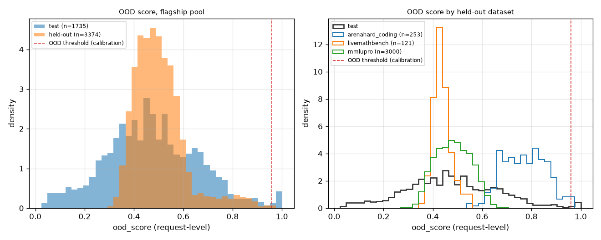

# shift_ood

Run `20261028T210636Z-86f6519`.

**Labels:** held-out datasets were fixed before training (Task 3) and appear only in the shift and OOD experiments; the OOD threshold comes from calibration; no latency is measured or simulated in this experiment; costs are the recorded costs of each model on each item; shipped is the policy config's OOD action (conservative); off makes the optimizer ignore the OOD verdict, an experiment switch (--ood off) the gateway never uses; the OOD verdict and score are request-level and computed by the artifact, so they are the same in every arm; the off arm computes them and does not act on them; the test split is replayed once, only for its OOD scores (the negatives of the AUROC); floor compliance counts only the decisions whose floor was not relaxed (Ruling V1-R5).

## Setup

| setting | value |
| --- | --- |
| pool | flagship |
| artifact version | dea4486d7575 |
| items (held-out / test, test for the OOD scores only) | 3374 / 1735 |
| Best Single (always_strongest, the reference) | gemini-2.5-pro |
| dual lambda (USD^-1, from the policy config) | 6.719579687342048 |
| min_cost floor (fixed in advance) | 0.3 |
| policy config (other than lambda) | {"mode": "dual", "default_floor": 0, "epsilon": 0, "ood_action": "conservative", "on_infeasible": "best_effort"} |
| OOD threshold (from calibration) | 0.959316 |
| bootstrap | 1000 resamples, percentile 95% intervals, seed 0 |
| replays run (held-out / test) | 5 / 1 |
| wall time (s) | 8.9 |

## Held-out datasets

| dataset | items | share of the held-out split |
| --- | --- | --- |
| arenahard_coding | 253 | 0.0749852 |
| livemathbench | 121 | 0.0358625 |
| mmlupro | 3000 | 0.889152 |

## Held-out split: each arm against always_strongest (paired on the same items)

| arm | success [95% CI] | mean cost USD [95% CI] | success delta vs always_strongest [95% CI] | cost reduction vs always_strongest [95% CI] | OOD flagged | floor relaxed |
| --- | --- | --- | --- | --- | --- | --- |
| always_strongest | 0.8447 [0.8320, 0.8560] | 0.0416814 [0.0402989, 0.043065] | reference | reference | n/a | n/a |
| dual/shipped | 0.8311 [0.8180, 0.8441] | 0.00622512 [0.00579556, 0.00674353] | -0.0136 [-0.0252, -0.0018] | 0.8506 [0.8395, 0.8600] | 0.000592768 | 0 |
| dual/off | 0.8311 [0.8180, 0.8441] | 0.00622085 [0.00579289, 0.00673927] | -0.0136 [-0.0252, -0.0018] | 0.8508 [0.8396, 0.8603] | 0.000592768 | 0 |
| min_cost/shipped | 0.8142 [0.7999, 0.8272] | 0.00094481 [0.000824157, 0.00108831] | -0.0305 [-0.0436, -0.0175] | 0.9773 [0.9740, 0.9802] | 0.000592768 | 0.00592768 |
| min_cost/off | 0.8142 [0.7999, 0.8272] | 0.0009443 [0.000823654, 0.00108756] | -0.0305 [-0.0436, -0.0175] | 0.9773 [0.9740, 0.9802] | 0.000592768 | 0.00592768 |

## OOD action effect (shipped against off, paired on the same held-out items)

| policy | items | items where the arms chose differently | success delta, shipped minus off [95% CI] | cost reduction by the action [95% CI] |
| --- | --- | --- | --- | --- |
| dual | 3374 | 1 | 0.0000 [0.0000, 0.0000] | -0.0007 [-0.0022, 0.0000] |
| min_cost | 3374 | 2 | 0.0000 [0.0000, 0.0000] | -0.0005 [-0.0014, 0.0000] |

## Floor compliance on the held-out split (min_cost, floor 0.3, Ruling V1-R5)

| arm | floor | decisions | not relaxed | realized success among them [95% Wilson CI] | realized >= floor | mean cost USD |
| --- | --- | --- | --- | --- | --- | --- |
| min_cost/shipped | 0.3 | 3374 | 0.994072 | 0.814 [0.800, 0.826] | yes | 0.00094481 |
| min_cost/off | 0.3 | 3374 | 0.994072 | 0.814 [0.800, 0.826] | yes | 0.0009443 |

## OOD detection: AUROC of ood_score, held-out items as positives, test items as negatives

| held-out set | items | AUROC against test [95% CI] | OOD flag rate | median ood_score |
| --- | --- | --- | --- | --- |
| all held-out items | 3374 | 0.5572 [0.5390, 0.5768] | 0.000592768 | 0.487313 |
| arenahard_coding | 253 | 0.9192 [0.9076, 0.9304] | 0.00790514 | 0.768426 |
| livemathbench | 121 | 0.4373 [0.4119, 0.4635] | 0 | 0.432045 |
| mmlupro | 3000 | 0.5315 [0.5130, 0.5523] | 0 | 0.482086 |
| test split (the negatives) | 1735 | n/a | 0.0126801 | 0.464119 |

## Per held-out dataset: each arm against always_strongest

| dataset | arm | items | success | mean cost USD | success delta vs always_strongest [95% CI] | cost reduction vs always_strongest | OOD flagged |
| --- | --- | --- | --- | --- | --- | --- | --- |
| arenahard_coding | always_strongest | 253 | 0.865613 | 0.0493706 | reference | n/a | n/a |
| arenahard_coding | dual/shipped | 253 | 0.818182 | 0.00568744 | -0.0474 [-0.1028, 0.0198] | 0.884801 | 0.00790514 |
| arenahard_coding | dual/off | 253 | 0.818182 | 0.00563061 | -0.0474 [-0.1028, 0.0198] | 0.885952 | 0.00790514 |
| arenahard_coding | min_cost/shipped | 253 | 0.794466 | 0.00328485 | -0.0711 [-0.1344, -0.0079] | 0.933465 | 0.00790514 |
| arenahard_coding | min_cost/off | 253 | 0.794466 | 0.00327806 | -0.0711 [-0.1344, -0.0079] | 0.933603 | 0.00790514 |
| livemathbench | always_strongest | 121 | 0.504132 | 0.0905588 | reference | n/a | n/a |
| livemathbench | dual/shipped | 121 | 0.760331 | 0.00877455 | 0.2562 [0.1653, 0.3388] | 0.903107 | 0 |
| livemathbench | dual/off | 121 | 0.760331 | 0.00877455 | 0.2562 [0.1653, 0.3388] | 0.903107 | 0 |
| livemathbench | min_cost/shipped | 121 | 0.677686 | 0.00155545 | 0.1736 [0.0826, 0.2562] | 0.982824 | 0 |
| livemathbench | min_cost/off | 121 | 0.677686 | 0.00155545 | 0.1736 [0.0826, 0.2562] | 0.982824 | 0 |
| mmlupro | always_strongest | 3000 | 0.856667 | 0.0390615 | reference | n/a | n/a |
| mmlupro | dual/shipped | 3000 | 0.835 | 0.00616763 | -0.0217 [-0.0340, -0.0097] | 0.842105 | 0 |
| mmlupro | dual/off | 3000 | 0.835 | 0.00616763 | -0.0217 [-0.0340, -0.0097] | 0.842105 | 0 |
| mmlupro | min_cost/shipped | 3000 | 0.821333 | 0.000722836 | -0.0353 [-0.0470, -0.0233] | 0.981495 | 0 |
| mmlupro | min_cost/off | 3000 | 0.821333 | 0.000722836 | -0.0353 [-0.0470, -0.0233] | 0.981495 | 0 |

