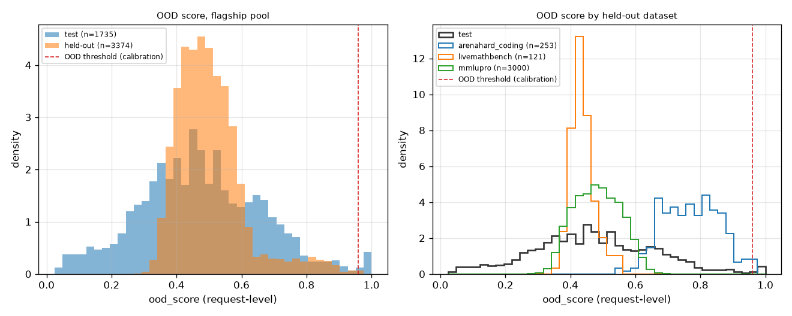

# shift_ood

Run `20261031T070425Z-f0429c6`.

**Labels:** held-out datasets were fixed before training and appear only in the shift and OOD experiments; the OOD threshold comes from calibration; no latency is measured or simulated in this experiment; costs are the recorded costs of each model on each item; shipped is the policy config's OOD action (conservative); off makes the optimizer ignore the OOD verdict, an experiment switch (--ood off) the gateway never uses; the OOD verdict and score are request-level and computed by the artifact, so they are the same in every arm; the off arm computes them and does not act on them; the test split is replayed once, only for its OOD scores (the negatives of the AUROC); floor compliance counts only the decisions whose floor was not relaxed.

## Setup

| setting | value |
| --- | --- |
| pool | flagship |
| artifact version | dea4486d7575 |
| items (held-out / test, test for the OOD scores only) | 3374 / 1735 |
| Best Single (always_strongest, the reference) | gemini-2.5-pro |
| dual lambda (USD^-1, from the policy config) | 6.721045792801306 |
| min_cost floor (fixed in advance) | 0.3 |
| policy config (other than lambda) | {"mode": "dual", "default_floor": 0, "epsilon": 0, "ood_action": "conservative", "on_infeasible": "best_effort"} |
| OOD threshold (from calibration) | 0.959316 |
| bootstrap | 1000 resamples, percentile 95% intervals, seed 0 |
| replays run (held-out / test) | 5 / 1 |
| wall time (s) | 2.8 |

## Held-out datasets

| dataset | items | share of the held-out split |
| --- | --- | --- |
| arenahard_coding | 253 | 0.0749852 |
| livemathbench | 121 | 0.0358625 |
| mmlupro | 3000 | 0.889152 |

## Held-out split: each arm against always_strongest (paired on the same items)

| arm | success [95% CI] | mean cost USD [95% CI] | success delta vs always_strongest [95% CI] | cost reduction vs always_strongest [95% CI] | OOD flagged | floor relaxed |
| --- | --- | --- | --- | --- | --- | --- |
| always_strongest | 0.8447 [0.8320, 0.8560] | 0.0416814 [0.0402989, 0.043065] | reference | reference | n/a | n/a |
| dual/shipped | 0.8305 [0.8177, 0.8438] | 0.0062541 [0.00582305, 0.00677352] | -0.0142 [-0.0255, -0.0024] | 0.8500 [0.8386, 0.8597] | 0.000592768 | 0 |
| dual/off | 0.8305 [0.8177, 0.8438] | 0.00624984 [0.00582123, 0.0067685] | -0.0142 [-0.0255, -0.0024] | 0.8501 [0.8387, 0.8598] | 0.000592768 | 0 |
| min_cost/shipped | 0.8127 [0.7987, 0.8251] | 0.000945986 [0.000825743, 0.00108966] | -0.0320 [-0.0453, -0.0187] | 0.9773 [0.9739, 0.9801] | 0.000592768 | 0.00592768 |
| min_cost/off | 0.8127 [0.7987, 0.8251] | 0.000945476 [0.000825241, 0.00108864] | -0.0320 [-0.0453, -0.0187] | 0.9773 [0.9739, 0.9802] | 0.000592768 | 0.00592768 |

## OOD action effect (shipped against off, paired on the same held-out items)

| policy | items | items where the arms chose differently | success delta, shipped minus off [95% CI] | cost reduction by the action [95% CI] |
| --- | --- | --- | --- | --- |
| dual | 3374 | 1 | 0.0000 [0.0000, 0.0000] | -0.0007 [-0.0021, 0.0000] |
| min_cost | 3374 | 2 | 0.0000 [0.0000, 0.0000] | -0.0005 [-0.0014, 0.0000] |

## Floor compliance on the held-out split (min_cost, floor 0.3)

| arm | floor | decisions | not relaxed | realized success among them [95% Wilson CI] | realized >= floor | mean cost USD |
| --- | --- | --- | --- | --- | --- | --- |
| min_cost/shipped | 0.3 | 3374 | 0.994072 | 0.812 [0.799, 0.825] | yes | 0.000945986 |
| min_cost/off | 0.3 | 3374 | 0.994072 | 0.812 [0.799, 0.825] | yes | 0.000945476 |

## OOD detection: AUROC of ood_score, held-out items as positives, test items as negatives

| held-out set | items | AUROC against test [95% CI] | OOD flag rate | median ood_score |
| --- | --- | --- | --- | --- |
| all held-out items | 3374 | 0.5572 [0.5390, 0.5768] | 0.000592768 | 0.487313 |
| arenahard_coding | 253 | 0.9192 [0.9076, 0.9304] | 0.00790514 | 0.768426 |
| livemathbench | 121 | 0.4373 [0.4119, 0.4635] | 0 | 0.432045 |
| mmlupro | 3000 | 0.5315 [0.5130, 0.5523] | 0 | 0.482086 |
| test split (the negatives) | 1735 | n/a | 0.0126801 | 0.464119 |

## Per held-out dataset: each arm against always_strongest

| dataset | arm | items | success | mean cost USD | success delta vs always_strongest [95% CI] | cost reduction vs always_strongest | OOD flagged |
| --- | --- | --- | --- | --- | --- | --- | --- |
| arenahard_coding | always_strongest | 253 | 0.865613 | 0.0493706 | reference | n/a | n/a |
| arenahard_coding | dual/shipped | 253 | 0.818182 | 0.00576437 | -0.0474 [-0.1028, 0.0198] | 0.883243 | 0.00790514 |
| arenahard_coding | dual/off | 253 | 0.818182 | 0.00570754 | -0.0474 [-0.1028, 0.0198] | 0.884394 | 0.00790514 |
| arenahard_coding | min_cost/shipped | 253 | 0.794466 | 0.00329861 | -0.0711 [-0.1344, -0.0078] | 0.933187 | 0.00790514 |
| arenahard_coding | min_cost/off | 253 | 0.794466 | 0.00329182 | -0.0711 [-0.1344, -0.0078] | 0.933324 | 0.00790514 |
| livemathbench | always_strongest | 121 | 0.504132 | 0.0905588 | reference | n/a | n/a |
| livemathbench | dual/shipped | 121 | 0.752066 | 0.00874755 | 0.2479 [0.1570, 0.3306] | 0.903405 | 0 |
| livemathbench | dual/off | 121 | 0.752066 | 0.00874755 | 0.2479 [0.1570, 0.3306] | 0.903405 | 0 |
| livemathbench | min_cost/shipped | 121 | 0.661157 | 0.00150148 | 0.1570 [0.0744, 0.2316] | 0.98342 | 0 |
| livemathbench | min_cost/off | 121 | 0.661157 | 0.00150148 | 0.1570 [0.0744, 0.2316] | 0.98342 | 0 |
| mmlupro | always_strongest | 3000 | 0.856667 | 0.0390615 | reference | n/a | n/a |
| mmlupro | dual/shipped | 3000 | 0.834667 | 0.00619483 | -0.0220 [-0.0347, -0.0103] | 0.841408 | 0 |
| mmlupro | dual/off | 3000 | 0.834667 | 0.00619483 | -0.0220 [-0.0347, -0.0103] | 0.841408 | 0 |
| mmlupro | min_cost/shipped | 3000 | 0.820333 | 0.000725176 | -0.0363 [-0.0483, -0.0243] | 0.981435 | 0 |
| mmlupro | min_cost/off | 3000 | 0.820333 | 0.000725176 | -0.0363 [-0.0483, -0.0243] | 0.981435 | 0 |

