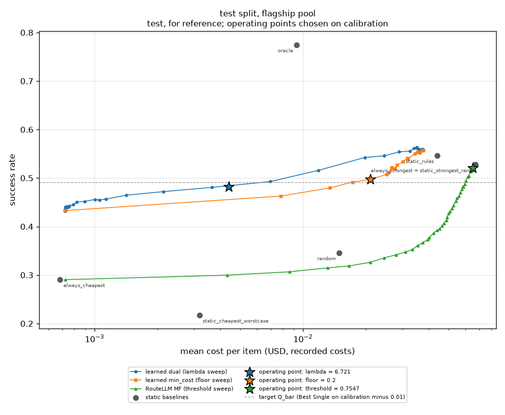
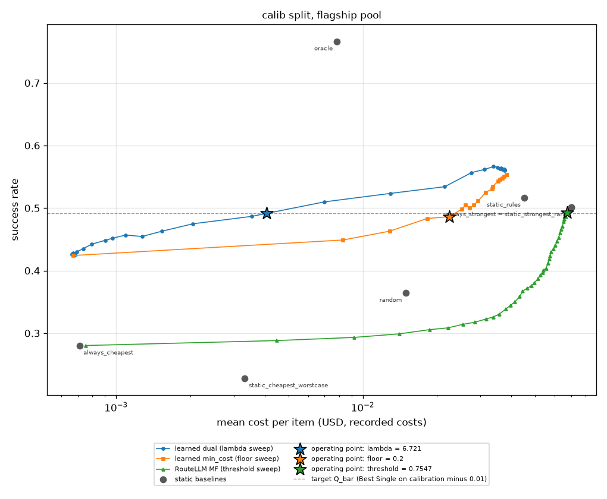

# sweeps

Run `20261031T064753Z-d02bb26`.

**Labels:** costs are the recorded costs of each model on each item; no latency is measured or simulated in this experiment; operating points (the tuned lambda, the floor, the RouteLLM threshold) are chosen on the calibration split only; test curves are labeled: test, for reference; operating points chosen on calibration; the calibrators and lower-bound tables of the learned policy were fitted on the calibration split, so the learned policy's calibration success is in-sample and optimistic; the RouteLLM MF scorer is trained on the train split; its threshold is chosen on calibration; oracle looks at the recorded outcomes: an upper bound, not a policy.

## Setup

| setting | value |
| --- | --- |
| pool | flagship |
| artifact version | dea4486d7575 |
| items (calibration / test) | 1773 / 1735 |
| Best Single (always_strongest) | gemini-2.5-pro |
| cheapest (RouteLLM weak model) | deepseek-v3-0324 |
| Best Single calibration success | 0.50141 |
| target Q_bar (that minus the margin) | 0.49141 (0.01) |
| tuned lambda (USD^-1, bisection on calibration) | 6.721045792801306 |
| calibration success at the tuned lambda / at lambda 0 | 0.491822 / 0.560068 |
| policy config (other than lambda) | {"mode": "dual", "default_floor": 0, "epsilon": 0, "ood_action": "conservative", "on_infeasible": "best_effort"} |
| RouteLLM MF weights SHA-256 | 8216c85e5965401a4735493d04f70863982fc5475a207bc851cd399eb466accc |
| bootstrap | 1000 resamples, percentile 95% intervals, seed 0 |
| replays run (calibration / test) | 151 / 110 |

## Operating points (chosen on calibration; paired against always_strongest on test)

| policy | parameter | calib success | calib cost USD | test success [95% CI] | test cost USD [95% CI] | success delta [95% CI] | cost reduction [95% CI] | test relaxed |
| --- | --- | --- | --- | --- | --- | --- | --- | --- |
| always_strongest |  | 0.50141 | 0.0700739 | 0.5274 [0.5049, 0.5516] | 0.0670642 [0.0629193, 0.0712717] | 0.0000 [0.0000, 0.0000] | 0.0000 [0.0000, 0.0000] | 0 |
| learned_dual | lambda = 6.721045792801306 | 0.491822 | 0.00408349 | 0.4818 [0.4599, 0.5055] | 0.00438797 [0.00383025, 0.00495434] | -0.0455 [-0.0697, -0.0225] | 0.9346 [0.9250, 0.9432] | 0 |
| learned_min_cost | floor = 0.2 | 0.486182 | 0.0224036 | 0.4968 [0.4726, 0.5205] | 0.020995 [0.0183877, 0.0233812] | -0.0305 [-0.0542, -0.0063] | 0.6869 [0.6568, 0.7221] | 0.14121 |
| routellm_mf | threshold = 0.7547044239276802 | 0.49295 | 0.0675064 | 0.5205 [0.4974, 0.5458] | 0.0652611 [0.0611199, 0.0694388] | -0.0069 [-0.0121, -0.0023] | 0.0269 [0.0195, 0.0354] | 0 |

## Static baselines

| policy | calib success | calib cost USD | test success | test cost USD |
| --- | --- | --- | --- | --- |
| always_strongest | 0.50141 | 0.0700739 | 0.527378 | 0.0670642 |
| always_cheapest | 0.280316 | 0.000709476 | 0.29049 | 0.000682562 |
| random | 0.364354 | 0.0149776 | 0.345821 | 0.0149205 |
| static_rules | 0.516638 | 0.0452793 | 0.546398 | 0.0439707 |
| oracle | 0.766497 | 0.00783205 | 0.77464 | 0.00928426 |
| static_strongest_rank | 0.50141 | 0.0700739 | 0.527378 | 0.0670642 |
| static_cheapest_worstcase | 0.227862 | 0.00332445 | 0.217291 | 0.00317929 |

## Lambda sweep, learned dual (test, for reference; operating points chosen on calibration)

| lambda | calib success | calib cost USD | calib relaxed | test success | test cost USD | test relaxed |
| --- | --- | --- | --- | --- | --- | --- |
| 0 | 0.560068 | 0.0375178 | 0 | 0.559654 | 0.0373738 | 0 |
| 0.01 | 0.561196 | 0.0374915 | 0 | 0.559654 | 0.0372966 | 0 |
| 0.0151178 | 0.561196 | 0.0374915 | 0 | 0.559654 | 0.0372636 | 0 |
| 0.0228546 | 0.56176 | 0.0374726 | 0 | 0.559654 | 0.0372636 | 0 |
| 0.0345511 | 0.56176 | 0.0374762 | 0 | 0.559654 | 0.0372636 | 0 |
| 0.0522335 | 0.56176 | 0.037486 | 0 | 0.558501 | 0.0369274 | 0 |
| 0.0789652 | 0.56176 | 0.0371069 | 0 | 0.558501 | 0.036597 | 0 |
| 0.119378 | 0.56176 | 0.0367675 | 0 | 0.559654 | 0.0360123 | 0 |
| 0.180472 | 0.563452 | 0.0363069 | 0 | 0.561383 | 0.0352375 | 0 |
| 0.272833 | 0.562888 | 0.0359244 | 0 | 0.563689 | 0.0352187 | 0 |
| 0.412463 | 0.565144 | 0.0352641 | 0 | 0.561383 | 0.03402 | 0 |
| 0.623551 | 0.566272 | 0.0338791 | 0 | 0.55562 | 0.032635 | 0 |
| 0.942668 | 0.56176 | 0.031107 | 0 | 0.55389 | 0.0288616 | 0 |
| 1.4251 | 0.556684 | 0.0276038 | 0 | 0.545821 | 0.0245483 | 0 |
| 2.15443 | 0.534123 | 0.0214779 | 0 | 0.542363 | 0.0197657 | 0 |
| 3.25702 | 0.523407 | 0.0129256 | 0 | 0.51585 | 0.0118526 | 0 |
| 4.92388 | 0.50987 | 0.00698363 | 0 | 0.492795 | 0.00696707 | 0 |
| 7.4438 | 0.486746 | 0.00354782 | 0 | 0.480692 | 0.00365848 | 0 |
| 11.2534 | 0.474901 | 0.0020498 | 0 | 0.472046 | 0.00214165 | 0 |
| 17.0125 | 0.463057 | 0.00153283 | 0 | 0.464553 | 0.00141741 | 0 |
| 25.7191 | 0.454597 | 0.00127236 | 0 | 0.456484 | 0.00113282 | 0 |
| 38.8816 | 0.456853 | 0.00109128 | 0 | 0.454755 | 0.0010528 | 0 |
| 58.7802 | 0.451777 | 0.00096639 | 0 | 0.455908 | 0.00100562 | 0 |
| 88.8624 | 0.448393 | 0.000901375 | 0 | 0.451873 | 0.000895593 | 0 |
| 134.34 | 0.442188 | 0.000793051 | 0 | 0.45072 | 0.000820671 | 0 |
| 203.092 | 0.434856 | 0.00073375 | 0 | 0.445533 | 0.00079184 | 0 |
| 307.029 | 0.430344 | 0.00069207 | 0 | 0.442651 | 0.000754969 | 0 |
| 464.159 | 0.42696 | 0.000678852 | 0 | 0.440346 | 0.000749626 | 0 |
| 701.704 | 0.425268 | 0.000680759 | 0 | 0.439769 | 0.000747023 | 0 |
| 1060.82 | 0.42696 | 0.000673409 | 0 | 0.440922 | 0.000736068 | 0 |
| 1603.72 | 0.426396 | 0.00066543 | 0 | 0.439193 | 0.000731396 | 0 |
| 2424.46 | 0.426396 | 0.000663216 | 0 | 0.437464 | 0.000725035 | 0 |
| 3665.24 | 0.426396 | 0.000663099 | 0 | 0.439769 | 0.00072418 | 0 |
| 5541.02 | 0.426396 | 0.000664079 | 0 | 0.436311 | 0.000724294 | 0 |
| 8376.78 | 0.427524 | 0.000664562 | 0 | 0.434006 | 0.000722534 | 0 |
| 12663.8 | 0.428088 | 0.000667414 | 0 | 0.433429 | 0.000722661 | 0 |
| 19144.8 | 0.427524 | 0.000667533 | 0 | 0.4317 | 0.00072311 | 0 |
| 28942.7 | 0.42696 | 0.000667752 | 0 | 0.4317 | 0.000720919 | 0 |
| 43754.8 | 0.426396 | 0.00066781 | 0 | 0.433429 | 0.000721143 | 0 |
| 66147.4 | 0.425832 | 0.000667878 | 0 | 0.433429 | 0.000721171 | 0 |
| 100000 | 0.425268 | 0.000667903 | 0 | 0.432853 | 0.000721198 | 0 |

## Floor sweep, learned min_cost (test, for reference; operating points chosen on calibration); relaxed is the share of items whose floor was relaxed

| floor | calib success | calib cost USD | calib relaxed | test success | test cost USD | test relaxed |
| --- | --- | --- | --- | --- | --- | --- |
| 0 | 0.42414 | 0.00066766 | 0 | 0.432853 | 0.000720765 | 0 |
| 0.05 | 0.448957 | 0.0083084 | 0 | 0.462824 | 0.00781493 | 0 |
| 0.1 | 0.463057 | 0.0128447 | 0 | 0.479539 | 0.0134122 | 0 |
| 0.15 | 0.483362 | 0.0182487 | 0.0614777 | 0.491643 | 0.0172328 | 0.0628242 |
| 0.2 | 0.486182 | 0.0224036 | 0.139312 | 0.49683 | 0.020995 | 0.14121 |
| 0.25 | 0.498026 | 0.025131 | 0.226734 | 0.507781 | 0.0251625 | 0.234006 |
| 0.3 | 0.504794 | 0.0261097 | 0.241963 | 0.511816 | 0.0257998 | 0.244957 |
| 0.35 | 0.500282 | 0.0271173 | 0.270164 | 0.521614 | 0.0265386 | 0.268012 |
| 0.4 | 0.504794 | 0.0282145 | 0.36661 | 0.519308 | 0.0276041 | 0.370029 |
| 0.45 | 0.511562 | 0.0293533 | 0.474901 | 0.526801 | 0.0282592 | 0.475504 |
| 0.5 | 0.525099 | 0.0315221 | 0.592217 | 0.533718 | 0.0301461 | 0.594236 |
| 0.55 | 0.530739 | 0.0335226 | 0.700508 | 0.54121 | 0.0317216 | 0.695101 |
| 0.6 | 0.534123 | 0.0336294 | 0.701072 | 0.540058 | 0.0319442 | 0.695677 |
| 0.65 | 0.543147 | 0.0353355 | 0.717992 | 0.550432 | 0.0343916 | 0.722767 |
| 0.7 | 0.545967 | 0.0358994 | 0.77101 | 0.553314 | 0.0353025 | 0.772334 |
| 0.75 | 0.547659 | 0.0368318 | 0.864636 | 0.552161 | 0.0363773 | 0.868588 |
| 0.8 | 0.550479 | 0.0372945 | 0.901861 | 0.556196 | 0.0371138 | 0.900288 |
| 0.85 | 0.553299 | 0.0382891 | 0.961647 | 0.557925 | 0.0376645 | 0.961383 |
| 0.9 | 0.553299 | 0.0382891 | 1 | 0.557925 | 0.0376645 | 1 |
| 0.95 | 0.553299 | 0.0382891 | 1 | 0.557925 | 0.0376645 | 1 |

## RouteLLM MF threshold sweep (test, for reference; operating points chosen on calibration)

| threshold | quantile | calib success | calib cost USD | calib relaxed | test success | test cost USD | test relaxed |
| --- | --- | --- | --- | --- | --- | --- | --- |
| 0.221797 | 0 | 0.50141 | 0.0700739 | 0 | 0.527378 | 0.0670642 | 0 |
| 0.709569 | 0.025 | 0.496334 | 0.0686993 | 0 | 0.526801 | 0.0660403 | 0 |
| 0.754704 | 0.05 | 0.49295 | 0.0675064 | 0 | 0.520461 | 0.0652611 | 0 |
| 0.770269 | 0.075 | 0.486182 | 0.066618 | 0 | 0.51585 | 0.0647976 | 0 |
| 0.782819 | 0.1 | 0.482234 | 0.0656526 | 0 | 0.513545 | 0.0638379 | 0 |
| 0.793877 | 0.125 | 0.478285 | 0.0652057 | 0 | 0.504899 | 0.0623872 | 0 |
| 0.800451 | 0.15 | 0.470953 | 0.0644846 | 0 | 0.502017 | 0.061669 | 0 |
| 0.807225 | 0.175 | 0.465877 | 0.0638124 | 0 | 0.494524 | 0.0603839 | 0 |
| 0.81347 | 0.2 | 0.460801 | 0.0631118 | 0 | 0.487608 | 0.0596629 | 0 |
| 0.81832 | 0.225 | 0.452905 | 0.0622935 | 0 | 0.481844 | 0.0588507 | 0 |
| 0.821842 | 0.25 | 0.447265 | 0.0613003 | 0 | 0.482421 | 0.0584155 | 0 |
| 0.825693 | 0.275 | 0.440496 | 0.0604191 | 0 | 0.476657 | 0.057934 | 0 |
| 0.830591 | 0.3 | 0.434856 | 0.0592729 | 0 | 0.470317 | 0.056873 | 0 |
| 0.834719 | 0.325 | 0.430344 | 0.058148 | 0 | 0.462248 | 0.0561042 | 0 |
| 0.838777 | 0.35 | 0.423576 | 0.0574208 | 0 | 0.458213 | 0.0549028 | 0 |
| 0.842497 | 0.375 | 0.4185 | 0.0570204 | 0 | 0.45245 | 0.0542166 | 0 |
| 0.845561 | 0.4 | 0.411732 | 0.0562742 | 0 | 0.443804 | 0.0526557 | 0 |
| 0.848214 | 0.425 | 0.403835 | 0.0553541 | 0 | 0.437464 | 0.051826 | 0 |
| 0.850906 | 0.45 | 0.401015 | 0.054054 | 0 | 0.431124 | 0.0506903 | 0 |
| 0.854349 | 0.475 | 0.397067 | 0.0535175 | 0 | 0.427089 | 0.0499787 | 0 |
| 0.857441 | 0.5 | 0.393119 | 0.0524372 | 0 | 0.41902 | 0.0491297 | 0 |
| 0.859967 | 0.525 | 0.386915 | 0.051431 | 0 | 0.413256 | 0.0487281 | 0 |
| 0.862933 | 0.55 | 0.380711 | 0.0495276 | 0 | 0.406916 | 0.0474076 | 0 |
| 0.8659 | 0.575 | 0.375635 | 0.0482518 | 0 | 0.401153 | 0.0465838 | 0 |
| 0.869518 | 0.6 | 0.371686 | 0.0463255 | 0 | 0.395389 | 0.0453339 | 0 |
| 0.872687 | 0.625 | 0.367174 | 0.044461 | 0 | 0.391931 | 0.043992 | 0 |
| 0.87594 | 0.65 | 0.358714 | 0.0432899 | 0 | 0.386744 | 0.0422874 | 0 |
| 0.880802 | 0.675 | 0.350254 | 0.0414013 | 0 | 0.377522 | 0.0403928 | 0 |
| 0.883696 | 0.7 | 0.344614 | 0.0397585 | 0 | 0.372911 | 0.0396843 | 0 |
| 0.888059 | 0.725 | 0.338409 | 0.0379578 | 0 | 0.367147 | 0.0375892 | 0 |
| 0.89257 | 0.75 | 0.330513 | 0.0357231 | 0 | 0.360807 | 0.0354564 | 0 |
| 0.896863 | 0.775 | 0.326001 | 0.0337978 | 0 | 0.352738 | 0.0335008 | 0 |
| 0.902283 | 0.8 | 0.322617 | 0.0315793 | 0 | 0.34755 | 0.0309799 | 0 |
| 0.907645 | 0.825 | 0.317541 | 0.028412 | 0 | 0.341787 | 0.0279941 | 0 |
| 0.912163 | 0.85 | 0.314157 | 0.025465 | 0 | 0.335447 | 0.0245188 | 0 |
| 0.917783 | 0.875 | 0.308517 | 0.0221342 | 0 | 0.326225 | 0.0210153 | 0 |
| 0.923869 | 0.9 | 0.305697 | 0.018668 | 0 | 0.318732 | 0.016576 | 0 |
| 0.929804 | 0.925 | 0.298928 | 0.0140342 | 0 | 0.314697 | 0.0131074 | 0 |
| 0.937109 | 0.95 | 0.293288 | 0.00922808 | 0 | 0.306628 | 0.00859875 | 0 |
| 0.949059 | 0.975 | 0.288212 | 0.00447585 | 0 | 0.299712 | 0.00432546 | 0 |
| 0.97666 | 1 | 0.280316 | 0.000751601 | 0 | 0.29049 | 0.000724173 | 0 |

