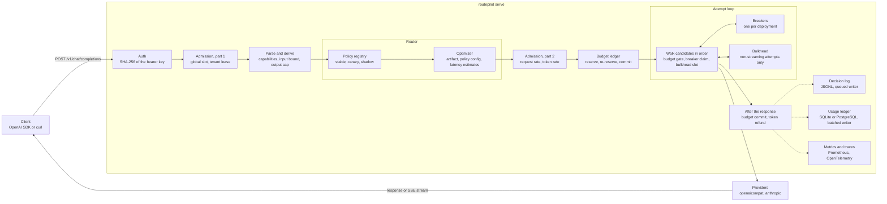
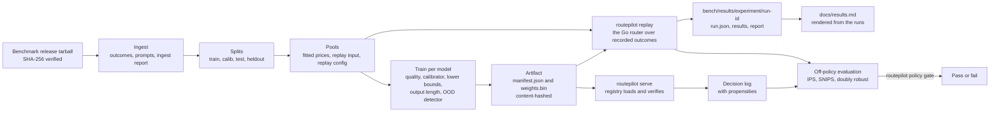
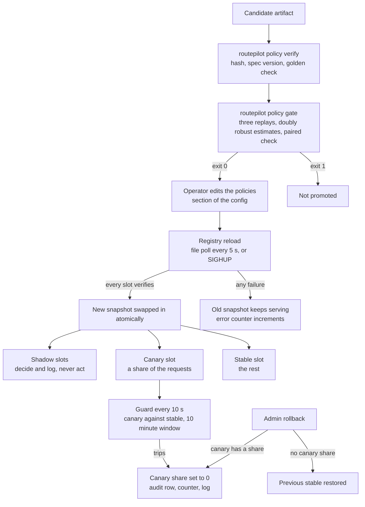
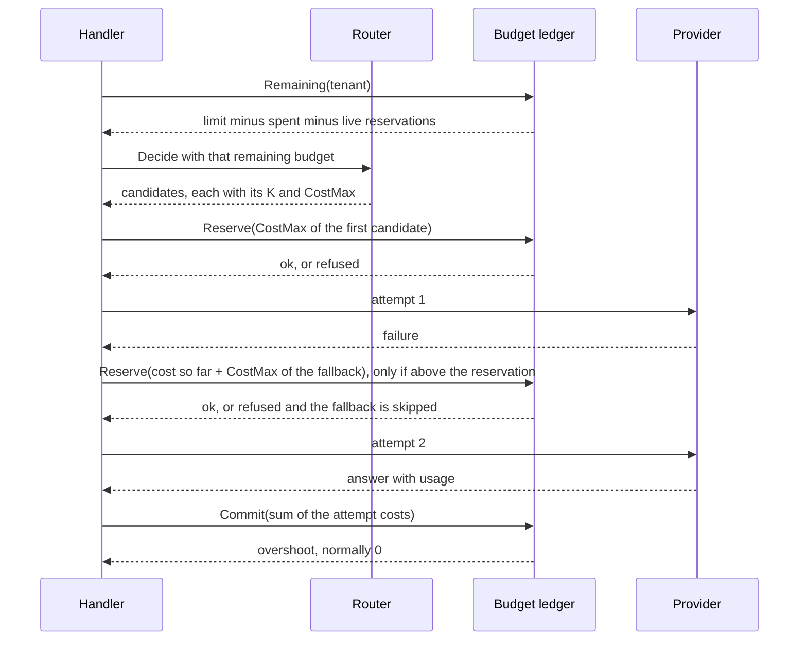

# Architecture

This page describes RoutePilot as the code builds it today. Each section names the files that hold a behavior and, where one exists, the test that pins it. Numbers come from the committed runs behind [results.md](results.md) and [performance.md](performance.md) and are linked to their runs. What RoutePilot does not do is in [limitations.md](limitations.md).

- [Two halves and one artifact](#two-halves-and-one-artifact)
- [The request path](#the-request-path)
- [The offline loop](#the-offline-loop)
- [The request lifecycle as built](#the-request-lifecycle-as-built)
- [The constrained program](#the-constrained-program)
- [The artifact format and content hash](#the-artifact-format-and-content-hash)
- [The policy lifecycle](#the-policy-lifecycle)
- [Budgets and accounting](#budgets-and-accounting)
- [The input-token bound](#the-input-token-bound)

## Two halves and one artifact

RoutePilot has two halves that meet at one file format.

- The gateway is Go (`cmd/routepilot`, `internal/`). It authenticates, routes, limits, calls providers and accounts for cost.
- The offline pipeline is Python (`python/routepilot_train`). It turns recorded outcomes of many models into a policy artifact: per-model success predictors, calibrators, lower-confidence-bound tables, output-length models and an out-of-distribution detector.

The gateway loads the artifact, verifies it and evaluates it in Go. No Python runs on the request path. `routepilot replay` runs the gateway's router, catalog and optimizer over recorded outcomes, so the offline experiments use the decision code that serves traffic.

The replay covers the decision and not the whole request. It does not run admission, rate limits, budgets, the attempt loop, breakers, providers or the policy registry. Those are covered by the gateway tests and by the systems experiments (failover, quota correctness, overhead), not by the replay.

## The request path



Solid arrows are the request. Dotted arrows are work that happens after the response has been written. The decision log and the usage ledger are written by background goroutines behind bounded queues, so a slow disk or database never slows a request. Metrics and spans are recorded along the way and finished after the response.

## The offline loop



The steps, with the commands that run them (the full order, seeds and run times are in [reproducibility.md](reproducibility.md)):

1. `make data` downloads the benchmark release, checks its SHA-256, ingests it into `data/derived/` (`outcomes.parquet`, `prompts.parquet`, `ingest_report.json`) and builds splits, pools and replay exports. `data/raw/` and `data/derived/` are never committed; the prompts live only in `data/derived/`.
2. Splits (`python/routepilot_train/data/splits.py`) depend only on the item ID. Three whole datasets, at most one per domain, are held out of all fitting and tuning; they appear in the shift and out-of-distribution experiments. Every other item goes to a split by the first 16 hex digits of `SHA-256(item_id + salt)` read as a fraction: below 0.6 is train, below 0.8 is calibration, the rest is test. Adding or removing items never moves an existing one.
3. Training (`make train`, `python/routepilot_train/train/`) fits, per model:
   - the quality predictor: an L2 logistic regression on 65,536 signed hashed text features and 12 dense features, with the penalty chosen by 5-fold cross-validation inside train;
   - a calibrator on the calibration split: isotonic regression from 1,000 calibration samples, Platt scaling below that;
   - a lower-bound table on the calibration split: 15 equal-mass bins of calibrated probability (bins under 30 samples are merged), each holding the one-sided 95% Clopper-Pearson lower bound, made non-decreasing by a running maximum;
   - an output-length model: ridge regression on `log1p(completion tokens)`, with a smearing factor and residual quantiles from the calibration split;
   - once for the pool, an out-of-distribution detector: k-means with 32 centroids on train, each centroid cut to its 512 largest entries, with the threshold at the 0.99 quantile of the calibration scores.

   Every fitting entry point asserts the `split` column of the frame it is given (`require_splits`) and raises on any other split, so a tuning step cannot read test rows by accident. The dual mode's lambda is tuned on the calibration split by bisection (`train/dual.py`).
4. Export writes the artifact (see [The artifact format and content hash](#the-artifact-format-and-content-hash)).
5. `routepilot replay` runs a policy over a pool's recorded outcomes, one JSON line per item, with no prompt text (items are referenced by `item_id` and a 16-hex prefix of the prompt hash: `TestReplayOutputHasNoPromptText`). The experiment scripts in `bench/scripts/` call it and write `bench/results/<experiment>/<run-id>/` with a `run.json`; `bench/scripts/render_docs.py` renders `docs/results.md` and `docs/performance.md` from those runs.
6. `routepilot policy gate` replays three times and hands the logs to the estimators in `python/routepilot_train/ope.py` (see [The policy lifecycle](#the-policy-lifecycle)).

Recorded cost and success come from the benchmark release. Latency of the API models in replay is simulated from public figures and every table that shows it says so.

## The request lifecycle as built

This is the order of `POST /v1/chat/completions` in `internal/gateway`, from `serve` in `server.go` and `handleChat` in `handlers.go`.

**0. The request is routed by path.** `serve` gives the request an ID and returns it in `x-routepilot-request-id`. `/healthz` and `/readyz` are plain text and unauthenticated. `/v1/models`, `/v1/chat/completions` and `/v1/feedback` need a tenant key; `/admin/policies` and `/admin/policies/rollback` need the admin key and exist only when `server.admin_key_sha256` is set; `/metrics` is unauthenticated. `/v1/feedback` exists only when a decision log is configured. Any other path is a 404 `not_found`.

**1. Authenticate** (`auth.go`). The bearer token is hashed with SHA-256 and compared in constant time with the `api_key_sha256` of every tenant, without stopping at the first match. A failure is a 401 `invalid_api_key`. Tenant keys are never stored, only their hashes.

**2. Admission, part 1** (`admission.go`). The request takes a global in-flight slot (`server.max_inflight`, default 1024), waiting at most `server.queue_wait_ms` (default 100) before a 503 `overloaded`. It then takes the tenant's concurrency lease (`max_concurrency`) with a lifetime of the tenant's longest allowed deadline plus 60 seconds; a refusal is a 429 `rate_limit_exceeded` with `Retry-After: 1`. Both are taken before the body is read, so one tenant's slow bodies cannot fill every global slot. Both are held to the end of the request, a stream included.

**3. Read and parse.** The body is read under `server.max_body_bytes` (default 4 MiB, else 413) and a 30 second read deadline (else 408). It is parsed and validated (else 400); fields the gateway does not model are kept and forwarded upstream, which is why the input-token bound counts them. The `routepilot` options (`min_quality`, `slo_ttft_ms`, `slo_e2e_ms`, `timeout_ms`) may also arrive as `x-routepilot-*` headers; the body wins field by field, and a bad header is a 400 that names the header.

**4. Derive requirements** (`catalog.Derive`, `internal/catalog/requirements.go`). From the parsed request: the capabilities it needs (tools, `json_object`, `json_schema`, vision, streaming), the input-token bound `InUpper` (see [The input-token bound](#the-input-token-bound)), the explicit output cap if any, the prompt bytes and the message text, cut to 32 KiB on a rune boundary for the predictor.

**5. Read the remaining budget.** Only for a tenant with `budget_usd`. The ledger reports the limit minus the spend minus the live reservations of the period. A ledger error is a 503 `overloaded` (the request fails closed); if the client has gone, nothing is written.

**6. Decide** (`decide` in `learned.go`, `router.Decide` in `internal/router`).

- A named model is pinned. It must exist (404 `model_not_found`), be allowed for the tenant (403 `model_not_allowed`) and pass the capability and limit checks (400 `model_capability_unavailable`): missing capability, context window below `InUpper + k`, or an explicit `max_tokens` above the model's limit. The only candidate is that model, so failover can use only its deployments.
- `auto` with a static policy (`cheapest`, `strongest`, `rules`) applies the same checks to every model the tenant may use and orders the survivors. Static policies ignore `min_quality` and the SLOs.
- `auto` with the learned policy takes one registry snapshot, picks the stable or canary slot for this request, builds the slot's optimizer and calls `Choose` (see [The constrained program](#the-constrained-program)). Every shadow slot of the same snapshot then decides on the same input, with no randomness; its decision is logged and never acted on, and its errors are never answered.

The router returns candidates in the order to try them. Each carries the model, the output budget `K` it was admitted with, its worst-case cost `CostMax`, and its available deployments in config order.

**7. Decision headers.** Before anything is written, the response gets `x-routepilot-policy-version`, `x-routepilot-decision-id` (`dec_` plus the request ID), `x-routepilot-relaxed` (only when a constraint was relaxed) and, for the learned policy, `x-routepilot-estimated-cost-usd`. A routing error carries them too. The pinned and static policies report `pinned` and `static-<policy>` as their version. A router error now ends the request: 400, 403, 404, 422 `no_feasible_model`, 429 `insufficient_quota` or 503 `no_healthy_deployment`.

**8. Deadline and admission, part 2.** The deadline is `routepilot.timeout_ms` if set, else `server.default_timeout_ms` (120 seconds), clamped to the tenant's `max_timeout_ms`, else `server.max_timeout_ms` (600 seconds). The concurrency lease is refreshed to the deadline plus 60 seconds. Then the request rate (GCRA, `rpm`) and the token rate (`tpm`) are checked, and the token limiter reserves `n = max over candidates of (InUpper of that model + K)`: a failover can land on any candidate, so the largest one is held. A refusal is a 429 with `Retry-After`; a reservation larger than the burst can never fit, so it is a 429 without `Retry-After` and a message to lower `max_tokens`. Each limiter call is bounded at 250 ms; a limiter backend that does not answer is a 503 `overloaded`.

**9. Reserve the budget.** For a budgeted tenant, the worst-case cost of the first candidate is reserved under the request ID with a lease of the deadline plus 60 seconds. If another request took the budget between steps 5 and 9, the answer is a 429 `insufficient_quota` ("tenant budget exhausted"). A ledger error is a 503. See [Budgets and accounting](#budgets-and-accounting).

**10. The attempt loop** (`attempts.go`, `proxy.go`, `stream.go`, `stream_attempt.go`). A context with the deadline covers every attempt and wait. `claimNext` hands out one (candidate, deployment) pair at a time:

- It walks the candidates in order and, within a candidate, its deployments in config order: another deployment of the same model first, then the next candidate. At most `reliability.max_attempts` pairs are issued (default 3, at most 5). Skipped pairs are not attempts.
- Before each pair is claimed, the budget gate rules on its candidate. It needs the cost of the attempts so far plus this candidate's `CostMax`. If the reservation already covers that, the pair goes ahead. Otherwise the reservation is raised first; if the raise is refused (or the ledger fails) the candidate is skipped with all its deployments. This holds for another deployment of the same model as much as for the next model, since either follows a billed attempt. `TestFallbackReReserveFailureSkipsModel` and `TestSameModelFailoverReservesForWhatTheFirstAlreadyCost` pin this.
- A non-streaming attempt on a deployment with `max_inflight` takes a bulkhead slot, or the deployment is skipped as if unavailable. The slot is returned when the provider call returns, on every path. Streams do not use the bulkhead.
- The deployment's circuit breaker is asked (`Allow`). A breaker opens after 5 consecutive failures, or when at least half of at least 20 requests in a 30 second window failed. It stays open for 10 seconds and then admits one probe at a time; a failed probe reopens it for twice as long, up to 120 seconds. Breakers are per deployment and shared by all tenants.
- The request sent upstream is a clone with the model replaced by the deployment's upstream model, the `routepilot` object removed, and, when the client set no output cap, `max_tokens` set to `K`, so a provider cannot produce more than was reserved. When the client did set a cap, exactly that cap is sent, in the field the client used; if both `max_tokens` and `max_completion_tokens` are set, `max_completion_tokens` wins (it is the cap the request was reserved for) and `max_tokens` is dropped.
- After a failure the outcome is reported to the breaker (`settle`) and the loop decides whether to go on. These are retryable: connect errors, protocol errors, timeouts while the request deadline has not passed, a cancel caused by the first-token watchdog, and upstream HTTP 408, 409, 429, 500, 502, 503, 504, 529, 401 and 403. Other 4xx answers go back to the client. A `Retry-After` of up to 2 seconds is waited out; a longer one trips that deployment's breaker for that long (at most 120 seconds) and the loop moves on. A 401 or 403 quarantines the deployment for 120 seconds. Without a `Retry-After` the wait is jittered exponential backoff, `random x min(1 s, 50 ms x 2^n)`. A wait that would end after the deadline is not started.
- A timeout caused by the request deadline counts against the deployment only if the attempt ran for at least 90% of the deadline the request would have had without a client `timeout_ms` (the server default, clamped to the tenant's maximum); a shorter run was cut off by a client-chosen deadline and says nothing about the deployment.
- When no attempt answers, the client gets: 503 `no_healthy_deployment` if nothing was sent, 504 `upstream_timeout` if the deadline passed, 429 `rate_limit_exceeded` (with the smallest upstream `Retry-After`) if every attempt that was sent got an upstream 429, else the mapped error of the last attempt (502 `upstream_error`, or the upstream's own 4xx message).

*Streaming.* An attempt commits when its first content reaches the client. The first committing chunk is one with content text, tool calls, a finish reason, usage that will be forwarded, or another real delta field such as `reasoning_content`. Chunks before it (a role-only opener) are held, at most 64 chunks and 1 MiB, and written just before the commit. One timer is the first-token watchdog until the commit and the idle watchdog afterwards (the provider's `ttft_timeout_ms`, default 10 seconds, and `idle_timeout_ms`, default 30 seconds). Exactly one chunk is in flight, read, written and flushed in turn, with a 30 second write deadline per write, so a slow client slows the upstream read. Before the commit a failure can go to the next deployment. After it the status line is sent: an upstream failure becomes one SSE error event, the stream ends without `[DONE]`, and there is no second upstream call (`TestMidstreamNeverRetried`). A half-open probe is settled as a success at the commit.

**11. Finish.** The deferred cleanup runs in this order: the budget is committed with what the attempts cost (or released if none was sent), the unused part of the token reservation is refunded, and the concurrency lease and the global slot are released. A non-streaming response is written whole, with its length declared, and flushed before this work starts, so the commit, the ledger and the log do not add to the latency the client sees. Then `serve` ends the trace, writes the decision records (the primary decision with its outcome, then one record per shadow decision), writes one structured log line, records the metrics, tells the guardrails how the request ended, and queues the usage rows.

Token refund rule (`refundAmount`): with no attempt sent, all `n` tokens come back; with attempts sent but no usage known, none; otherwise the difference to the tokens the answering attempt used.

A client that disconnects cancels the upstream call. The attempts that were sent are still charged, and the budget commit runs on a context detached from the request, bounded at 2 seconds.

## The constrained program

For each `auto` request the learned policy solves a small constrained program per model. The code is `Optimizer.Choose` in `internal/router/optimize.go`, behind the router's feasibility filter.

```text
For a request x of tenant t and a model m:

  in_m(x)   input-token bound of m: InUpper(x) plus m's prompt overhead
  k_m(x)    output budget of m: the client's max_tokens if set, else the smaller of the
            model's max output and the tenant's default_max_tokens, cut to what the
            remaining budget pays for after the input bound
  q         quality floor: routepilot.min_quality, else the tenant's min_quality,
            else the policy's default_floor
  s         latency SLO in ms (slo_ttft_ms or slo_e2e_ms), optional
  B         what the tenant may still spend, optional

  p, L      calibrated success probability and its lower confidence bound (artifact)
  cost_exp  price_in * ceil(in_m(x) * in_ratio) + price_out * ceil(clamp(e_out, 1, k_m))
  cost_max  price_in * in_m(x) + price_out * k_m
  Q95       p95 of the latency the SLO constrains

  F(x)    the tenant may use m, m has the capabilities R(x), its context window holds
          in_m(x) + k_m, an explicit max_tokens is within its limit, and one of its
          deployments is available (breaker not open)
  Bset    models of F(x) with k_m >= 1 and cost_max <= B       (all of F(x) without B)
  S       models of Bset with L >= q and Q95 <= s              (the safe set)

  min_cost:  choose the m in S with the smallest cost_exp
  dual:      choose the m in S with the largest p - lambda * cost_exp   (cost in USD)
  ties:      higher L, then lower Q95, then the smaller model ID
```

Money is `int64` picodollars throughout; floats appear only in probabilities and in the dual objective.

**The quality floor is compared with L, not p.** `L` is the lower bound of the calibration bin that holds `p`, so a request is routed to a model only when the model's tested success rate in that region is confidently above the floor. This is conservative: at a high floor most requests find no model in S (see [results.md](results.md#lower-confidence-bound-against-point-estimate)). The `WithFloorOnPoint` switch compares with `p` for that experiment only; the gateway never calls it.

**Latency.** The SLO check uses the 95th percentile (delta 0.05) and the maximum over the model's available deployments, because a failover can land on any of them. For `slo_ttft_ms` it is the time-to-first-token quantile. For `slo_e2e_ms` it is a union bound: the time to first token at quantile 1 - delta/3, plus the artifact's 0.99 output-length quantile (cut to `k_m`) times the time per token at quantile 1 - delta/3. The estimator (`internal/latency`) keeps decayed histograms per deployment (half-life 5 minutes) fed by the streaming path; a deployment with fewer than 50 effective observations contributes the model's prior profile from `server.latency_profiles`, and a model with neither fails the SLO ("no latency estimate"). The prior profiles of the benchmark's API models are simulated, and the error message marks a bound that rests on one.

**Out-of-distribution requests.** The artifact scores a request by one minus its best cosine similarity to a stored centroid and flags it above the threshold. Under `ood_action: conservative` (the value in both shipped policy configs) `p` and `L` are replaced by each model's pooled calibration success rate and pooled lower bound. Under `strongest` the candidates are ordered by rank, highest first, instead of by the objective, and exploration is off. Every decision reports `ood` and `ood_score`. On the benchmark data the detector is nearly inert (see [limitations.md](limitations.md)).

**Infeasibility.** Permission, capability, context and budget are hard and never relaxed. If no model in the policy's artifact can serve the request, the answer is 400 `model_capability_unavailable`. If Bset is empty the answer is 429 `insufficient_quota`. If Bset is not empty but S is, the tenant's `on_infeasible` (else the policy's) decides:

- `reject`: 422 `no_feasible_model`, with a message naming the binding constraints (the floor above the best lower bound, the SLO below the best p95, or both together).
- `best_effort` (the default): with an SLO set, drop the SLO and keep the floor, using the same objective over the models whose `L` clears the floor (`x-routepilot-relaxed: latency`). If that set is empty too, or no SLO was set, drop the floor and take the model with the highest `L` (`quality`, or `latency,quality` when an SLO was set).

**Exploration.** A decision that relaxed nothing, is not under the `strongest` action and was given a random source explores: with probability epsilon (the policy config, default 0) it takes a uniformly random model of S instead of the optimum. The decision records its propensity, the probability the policy had of making the choice it made: `epsilon / |S|`, plus `1 - epsilon` when the choice is the model the optimizer ranks first. Exploration never leaves S, so it never violates a constraint. Shadow decisions get no random source and never explore. The propensity is what makes off-policy evaluation possible.

**Order.** The result is the chosen model first, then the rest of S in order, then, under `best_effort`, the rest of Bset by lower bound. That is the failover order. A model outside Bset is never a candidate.

Every model the tenant may use appears in the decision's scores with its `p`, `L`, `cost_exp`, `cost_max`, latency estimate, feasibility and, if excluded, the reasons. These go to the decision log.

## The artifact format and content hash

An artifact is a directory `policies/<name>/<version>/` with two files, written by `python/routepilot_train/export/artifact.py` and read by `internal/policy/artifact.go`.

`manifest.json` is canonical JSON: sorted keys, indent 1, ASCII only, LF, a trailing newline. Go reads it strictly: an unknown field or data after the object is an error.

| Field | Content |
|---|---|
| `format`, `format_version` | `routepilot-policy-artifact`, 1 |
| `version` | the content hash, 12 lowercase hex digits |
| `feature_spec_version` | 1, the feature spec both sides implement |
| `dim` | hashed feature dimension (65,536 by default) |
| `dense_mean`, `dense_std` | standardization of the 12 dense features |
| `models[]` | per model: `id`; `quality` (a weights reference and a bias); `calibrator` (`isotonic` knots `x`, `y`, or `platt` `a`, `b`); `lcb` (`upper`, `lower`, `n`, `pooled_rate`, `pooled_lcb`); `length` (a weights reference, `bias`, `smear`, `residual_quantiles` for 0.5, 0.9, 0.95, 0.99, `in_ratio`) |
| `ood` | `k`, `threshold`, and per centroid an index reference and a value reference |
| `golden[]` | predictions recorded at training time for eight invented prompts |
| `training` | pool, dataset SHA-256, split salt, git SHA, creation time; carried and reported, not read by the router |

`weights.bin` is the concatenation of little-endian arrays with no gaps. A reference is `{offset, len, dtype}` with the offset in bytes, the length in elements and the type `f32` or `i32`. The order is, per model, its quality weights and then its length weights (each `dim` hashed weights followed by the 12 dense weights), then, per centroid, its indices and then its values. Every weight is `f32`; centroid indices are `i32`.

**The hash.** `version` is the first 12 hex digits of

```text
SHA-256( manifest bytes with "version": "" || weights.bin bytes )
```

The trainer writes the manifest with an empty version, hashes it with the weights, then rewrites the manifest with the version filled in and names the directory after it. Go recomputes the hash from the raw manifest bytes, replacing the one `"version": "<v>"` with `"version": ""`, so no JSON round trip can change what is hashed. The hash covers everything the router reads, the training metadata included.

**What `Load` checks, in order.** Any failure refuses the artifact with an error naming the check:

1. The manifest is well-formed and strict (`ErrManifest`).
2. Format name and version (`ErrFormat`), feature spec version (`ErrSpecVersion`).
3. The version is 12 hex digits, occurs exactly once in the manifest, and equals the recomputed hash (`ErrHashMismatch`). `TestLoadRejectsHashMismatch`.
4. The directory is named after the version (`ErrDirName`).
5. Every array reference fits `weights.bin`, has the right type and length, and holds only finite values; centroid indices are strictly ascending and in range; calibrator knots are strictly increasing; each lower-bound table has arrays of equal length, finite values and non-decreasing upper edges; every scalar is finite (`ErrArrayRef`, `ErrManifest`).
6. The golden self-check: the artifact scores the eight golden prompts and must reproduce the recorded outputs: OOD score and `p` within 1e-5, `L` within 1e-9, expected output length and 0.99 length quantile within a relative 1e-3 (`ErrGolden`). `TestLoadRejectsGoldenMismatch`.

The golden prompts are invented text (arithmetic, a code fence, LaTeX, multiple choice, a long paragraph, a system and user pair, non-ASCII text, a single word), never dataset text. The check catches a drift between the trainer's and the router's arithmetic, such as a different feature hash or a different rounding. Scores accumulate in float64 in the same order on both sides (hashed terms in ascending index order, then dense terms, then the bias) with float32 weights widened first, and the Go code uses explicit conversions to forbid fused multiply-adds that would round differently. The feature extraction itself is pinned by golden vectors in `testdata/features/`.

**What the hash is not.** It is a content address and not a signature. It protects against a truncated, corrupted or hand-edited artifact. A party that can write the policy directory can write a consistent artifact. Protect the directory like any other deployment input.

**The policy version.** The artifact does not hold the optimizer settings. The policy config (`mode`, `lambda`, `default_floor`, `epsilon`, `ood_action`, `on_infeasible`) is a separate YAML file. The version the gateway reports is `<artifact version>+<8 hex digits>` where the suffix is the first 8 hex digits of the SHA-256 of the config's JSON encoding. Changing lambda therefore changes the reported version, and an artifact can run under several configs.

## The policy lifecycle



**Registry** (`internal/policy/registry.go`). The registry holds an immutable `Snapshot`: one stable slot, an optional canary slot with a percentage, and any number of shadow slots. Each slot is a verified artifact plus its optimizer config. A request takes one snapshot and sees one consistent set of slots from start to finish.

**Assignment.** The canary serves a request when `fnv64a(tenant + requestID) mod 10000 < percent * 100` (`TestRegistryPickFollowsTheDocumentedHash`). The request ID is random, so the split is per request and not sticky per client, and raising the percentage only adds requests to the canary. The slot role (`stable`, `canary`) is a label on the metrics and a field of the decision log.

**Shadow.** Every shadow slot decides on every `auto` request after the primary decision, without randomness. Its decision is written to the decision log with `policy_role: shadow` and has no effect on the response.

**Reload.** `Reload` loads every slot from scratch, and only if all of them verify (artifact hash, spec version, golden check, config validation, and at least one of the catalog's models among the artifact's) is the new snapshot published. Any failure, a truncated `weights.bin` included, keeps the old snapshot, increments the reload error counter and records the error (`TestReloadKeepsOldOnCorruptArtifact`). An artifact trained for other models than the catalog's is such a failure, at start and on reload, because every automatic request would otherwise be answered with a capability error; an artifact that covers only some of the catalog's models loads, and a warning names the ones it leaves out, which are then never chosen automatically. `routepilot serve` reloads on SIGHUP and polls every 5 seconds the config file and, for every slot, `manifest.json`, `weights.bin` and the policy config, comparing size and modification time. A reload that failed is not retried until a file changes again. On Windows SIGHUP is never delivered and the poll covers it. A reload re-reads only the `policies` section; a change to any other section is logged as ignored until restart.

**Rollback.** Two kinds, both in memory until the next reload:

- `RollbackCanary` sets the canary's share to 0. The canary stays loaded, so the rollout can resume by raising the share.
- `RollbackStable` puts back the stable policy that was replaced by the last reload that changed it. The registry remembers exactly one, and rolling back spends it.

**Admin routes** (`admin.go`). With `server.admin_key_sha256` set, `GET /admin/policies` returns the versions in each role, the canary percentage, the snapshot generation and the reload errors. `POST /admin/policies/rollback` pulls the canary if it has a share, else restores the previous stable policy, else answers 409. Each rollback writes a `rollback` event by `admin` to the usage ledger when there is one. Without the key the routes answer like any unknown path.

**Guardrails** (`internal/policy/guardrails.go`, `internal/gateway/guardrails.go`). Every request the learned policy decided is observed under its role: whether it failed on the policy's side (a 5xx, or a routing refusal with a 4xx other than 400), whether it relaxed a constraint, and its latency, in one-minute buckets over a 10 minute window. Every 10 seconds the guard compares the canary with stable. With at least 200 canary requests (and some stable ones) it trips when:

| Rule | Threshold |
|---|---|
| error rate | canary more than 0.02 above stable |
| relaxation rate | canary more than 0.05 above stable |
| p95 latency | canary more than 1.2 times stable (histogram resolution 1%) |
| feedback | with at least 200 canary labels, canary success lower by more than 0.02 and a one-sided two-proportion z above 1.645 |

On a trip the canary's share goes to 0, an `auto_rollback` event by `guardrail` is written to the ledger with the reason (counts, rates and latencies only), the rollback counter increments and a warning is logged (`TestAutoRollbackSetsCanaryZero`, `TestGuardTripsOnErrorRate`). The guard then stays quiet until the canary or stable policy changes or the canary's share is raised again. The thresholds are constants in the code and were not tuned on real canary traffic.

**Feedback.** `POST /v1/feedback` takes `{decision_id, success}` from a client, is charged against the caller's request rate (`rpm`) like a chat request, appends it to the decision log under the caller's tenant and, if the decision is one the gateway remembers (at most 100,000 decisions, at most 10 minutes old, of the same tenant, credited once), counts it as a label for the slot that made it.

**Promotion gate** (`cmd/routepilot/policy_gate.go`, `python/routepilot_train/ope.py`). `routepilot policy gate` replays a split three times with the real router: the incumbent with exploration (epsilon 0.1 by default), recording every model's `p` and expected cost, which is the logged data; the candidate, deterministically; and the incumbent, deterministically. The estimators then compute inverse propensity scoring, self-normalized IPS and doubly robust (DR) values with bootstrap intervals, using the logging policy's own predictions as the outcome model. The candidate passes only if both checks hold:

- success: the lower end of the 95% interval of the paired per-item DR difference (candidate minus incumbent, resampled together) is at least -0.005;
- cost: the candidate's DR cost is at most 1.02 times the incumbent's.

The success check is paired because each policy's own interval is a few points wide on a calibration split, so an identical candidate could not clear the literal unpaired rule against a margin of 0.005. The unpaired comparison is still computed and written to `gate.json`. Exit codes: 0 pass, 1 fail, 2 error. The split defaults to `calib`, the split the calibrators were fitted on, which the results label in-sample; `--split` picks another. In the off-policy validation run the effective sample size was 15 to 25 on 1,735 items, so the gate has little power at that size ([results](results.md#off-policy-evaluation-validation)).

**What is manual.** The gate decides nothing by itself. Moving a policy from shadow to canary to stable is an edit of the config's `policies` section followed by a reload. The ledger's rollout table accepts `reload`, `canary` and `promote` events, but the gateway writes only `rollback` and `auto_rollback`.

## Budgets and accounting



**Money.** Prices are picodollars (1e-12 USD) per token in an `int64` (`internal/money`). Products and sums saturate; floats never hold money. A config gives prices as decimal USD per million tokens, and they are parsed into integer picodollars per token.

**Routing against the remaining budget.** The router is told what the tenant may still spend. With an explicit `max_tokens` the cap is kept and a model is admitted only if its worst case fits. Without one, each model gets the output budget the remaining budget pays for after the input bound, `floor((B - in_m * price_in) / price_out)`, and is out if not even one output token fits (`TestAffordableKCostMaxNeverExceedsBudget`). If every model is out because of cost, the request is a 429 `insufficient_quota` and nothing is relaxed.

**Reservation.** The ledger (`internal/quota/budget.go`, a memory implementation under one mutex and a Redis implementation in Lua scripts, both passing one conformance suite) holds a request's worst case under its request ID. `Reserve` succeeds exactly when the committed spend plus the other live reservations plus this amount is within the limit; it never lowers a reservation and keeps it in the period where it began. The period is the UTC calendar month or `total`. A reservation is a lease that expires at the request's deadline plus 60 seconds, so a crashed gateway's reservations stop blocking the tenant, and `Reserve`, `Remaining` and `Commit` ignore an expired lease even before the sweep (every 30 seconds, only when some tenant has a budget) removes it. The concurrent case is the `ConcurrentNeverOvershoots` subtest of the suite.

The first reservation is the worst case of the first candidate only. The token limiter, by contrast, holds the largest candidate.

**Re-reservation before every further attempt.** The gate described in step 10 asks for `cost of the attempts so far + CostMax of the candidate`, before a fallback to a pricier model and equally before a failover to another deployment of the same model. If that is above what is reserved, the reservation is raised; if the ledger refuses, the candidate is skipped. A further attempt therefore never spends money that was not reserved.

**What an attempt costs.** Each attempt sent gets a record (`attemptUsage` in `budget.go`), settled once:

- if the provider reported usage, the attempt is charged those tokens at the model's prices;
- an attempt that failed with an HTTP status or a connect error before any response is free;
- an attempt that failed after the upstream answered 2xx (the body was cut, or the stream was reset) is never free, because the provider ran the request. A non-streaming answer cut in transit has an unknown size and is charged the model's input bound plus its whole output budget. A stream is charged like the next case (`TestFailureAfterTheUpstreamAnsweredIsBilled`);
- any other attempt without usage (a timeout, a cancel, a failure mid-stream, an answer that ended without usage) is charged the model's input bound as prompt tokens and, as completion tokens, the bytes of content, tool-call and reasoning deltas it received (a reasoning model's `reasoning_content` is billed as completion tokens like any other output, `TestStreamCutAfterReasoningIsChargedForIt`), never more than the output budget it was sent with. The record is flagged `usage_estimated` (`TestBudgetEstimatesUsageTheProviderDoesNotReport`).

**Commit.** When the request ends, the sum of the attempt costs is committed: added to the period's spend, with the reservation removed. If no attempt was sent the reservation is released. The commit is idempotent by request ID: the result is remembered for 15 minutes, longer than the longest lease (the 600 second deadline plus 60 seconds of grace), and then forgotten. The memory ledger holds about 140 bytes per request for that long (141 bytes each over 1,000,000 commits, measured once with a throwaway test), so memory is bounded by the requests of the busiest 15 minutes: roughly 13 MB at 100 requests per second. Redis keeps one small `commit` key per request for the same 15 minutes. The overshoot, the part of the commit above the reservation, is added to `rp_budget_overshoot_picousd_total` and logged with the request ID and the amounts (`TestBudgetOvershootIsCountedAndLogged`). The spend is recorded in full in every case; the counter says that a request cost more than was held.

**Failures.** A ledger error on the read or the reservation is a 503 (fail closed). A failed commit is logged and is not retried; `routepilot reconcile` is the check. A request that never ends leaves a lease that expires on its own.

**Usage ledger** (`internal/accounting`). One row per attempt sent, keyed by `(request_id, attempt)` and idempotent on that key: tenant, model, deployment, prompt and completion tokens, whether they were estimated, the decision's cost estimate, the cost charged, the policy version, status (`ok`, `http_<status>`, `timeout`, `connect`, `protocol`, `canceled`, `aborted`, `error`) and timestamps. `accounting.driver` picks SQLite or PostgreSQL, behind one `Store` interface and one conformance suite; with the driver absent there is no ledger. Rows go through a batcher: the request only appends to a bounded queue (65,536 rows), and one goroutine writes batches of up to 512 rows every 50 ms, each write bounded at 5 seconds. A row that does not fit the queue, or whose batch fails, is lost, counted in `rp_accounting_write_errors_total` and never retried. On shutdown the server first waits the `shutdown_grace_ms` for open requests; any still open after that are cut, and serve waits up to 5 seconds for their handlers to finish, which commits their budgets and queues their rows, before the queue gets 15 seconds to drain. Rollout events (`rollback`, `auto_rollback`) are rare and written directly.

**Reconcile.** `routepilot reconcile --config FILE` compares, per budgeted tenant, the ledger's sum of charged costs over the budget period with the budget counter, and prints `tenant ledger_usd counter_usd diff_usd`. Exit 0 means every tenant matches, 1 that one differs, 2 that nothing could be compared. It needs the Redis backend: the memory counter lives in the gateway process.

**Token rate.** The token limiter is separate from the budget. It limits tokens per minute (GCRA), reserves `n` at admission and refunds the unused part at the end (step 11).

**Evidence.** In the quota run, 64 concurrent clients raced on one tenant with a total budget of 0.05 USD, once per backend. The overshoot counter stayed 0, the spend was 0.049904 USD (memory) and 0.049894 USD (Redis), the ledger sum equalled the cost recomputed from the tokens the clients saw, and for Redis the ledger and the counter reconciled with a difference of 0. The mock answers with exactly the requested `max_tokens` and reports exact usage, so this shows the accounting is consistent, not that real providers stay inside the bound ([run `20261029T010202Z-f5ff91d`](../bench/results/quota_correctness/20261029T010202Z-f5ff91d/), [results](results.md#quota-correctness-under-concurrent-clients)). Redis budgets are exact only below 9,000 USD (Lua numbers are doubles), and larger `budget_usd` values are rejected with that backend.

## The input-token bound

The budget reservation, the token-rate reservation and the context-window check all need a number that is at least the prompt tokens a request will cost, known before the provider is called. That number is `in_upper`, computed in `catalog.Derive`.

**Definition as built.** `in_upper` counts every byte the gateway forwards upstream as prompt input, plus fixed framing, plus an allowance for images. Counted bytes:

- the text of every message: string contents and text parts;
- each message's `name` and `tool_call_id`, and each tool call's `id`, `type`, function name and arguments;
- the raw key and value bytes of unknown fields on a message, on a content part and on the request itself;
- every content part that is neither text nor an image, as marshaled JSON;
- the raw bytes of `tool_choice` and of `response_format.json_schema`;
- the size of the tool definitions as marshaled JSON.

Added on top: 8 tokens per message and 16 per request, for chat-template framing, and `ImageTokenAllowance` = 2048 tokens per image part. The `routepilot` options object is stripped before forwarding and is not counted.

**Why bytes bound tokens.** A byte-level tokenizer emits at most one token per input byte, so the byte count bounds the token count of the text, and the framing allowance covers the template tokens a provider wraps around it. The reasoning holds for text the gateway sends and for tokenizers of that kind. Tests pin the counting (`TestDeriveInUpperCountsForwardedContent` for each counted field, `TestInUpperBoundsMockPromptTokens` against the mock provider's own count on generated requests).

**The image allowance is an allowance, not a bound.** The bytes of an image URL or data URL are not counted (counting base64 would wrongly reject vision requests), and each image part is charged a flat 2048 tokens. What a provider actually charges for an image depends on the image and the provider. If it charges more, the request costs more than was reserved. The budget overshoot counter records that; nothing prevents it.

**Per-model prompt overhead.** A provider can add hidden prompt tokens that no byte count covers. A model may declare `prompt_overhead_tokens` in the config (default 0), and that model's bound is

```text
in_m(x) = in_upper(x) + prompt_overhead_tokens(m)        (saturating)
```

Everything that judges a request against one specific model uses `in_m`: the context-window check, `cost_max`, the affordable output budget, the expected-cost input estimate, the price of an attempt that has to be estimated, and the token reservation (the largest `in_m + K` over the candidates). The request-level `in_upper` stays the same number for every model, and the replay reports it next to the chosen model's overhead (`in_upper` and `prompt_overhead`; `TestReplayRecordsPromptOverhead`). The trainer applies the same formula to the prompts it fits the output-length model on, with 24 framing tokens for a single-message prompt.

**Checked against the benchmark.** The `inupper` experiment compares `in_upper` with the prompt tokens the benchmark recorded for every record, 142,926 in the flagship pool. The ratio of recorded prompt tokens to the bound had a maximum of 5.093 and the bound was too low for 4,319 records. The overhead of a model is fitted as the largest excess of its recorded prompt tokens over the byte bound plus 24 framing tokens, over its train and calibration records only, with recording anomalies left out. The only model that needed one is intern-s1, at 124 tokens. With it, the adjusted bound covers the records as follows (train and calibration are what it was fitted on; test and held-out records are out of sample):

| Split | Records | Records above the bound | Coverage | Largest ratio |
|---|---|---|---|---|
| train (fitted on) | 61,268 | 0 | 100.000% | 1 |
| calib (fitted on) | 20,952 | 0 | 100.000% | 0.9884 |
| test | 20,518 | 3 | 99.985% | 1.045 |
| held-out datasets | 40,188 | 1 | 99.998% | 5.093 |

The three test records are intern-s1 records that exceed the adjusted bound by 1 to 8 tokens. The held-out record is gpt-5 on `livemathbench/7`, recorded at 3,295 prompt tokens against a bound of 647, which the run flags as a recording anomaly (it is more than three times the median of the other models on the same item and more than 1,000 tokens above it). Run [`20261028T012056Z-1212012`](../bench/results/inupper/20261028T012056Z-1212012/), [results](results.md#input-token-bound-in_upper). The dataset has no image parts, tools or extra fields, so this check covers the text and framing part of the formula, and only the cited tests cover the rest.

**Where the guarantee stops.** The reservation is a proof of safety only when all of these hold: the request carries text the gateway counted; the provider adds no hidden prompt tokens beyond the model's declared overhead; the tokenizer emits no more tokens than bytes; images are within the allowance; and the provider honors the output cap, which the gateway always sends. Outside that, the commit can exceed the reservation. The overshoot counter makes that visible, `routepilot reconcile` shows that the ledger and the counter still agree, and [limitations.md](limitations.md) lists the gap with the others.
