<!-- Generated by bench/scripts/render_docs.py from bench/results/. Do not edit by hand. -->

This file is generated by `bench/scripts/render_docs.py` from the committed runs under `bench/results/`. Do not edit it by hand: change the script or `bench/results/SELECTION.yaml` and run the script again.

# Results

## How to read this

- Every number comes from a committed run under `bench/results/<experiment>/<run-id>/`. Each section links its run; the run directory holds `run.json` (code version, machine, command), `results.json` (the data these tables are read from), `report.md` and the figures.
- The test split is read once per reported point. Operating points (lambda, quality floors, the RouteLLM threshold, the static rules) are chosen on the train and calibration splits only. Held-out datasets appear only in the shift and OOD section.
- Labels: **recorded** quantities are taken from the benchmark release (success and cost of each model on each item). **Fitted** quantities are fitted from recorded costs (prices). **Assumed** quantities are stated assumptions (the live Ollama prices). **Simulated** quantities are modeled, never measured (latency of API models in offline replay). **Measured** quantities were measured on this machine by a committed script. Each section copies the run's own Labels line.
- Intervals are bootstrap intervals over items, with the settings the run states. A success change is in percentage points against the Best Single model.
- Runs are chosen by `bench/results/SELECTION.yaml`; an experiment without an entry shows its newest run. Superseded runs are listed with the reason, not shown.

## Runs used in this file

| experiment | run | status |
|---|---|---|
| data | [`20261028T004933Z-bec7b21`](../bench/results/data/20261028T004933Z-bec7b21/) | current |
| train | [`20261028T202236Z-e49df83`](../bench/results/train/20261028T202236Z-e49df83/) | current |
| mf_train | [`20261028T202400Z-e49df83`](../bench/results/mf_train/20261028T202400Z-e49df83/) | current |
| baselines | [`20261028T004934Z-bec7b21`](../bench/results/baselines/20261028T004934Z-bec7b21/) | current |
| baselines | [`20261028T004943Z-bec7b21`](../bench/results/baselines/20261028T004943Z-bec7b21/) | also |
| sweeps | [`20261028T033434Z-5e4dbcc`](../bench/results/sweeps/20261028T033434Z-5e4dbcc/) | current |
| headline | [`20261028T203202Z-028d6b4`](../bench/results/headline/20261028T203202Z-028d6b4/) | current |
| headline | [`20261028T203239Z-028d6b4`](../bench/results/headline/20261028T203239Z-028d6b4/) | also |
| calibration | [`20261028T203251Z-028d6b4`](../bench/results/calibration/20261028T203251Z-028d6b4/) | current |
| lcb_vs_point | [`20261028T203321Z-028d6b4`](../bench/results/lcb_vs_point/20261028T203321Z-028d6b4/) | current |
| shift_ood | [`20261028T210636Z-86f6519`](../bench/results/shift_ood/20261028T210636Z-86f6519/) | current |
| ope_validation | [`20261028T210706Z-86f6519`](../bench/results/ope_validation/20261028T210706Z-86f6519/) | current |
| bandits | [`20261028T223648Z-1dadba6`](../bench/results/bandits/20261028T223648Z-1dadba6/) | current |
| ablations | [`20261028T221525Z-1dadba6`](../bench/results/ablations/20261028T221525Z-1dadba6/) | current |
| failure_analysis | [`20261029T015809Z-00deb40`](../bench/results/failure_analysis/20261029T015809Z-00deb40/) | current |
| failover | [`20261029T010235Z-f5ff91d`](../bench/results/failover/20261029T010235Z-f5ff91d/) | current |
| quota_correctness | [`20261029T010202Z-f5ff91d`](../bench/results/quota_correctness/20261029T010202Z-f5ff91d/) | current |
| inupper | [`20261028T012056Z-1212012`](../bench/results/inupper/20261028T012056Z-1212012/) | current |
| live_collect | [`20261029T042250Z-6ecd7f2`](../bench/results/live_collect/20261029T042250Z-6ecd7f2/) | current |
| live_collect | [`20261029T015819Z-00deb40`](../bench/results/live_collect/20261029T015819Z-00deb40/) | also |
| live_collect | [`20261029T015906Z-00deb40`](../bench/results/live_collect/20261029T015906Z-00deb40/) | also |
| live_collect | [`20261029T033743Z-766a3b8`](../bench/results/live_collect/20261029T033743Z-766a3b8/) | also |
| live_train | [`20261029T043015Z-6ecd7f2`](../bench/results/live_train/20261029T043015Z-6ecd7f2/) | current |
| live_demo | [`20261029T043138Z-6ecd7f2`](../bench/results/live_demo/20261029T043138Z-6ecd7f2/) | current |

## Data: pools, splits and Best Single

### Run [`20261028T004933Z-bec7b21`](../bench/results/data/20261028T004933Z-bec7b21/)

Status: current. Newest run.

Run facts: commit bec7b21, started 2026-10-28T00:49:33Z, AMD Ryzen 9 7900X 12-Core Processor (24 threads), 31.2 GB RAM, Windows-11-10.0.26300-SP0, go1.27.2. Command: `python bench/scripts/data_summary.py`.

**Note from the run's report:** Counts, rates and item IDs only: no prompt text. Prices are not list prices: they are fitted from recorded costs (non-negative least squares on prompt and completion tokens, rows with a non-zero recorded cost).

#### Items per dataset and split

| dataset | train | calib | test | heldout | total |
|---|---|---|---|---|---|
| aime | 36 | 10 | 14 | 0 | 60 |
| arc-agi | 251 | 71 | 78 | 0 | 400 |
| arenahard_coding | 0 | 0 | 0 | 253 | 253 |
| arenahard_creative_writing | 151 | 48 | 51 | 0 | 250 |
| arenahard_math | 131 | 58 | 58 | 0 | 247 |
| gpqa | 131 | 34 | 33 | 0 | 198 |
| hle | 1271 | 454 | 433 | 0 | 2158 |
| livecodebench | 618 | 232 | 205 | 0 | 1055 |
| livemathbench | 0 | 0 | 0 | 121 | 121 |
| mmlupro | 0 | 0 | 0 | 3000 | 3000 |
| simpleqa | 2596 | 866 | 864 | 0 | 4326 |
| total | 5185 | 1773 | 1736 | 3374 | 12068 |

Held-out datasets (fixed before training, used only in the shift and OOD experiments): arenahard_coding (code), livemathbench (math), mmlupro (knowledge). Split salt `routepilot-split-v1`.

#### Pools

| pool | models | datasets | items | train | calib | test | heldout | Best Single | cheapest |
|---|---|---|---|---|---|---|---|---|---|
| flagship | 12 | 11 | 12067 | 5185 | 1773 | 1735 | 3374 | gemini-2.5-pro | deepseek-v3-0324 |
| mixed | 16 | 8 | 3182 | 1067 | 382 | 361 | 1372 | gpt-5 | Llama-3.1-Nemotron-Nano-8B-v1 |

Best Single is the model with the highest success on train and calibration. Cheapest is the model with the lowest mean cost per item on train and calibration.

#### Success per split, pool flagship (recorded)

| model | rank | train | calib | test | heldout |
|---|---|---|---|---|---|
| gemini-2.5-pro | 12 | 0.511 | 0.501 | 0.527 | 0.845 |
| gpt-5 | 11 | 0.495 | 0.514 | 0.516 | 0.868 |
| qwen3-235b-a22b-2507 | 10 | 0.444 | 0.443 | 0.459 | 0.825 |
| qwen3-235b-a22b-thinking-2507 | 9 | 0.433 | 0.440 | 0.428 | 0.786 |
| gpt-5-chat | 8 | 0.360 | 0.369 | 0.368 | 0.809 |
| deepseek-r1-0528 | 7 | 0.349 | 0.345 | 0.348 | 0.828 |
| glm-4.6 | 6 | 0.311 | 0.320 | 0.333 | 0.797 |
| kimi-k2-0905 | 5 | 0.307 | 0.320 | 0.322 | 0.801 |
| gemini-2.5-flash | 4 | 0.306 | 0.299 | 0.307 | 0.793 |
| deepseek-v3-0324 | 3 | 0.296 | 0.280 | 0.290 | 0.772 |
| intern-s1 | 2 | 0.221 | 0.228 | 0.217 | 0.814 |
| claude-sonnet-4 | 1 | 0.223 | 0.218 | 0.229 | 0.814 |

#### Prices fitted from recorded costs, pool flagship (fitted, not list prices)

| model | input USD/Mtok | output USD/Mtok | fit RMSE USD | R^2 | rows fitted | note |
|---|---|---|---|---|---|---|
| claude-sonnet-4 | 3.0000 | 15.0000 | 0.000000 | 1.00000 | 12066 |  |
| deepseek-r1-0528 | 0.5000 | 2.1500 | 0.000000 | 1.00000 | 12067 |  |
| deepseek-v3-0324 | 0.2500 | 0.8800 | 0.000000 | 1.00000 | 12067 |  |
| gemini-2.5-flash | 0.1979 | 2.4804 | 0.002230 | 0.99266 | 12035 |  |
| gemini-2.5-pro | 1.1600 | 10.0021 | 0.000221 | 0.99999 | 11866 |  |
| glm-4.6 | 0.5535 | 2.2004 | 0.000215 | 0.99996 | 12038 |  |
| gpt-5 | 1.1456 | 10.0034 | 0.000279 | 0.99997 | 11529 |  |
| gpt-5-chat | 1.4882 | 9.0398 | 0.001963 | 0.89022 | 12067 | R^2 below 0.9, expected costs are less accurate |
| intern-s1 | 0.1800 | 0.5400 | 0.000000 | 1.00000 | 12067 |  |
| kimi-k2-0905 | 0.4989 | 2.0029 | 0.000075 | 0.99901 | 12065 |  |
| qwen3-235b-a22b-2507 | 0.0360 | 0.6481 | 0.000477 | 0.90950 | 11868 |  |
| qwen3-235b-a22b-thinking-2507 | 1.6759 | 1.7047 | 0.004857 | 0.64781 | 10659 | R^2 below 0.9, expected costs are less accurate |

#### Success per split, pool mixed (recorded)

| model | rank | train | calib | test | heldout |
|---|---|---|---|---|---|
| gpt-5 | 16 | 0.834 | 0.866 | 0.837 | 0.849 |
| gemini-2.5-pro | 15 | 0.828 | 0.804 | 0.825 | 0.815 |
| qwen3-235b-a22b-thinking-2507 | 14 | 0.797 | 0.796 | 0.817 | 0.780 |
| deepseek-r1-0528 | 13 | 0.794 | 0.772 | 0.748 | 0.796 |
| kimi-k2-0905 | 12 | 0.705 | 0.709 | 0.745 | 0.795 |
| qwen3-235b-a22b-2507 | 11 | 0.689 | 0.688 | 0.726 | 0.816 |
| gpt-5-chat | 10 | 0.691 | 0.670 | 0.706 | 0.784 |
| glm-4.6 | 9 | 0.681 | 0.688 | 0.698 | 0.771 |
| deepseek-v3-0324 | 8 | 0.664 | 0.662 | 0.673 | 0.746 |
| gemini-2.5-flash | 7 | 0.632 | 0.657 | 0.626 | 0.758 |
| claude-sonnet-4 | 6 | 0.603 | 0.594 | 0.618 | 0.778 |
| intern-s1 | 5 | 0.601 | 0.597 | 0.579 | 0.801 |
| Qwen3-8B | 4 | 0.584 | 0.558 | 0.568 | 0.617 |
| DeepSeek-R1-0528-Qwen3-8B | 3 | 0.575 | 0.531 | 0.562 | 0.614 |
| NVIDIA-Nemotron-Nano-9B-v2 | 2 | 0.533 | 0.497 | 0.485 | 0.603 |
| Llama-3.1-Nemotron-Nano-8B-v1 | 1 | 0.351 | 0.340 | 0.285 | 0.369 |

#### Prices fitted from recorded costs, pool mixed (fitted, not list prices)

| model | input USD/Mtok | output USD/Mtok | fit RMSE USD | R^2 | rows fitted | note |
|---|---|---|---|---|---|---|
| DeepSeek-R1-0528-Qwen3-8B | 0.0300 | 0.1100 | 0.000000 | 1.00000 | 2432 |  |
| Llama-3.1-Nemotron-Nano-8B-v1 | 0.0150 | 0.0200 | 0.000000 | 1.00000 | 2432 |  |
| NVIDIA-Nemotron-Nano-9B-v2 | 0.0400 | 0.1600 | 0.000000 | 1.00000 | 2432 |  |
| Qwen3-8B | 0.0350 | 0.1380 | 0.000000 | 1.00000 | 2432 |  |
| claude-sonnet-4 | 3.0000 | 15.0000 | 0.000000 | 1.00000 | 3181 |  |
| deepseek-r1-0528 | 0.5000 | 2.1500 | 0.000000 | 1.00000 | 3182 |  |
| deepseek-v3-0324 | 0.2500 | 0.8800 | 0.000000 | 1.00000 | 3182 |  |
| gemini-2.5-flash | 0.0000 | 2.3718 | 0.004207 | 0.95138 | 3176 |  |
| gemini-2.5-pro | 1.2500 | 10.0000 | 0.000000 | 1.00000 | 3061 |  |
| glm-4.6 | 0.0595 | 2.2006 | 0.000329 | 0.99982 | 3177 |  |
| gpt-5 | 1.2293 | 10.0009 | 0.000063 | 1.00000 | 3164 |  |
| gpt-5-chat | 3.1773 | 7.3523 | 0.003439 | 0.62588 | 3182 | R^2 below 0.9, expected costs are less accurate |
| intern-s1 | 0.1800 | 0.5400 | 0.000000 | 1.00000 | 3182 |  |
| kimi-k2-0905 | 0.4949 | 2.0042 | 0.000145 | 0.99818 | 3180 |  |
| qwen3-235b-a22b-2507 | 0.0358 | 0.6307 | 0.000206 | 0.97513 | 3174 |  |
| qwen3-235b-a22b-thinking-2507 | 4.4943 | 1.4385 | 0.006392 | 0.52149 | 2942 | R^2 below 0.9, expected costs are less accurate |

Small models in this pool: DeepSeek-R1-0528-Qwen3-8B, Llama-3.1-Nemotron-Nano-8B-v1, NVIDIA-Nemotron-Nano-9B-v2, Qwen3-8B. Cost basis: fitted from recorded costs.

R^2 range of the fitted prices: flagship 0.648 to 1.000; mixed 0.521 to 1.000.

Records with a negative recorded token count: 10 (listed by item and model in `results.json`). Records with zero recorded cost are kept at zero.

Older runs, listed and not shown:

- [`20261028T000340Z-dc84ab7`](../bench/results/data/20261028T000340Z-dc84ab7/): Superseded. It defined the cheapest model as the one with the lowest fitted price; the newest run defines it as the lowest mean cost per item on train and calibration, as the replay charges it. (started 2026-10-28T00:03:40Z)

## Training: calibrators and artifact

### Run [`20261028T202236Z-e49df83`](../bench/results/train/20261028T202236Z-e49df83/)

Status: current. Newest run, the mixed pool.

Run facts: commit e49df83, started 2026-10-28T20:22:36Z, AMD Ryzen 9 7900X 12-Core Processor (24 threads), 31.2 GB RAM, Windows-11-10.0.26300-SP0, go1.27.2. Command: `python -m routepilot_train.train.pipeline --pool mixed --derived data/derived --out policies --dim 65536 --calibrator switch`.

**Labels:** calib_ece and calib_brier are measured on the calibration split, which is in-sample for the calibrator and the lower-bound tables; no test or held-out row was read; prices are not used here; nothing in this run is simulated or assumed.

Pool mixed, artifact version `15201d82e792`, hashed feature dimension 65536, 1067 train items, 382 calibration items, calibrator rule `switch`, OOD k 32 and threshold 1, training wall time 75.56 s.

#### Per-model fit (calibration columns are in-sample for the calibrator)

| model | calibrator | C | alpha | cv log loss | calib ece | calib brier | calib success rate | lcb bins |
|---|---|---|---|---|---|---|---|---|
| DeepSeek-R1-0528-Qwen3-8B | platt | 10 | 1 | 0.6106 | 0.08182 | 0.2075 | 0.5314 | 7 |
| Llama-3.1-Nemotron-Nano-8B-v1 | platt | 10 | 1 | 0.48 | 0.05028 | 0.148 | 0.3403 | 7 |
| NVIDIA-Nemotron-Nano-9B-v2 | platt | 10 | 1 | 0.5603 | 0.04756 | 0.1953 | 0.4974 | 7 |
| Qwen3-8B | platt | 10 | 0.1 | 0.6219 | 0.1065 | 0.216 | 0.5576 | 7 |
| claude-sonnet-4 | platt | 10 | 0.1 | 0.5922 | 0.06053 | 0.1913 | 0.5942 | 7 |
| deepseek-r1-0528 | platt | 10 | 0.1 | 0.4643 | 0.06299 | 0.1587 | 0.7723 | 7 |
| deepseek-v3-0324 | platt | 10 | 0.1 | 0.61 | 0.06858 | 0.2109 | 0.6623 | 7 |
| gemini-2.5-flash | platt | 10 | 1 | 0.6223 | 0.0706 | 0.1884 | 0.6571 | 7 |
| gemini-2.5-pro | platt | 1 | 10 | 0.4285 | 0.05019 | 0.1456 | 0.8037 | 7 |
| glm-4.6 | platt | 10 | 1 | 0.5599 | 0.07272 | 0.1925 | 0.6885 | 7 |
| gpt-5 | platt | 1 | 1 | 0.4257 | 0.06224 | 0.1139 | 0.8665 | 7 |
| gpt-5-chat | platt | 10 | 0.1 | 0.5591 | 0.07804 | 0.1913 | 0.6702 | 7 |
| intern-s1 | platt | 1 | 1 | 0.6099 | 0.05951 | 0.1881 | 0.5969 | 7 |
| kimi-k2-0905 | platt | 10 | 1 | 0.5558 | 0.05768 | 0.1849 | 0.7094 | 7 |
| qwen3-235b-a22b-2507 | platt | 1 | 1 | 0.5516 | 0.06949 | 0.1773 | 0.6885 | 7 |
| qwen3-235b-a22b-thinking-2507 | platt | 10 | 1 | 0.456 | 0.0509 | 0.1398 | 0.7958 | 7 |

Older runs, listed and not shown:

- [`20261028T021252Z-7802bb3`](../bench/results/train/20261028T021252Z-7802bb3/): Not superseded. It is the flagship pool training run that produced the artifact used by the flagship runs above. (pool flagship; started 2026-10-28T02:12:52Z)

## RouteLLM matrix-factorization router

### Run [`20261028T202400Z-e49df83`](../bench/results/mf_train/20261028T202400Z-e49df83/)

Status: current. Newest run, the mixed pool.

Run facts: commit e49df83, started 2026-10-28T20:24:00Z, AMD Ryzen 9 7900X 12-Core Processor (24 threads), 31.2 GB RAM, Windows-11-10.0.26300-SP0, go1.27.2. Command: `python -m routepilot_train.baselines.routellm_mf --pool mixed --derived data/derived`.

**Labels:** trained on the train split only: no calibration, test or held-out row was read; no price and no latency is used or simulated here; the exported weights are derived data and are not committed; only their SHA-256 is recorded.

Pool mixed, strong model gpt-5, weak model Llama-3.1-Nemotron-Nano-8B-v1, 814 train items, 35157 training pairs, input width 65548, training wall time 3.19 s.

#### Hyperparameters

| setting | value |
|---|---|
| dim h | 128 |
| epochs | 10 |
| lr | 0.001 |
| l2 | 1e-05 |
| seed | 0 |
| batch items | 256 |

#### Epochs (loss: mean pairwise loss on the train items)

| epoch | loss | seconds |
|---|---|---|
| 1 | 0.6919 | 0.2909 |
| 2 | 0.6845 | 0.305 |
| 3 | 0.6763 | 0.3121 |
| 4 | 0.6667 | 0.3153 |
| 5 | 0.6552 | 0.3061 |
| 6 | 0.6419 | 0.3084 |
| 7 | 0.6263 | 0.3099 |
| 8 | 0.6087 | 0.3013 |
| 9 | 0.589 | 0.3139 |
| 10 | 0.5678 | 0.3226 |

Older runs, listed and not shown:

- [`20261028T033419Z-5e4dbcc`](../bench/results/mf_train/20261028T033419Z-5e4dbcc/): Not superseded. It is the flagship pool run behind the RouteLLM matrix-factorization baseline in the flagship runs above. (pool flagship; started 2026-10-28T03:34:19Z)

## Baselines

### Run [`20261028T004934Z-bec7b21`](../bench/results/baselines/20261028T004934Z-bec7b21/)

Status: current. Flagship pool.

Run facts: commit bec7b21, started 2026-10-28T00:49:34Z, AMD Ryzen 9 7900X 12-Core Processor (24 threads), 31.2 GB RAM, Windows-11-10.0.26300-SP0, go1.27.2. Command: `python bench/scripts/baselines.py --pool flagship`.

**Labels:** costs are the recorded costs of each model on each item; no latency is measured or simulated in this experiment; Best Single, the cheapest model and the rules mapping are chosen on train+calib; this table is the test split, read once per policy; oracle looks at the recorded outcomes: an upper bound, not a policy.

Pool flagship, test split, 1735 items. Best Single gemini-2.5-pro, cheapest deepseek-v3-0324. Intervals: percentile bootstrap over items, 1000 resamples, alpha 0.05, seed 0.

#### Quality and cost on the test split, against Best Single

| policy | n | success [CI] | mean cost USD [CI] | success vs Best Single, points [CI] | cost reduction vs Best Single [CI] |
|---|---|---|---|---|---|
| always_strongest | 1735 | 52.7% [50.5%, 55.2%] | 0.06706 [0.06292, 0.07127] | 0.00 [0.00, 0.00] | 0.0% [0.0%, 0.0%] |
| always_cheapest | 1735 | 29.0% [27.0%, 31.1%] | 0.0006826 [0.0006322, 0.000735] | -23.69 [-26.11, -21.38] | 99.0% [98.9%, 99.0%] |
| random | 1735 | 34.6% [32.1%, 36.7%] | 0.01492 [0.01311, 0.01694] | -18.16 [-20.64, -16.02] | 77.8% [75.0%, 80.4%] |
| static_rules | 1735 | 54.6% [52.4%, 56.9%] | 0.04397 [0.04073, 0.04718] | +1.90 [+0.69, +3.17] | 34.4% [30.9%, 38.0%] |
| oracle | 1735 | 77.5% [75.5%, 79.5%] | 0.009284 [0.007501, 0.01103] | +24.73 [+22.65, +26.74] | 86.2% [83.7%, 88.6%] |
| static_strongest_rank | 1735 | 52.7% [50.5%, 55.2%] | 0.06706 [0.06292, 0.07127] | 0.00 [0.00, 0.00] | 0.0% [0.0%, 0.0%] |
| static_cheapest_worstcase | 1735 | 21.7% [19.9%, 23.8%] | 0.003179 [0.003013, 0.003357] | -31.01 [-33.49, -28.65] | 95.3% [95.0%, 95.5%] |

#### Random policy over seeds

| quantity | mean | min | max |
|---|---|---|---|
| success_rate | 0.359 | 0.3458 | 0.3631 |
| mean_cost_usd | 0.01471 | 0.01412 | 0.01492 |

#### Static rules mapping (chosen on train and calibration)

| rule | model |
|---|---|
| default | gemini-2.5-pro |
| code | gpt-5 |
| math | gpt-5 |
| choices | gpt-5 |
| long | gpt-5 |

Rules parity between the Python mapping and the Go router: 12067 items, 0 mismatches.

Pareto front of the baselines: always_cheapest, oracle.

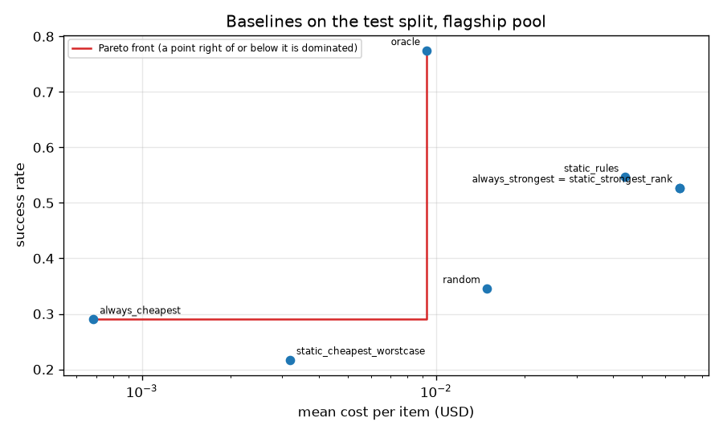

### Run [`20261028T004943Z-bec7b21`](../bench/results/baselines/20261028T004943Z-bec7b21/)

Status: also. Mixed pool (flagship plus four small models), sensitivity only. The small models' costs are fitted from their recorded costs.

Run facts: commit bec7b21, started 2026-10-28T00:49:43Z, AMD Ryzen 9 7900X 12-Core Processor (24 threads), 31.2 GB RAM, Windows-11-10.0.26300-SP0, go1.27.2. Command: `python bench/scripts/baselines.py --pool mixed`.

**Labels:** costs of the four small models are fitted from recorded costs and applied to their recorded token counts; flagship costs are recorded; no latency is measured or simulated in this experiment; Best Single, the cheapest model and the rules mapping are chosen on train+calib; this table is the test split, read once per policy; oracle looks at the recorded outcomes: an upper bound, not a policy.

Pool mixed, test split, 361 items. Best Single gpt-5, cheapest Llama-3.1-Nemotron-Nano-8B-v1. Intervals: percentile bootstrap over items, 1000 resamples, alpha 0.05, seed 0.

#### Quality and cost on the test split, against Best Single

| policy | n | success [CI] | mean cost USD [CI] | success vs Best Single, points [CI] | cost reduction vs Best Single [CI] |
|---|---|---|---|---|---|
| always_strongest | 361 | 83.7% [79.8%, 87.3%] | 0.04785 [0.04138, 0.05437] | 0.00 [0.00, 0.00] | 0.0% [0.0%, 0.0%] |
| always_cheapest | 361 | 28.5% [23.8%, 33.0%] | 0.0001053 [9.935e-05, 0.0001116] | -55.12 [-60.39, -49.58] | 99.8% [99.7%, 99.8%] |
| random | 361 | 65.1% [60.4%, 70.1%] | 0.02156 [0.01632, 0.02709] | -18.56 [-23.82, -13.57] | 54.9% [43.8%, 65.0%] |
| static_rules | 361 | 83.7% [79.8%, 87.3%] | 0.04785 [0.04138, 0.05437] | 0.00 [0.00, 0.00] | 0.0% [0.0%, 0.0%] |
| oracle | 361 | 94.7% [92.5%, 97.0%] | 0.007578 [0.004134, 0.01187] | +11.08 [+8.03, +14.68] | 84.2% [76.3%, 90.7%] |
| static_strongest_rank | 361 | 83.7% [79.8%, 87.3%] | 0.04785 [0.04138, 0.05437] | 0.00 [0.00, 0.00] | 0.0% [0.0%, 0.0%] |
| static_cheapest_worstcase | 361 | 28.5% [23.8%, 33.0%] | 0.0001053 [9.935e-05, 0.0001116] | -55.12 [-60.39, -49.58] | 99.8% [99.7%, 99.8%] |

#### Random policy over seeds

| quantity | mean | min | max |
|---|---|---|---|
| success_rate | 0.6515 | 0.6343 | 0.6731 |
| mean_cost_usd | 0.01509 | 0.01276 | 0.02156 |

#### Static rules mapping (chosen on train and calibration)

| rule | model |
|---|---|
| default | gpt-5 |
| code | gpt-5 |
| math | gpt-5 |
| choices | gpt-5 |
| long | gpt-5 |

Rules parity between the Python mapping and the Go router: 3182 items, 0 mismatches.

Pareto front of the baselines: always_cheapest, static_cheapest_worstcase, oracle.

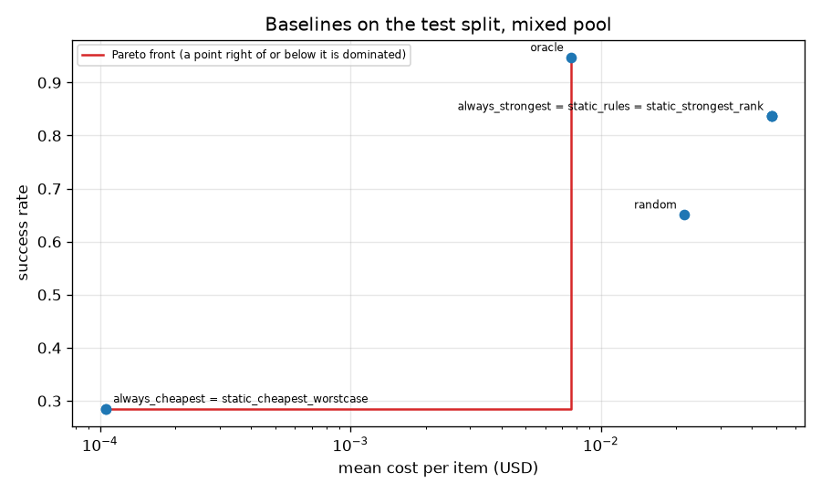

## Operating-point sweeps

### Run [`20261028T033434Z-5e4dbcc`](../bench/results/sweeps/20261028T033434Z-5e4dbcc/)

Run facts: commit 5e4dbcc, started 2026-10-28T03:34:34Z, AMD Ryzen 9 7900X 12-Core Processor (24 threads), 31.2 GB RAM, Windows-11-10.0.26300-SP0, go1.27.2. Command: `python bench/scripts/sweeps.py --pool flagship`.

**Labels:** costs are the recorded costs of each model on each item; no latency is measured or simulated in this experiment; operating points (the tuned lambda, the floor, the RouteLLM threshold) are chosen on the calibration split only; test curves are labeled: test, for reference; operating points chosen on calibration; the calibrators and lower-bound tables of the learned policy were fitted on the calibration split, so the learned policy's calibration success is in-sample and optimistic; the RouteLLM MF scorer is trained on the train split; its threshold is chosen on calibration; oracle looks at the recorded outcomes: an upper bound, not a policy.

Pool flagship, artifact `dea4486d7575`, Best Single gemini-2.5-pro. Operating points are chosen on the calibration split; the test split is read once per point. Intervals: percentile bootstrap over items, 1000 resamples, alpha 0.05, seed 0.

Lambda tuning: status tuned, lambda 6.72, calibration success 49.2% against 56.0% at lambda 0. Target on calibration: 49.1%.

#### Operating points on the test split

| policy | parameter | n | success [CI] | mean cost USD [CI] | success vs Best Single, points [CI] | cost reduction vs Best Single [CI] |
|---|---|---|---|---|---|---|
| Best Single (always) | none | 1735 | 52.7% [50.5%, 55.2%] | 0.06706 [0.06292, 0.07127] | 0.00 [0.00, 0.00] | 0.0% [0.0%, 0.0%] |
| learned dual | lambda = 6.72 | 1735 | 48.2% [46.0%, 50.6%] | 0.004337 [0.003778, 0.0049] | -4.55 [-6.97, -2.25] | 93.5% [92.6%, 94.4%] |
| learned min_cost | floor = 0.2 | 1735 | 49.7% [47.3%, 52.1%] | 0.021 [0.01839, 0.02338] | -3.00 [-5.36, -0.63] | 68.7% [65.7%, 72.2%] |
| RouteLLM MF baseline | threshold = 0.7547 | 1735 | 52.0% [49.7%, 54.6%] | 0.06526 [0.06112, 0.06944] | -0.69 [-1.21, -0.23] | 2.7% [2.0%, 3.5%] |

The full sweeps are in `results.json`: lambda (41 points), floor (20 points), threshold (41 points).

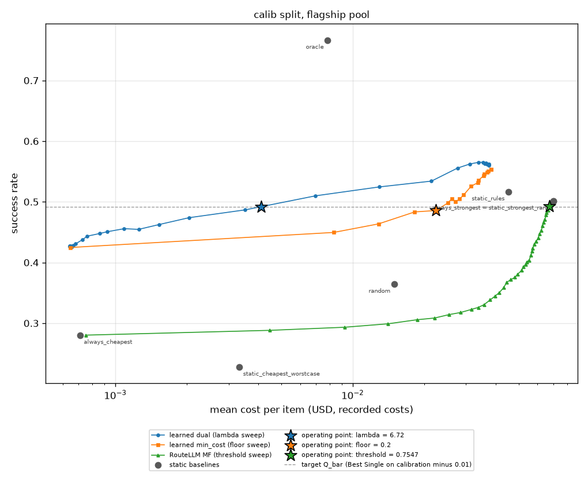

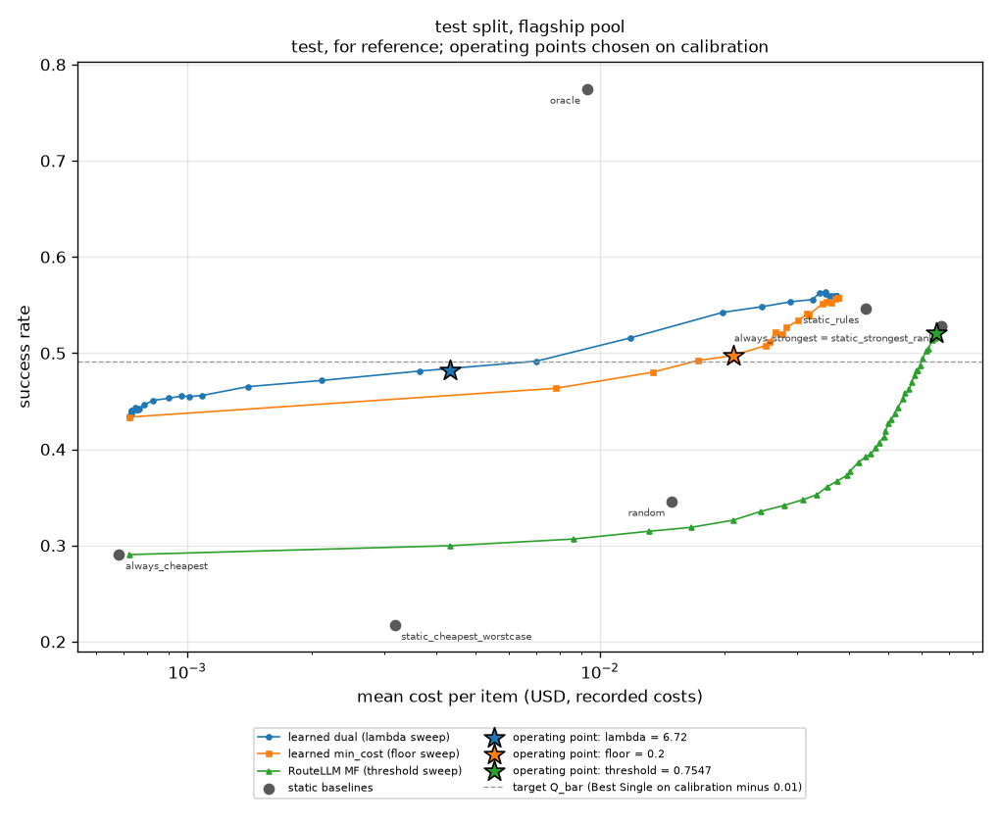

## Headline operating points and targets

### Run [`20261028T203202Z-028d6b4`](../bench/results/headline/20261028T203202Z-028d6b4/)

Status: current. Flagship pool.

Run facts: commit 028d6b4, started 2026-10-28T20:32:02Z, AMD Ryzen 9 7900X 12-Core Processor (24 threads), 31.2 GB RAM, Windows-11-10.0.26300-SP0, go1.27.2. Command: `python bench/scripts/headline.py --pool flagship`.

**Labels:** costs are the recorded costs of each model on each item; no latency is measured or simulated in this experiment; operating points (lambda, the floor, the RouteLLM threshold) are chosen on the calibration split only; the test split is read once per reported point; the calibrators and lower-bound tables of the learned policy were fitted on the calibration split, so the learned policy's calibration success is in-sample and optimistic; oracle looks at the recorded outcomes: an upper bound, not a policy; the lambda = 0 dual row is a reference, not an operating point; the cross-fitted row refits calibrators and lower-bound tables on half A of the calibration items and tunes lambda on half B; its artifact is temporary and not committed.

Pool flagship, artifact `dea4486d7575`. Calibration items 1773, test items 1735. Best Single gemini-2.5-pro, cheapest deepseek-v3-0324. Intervals: percentile bootstrap over items, 1000 resamples, alpha 0.05, seed 0.

Lambda of the dual mode (config): 6.72. It is chosen on the calibration split, where Best Single succeeds on 50.1% of the items; the calibration target is Best Single's calibration success minus a margin of 1 point, 49.1%. At lambda 0 the calibration success is 56.0%; at the tuned lambda it is 49.2%.

#### Operating points on the test split, against Best Single

| policy | parameter | n | success [CI] | mean cost USD [CI] | success vs Best Single, points [CI] | cost reduction vs Best Single [CI] | cost reduction >= 25% | success within 1 point | both targets |
|---|---|---|---|---|---|---|---|---|---|
| Best Single (always) | none | 1735 | 52.7% [50.5%, 55.2%] | 0.06706 [0.06292, 0.07127] | 0.00 [0.00, 0.00] | 0.0% [0.0%, 0.0%] | n/a | n/a | n/a |
| learned dual | lambda = 6.72 | 1735 | 48.2% [46.0%, 50.6%] | 0.004337 [0.003778, 0.0049] | -4.55 [-6.97, -2.25] | 93.5% [92.6%, 94.4%] | met | not met | not met |
| learned min_cost | floor = 0.2 | 1735 | 49.7% [47.3%, 52.1%] | 0.021 [0.01839, 0.02338] | -3.00 [-5.36, -0.63] | 68.7% [65.7%, 72.2%] | met | not met | not met |
| RouteLLM MF baseline | threshold = 0.7547 | 1735 | 52.0% [49.7%, 54.6%] | 0.06526 [0.06112, 0.06944] | -0.69 [-1.21, -0.23] | 2.7% [2.0%, 3.5%] | not met | met | not met |
| learned dual, lambda 0 (reference) | lambda = 0 | 1735 | 56.0% [53.7%, 58.3%] | 0.03737 [0.0343, 0.04045] | +3.23 [+1.10, +5.19] | 44.3% [40.7%, 47.7%] | reference | reference | reference |
| learned dual, cross-fitted lambda | lambda = 10.27 | 1735 | 47.7% [45.4%, 50.0%] | 0.001972 [0.001778, 0.002202] | -5.07 [-7.32, -2.94] | 97.1% [96.7%, 97.4%] | met | not met | not met |

#### Were the targets met? (the run's own statements)

- learned dual (spec operating point): cost reduction 93.5% (meets the 25% target), success -4.55 points against always_strongest (outside the 1 point target): targets NOT met.
- learned min_cost: cost reduction 68.7% (meets the 25% target), success -3.00 points against always_strongest (outside the 1 point target): targets NOT met.
- RouteLLM MF: cost reduction 2.7% (misses the 25% target), success -0.69 points against always_strongest (within the 1 point target): targets NOT met.
- learned dual, cross-fitted: cost reduction 97.1% (meets the 25% target), success -5.07 points against always_strongest (outside the 1 point target): targets NOT met.

#### Static baselines on the test split

| policy | n | success [CI] | mean cost USD [CI] | success vs Best Single, points [CI] | cost reduction vs Best Single [CI] |
|---|---|---|---|---|---|
| always_strongest | 1735 | 52.7% [50.5%, 55.2%] | 0.06706 [0.06292, 0.07127] | 0.00 [0.00, 0.00] | 0.0% [0.0%, 0.0%] |
| always_cheapest | 1735 | 29.0% [27.0%, 31.1%] | 0.0006826 [0.0006322, 0.000735] | -23.69 [-26.11, -21.38] | 99.0% [98.9%, 99.0%] |
| random | 1735 | 34.6% [32.1%, 36.7%] | 0.01492 [0.01311, 0.01694] | -18.16 [-20.64, -16.02] | 77.8% [75.0%, 80.4%] |
| static_rules | 1735 | 54.6% [52.4%, 56.9%] | 0.04397 [0.04073, 0.04718] | +1.90 [+0.69, +3.17] | 34.4% [30.9%, 38.0%] |
| oracle | 1735 | 77.5% [75.5%, 79.5%] | 0.009284 [0.007501, 0.01103] | +24.73 [+22.65, +26.74] | 86.2% [83.7%, 88.6%] |
| static_strongest_rank | 1735 | 52.7% [50.5%, 55.2%] | 0.06706 [0.06292, 0.07127] | 0.00 [0.00, 0.00] | 0.0% [0.0%, 0.0%] |
| static_cheapest_worstcase | 1735 | 21.7% [19.9%, 23.8%] | 0.003179 [0.003013, 0.003357] | -31.01 [-33.49, -28.65] | 95.3% [95.0%, 95.5%] |

#### Per dataset on the test split

| dataset | n | always strongest success | always strongest cost USD | learned dual success | learned dual cost USD | learned dual success delta | learned dual cost reduction | learned dual crossfit success | learned dual crossfit cost USD | learned dual crossfit success delta | learned dual crossfit cost reduction |
|---|---|---|---|---|---|---|---|---|---|---|---|
| aime | 14 | 0.7143 | 0.1751 | 0.6429 | 0.00795 | -0.07143 | 0.9546 | 0.7143 | 0.005892 | 0 | 0.9663 |
| arc-agi | 78 | 0.4615 | 0.1998 | 0.2564 | 0.003102 | -0.2051 | 0.9845 | 0.2692 | 0.002316 | -0.1923 | 0.9884 |
| arenahard_creative_writing | 51 | 0.9608 | 0.03208 | 0.9804 | 0.002294 | 0.01961 | 0.9285 | 0.9608 | 0.001358 | 0 | 0.9577 |
| arenahard_math | 58 | 0.7931 | 0.05522 | 0.7586 | 0.01113 | -0.03448 | 0.7985 | 0.8276 | 0.00462 | 0.03448 | 0.9163 |
| gpqa | 33 | 0.8182 | 0.1058 | 0.697 | 0.009196 | -0.1212 | 0.9131 | 0.6667 | 0.002972 | -0.1515 | 0.9719 |
| hle | 432 | 0.2153 | 0.1245 | 0.09028 | 0.005342 | -0.125 | 0.9571 | 0.08333 | 0.00219 | -0.1319 | 0.9824 |
| livecodebench | 205 | 0.8098 | 0.1371 | 0.7024 | 0.006819 | -0.1073 | 0.9503 | 0.7171 | 0.003057 | -0.09268 | 0.9777 |
| simpleqa | 864 | 0.5648 | 0.009356 | 0.5868 | 0.002778 | 0.02199 | 0.703 | 0.5718 | 0.001331 | 0.006944 | 0.8577 |

#### Cross-fitted sensitivity (calibration halves)

| setting | value |
|---|---|
| artifact version | 34094acf7297 |
| n a | 906 |
| n b | 867 |
| calibrator types | platt: 12 |
| best single b success | 0.4948 |
| target b | 0.4848 |
| success b at zero | 0.5536 |
| status | tuned |
| lambda | 10.27 |
| success b at lambda | 0.4856 |

#### Calibration quality of the shipped artifact on the test split

| scope | n | base rate | mean p | ece mass | ece width | brier | log loss |
|---|---|---|---|---|---|---|---|
| pooled | 20820 | 0.3622 | 0.3562 | 0.01604 | 0.0151 | 0.1726 | 0.529 |
| claude-sonnet-4 | 1735 | 0.2288 | 0.2158 | 0.03418 | 0.02891 | 0.1307 | 0.422 |
| deepseek-r1-0528 | 1735 | 0.3481 | 0.3405 | 0.0343 | 0.01905 | 0.1782 | 0.5363 |
| deepseek-v3-0324 | 1735 | 0.2905 | 0.2772 | 0.04664 | 0.02779 | 0.1537 | 0.461 |
| gemini-2.5-flash | 1735 | 0.3072 | 0.2999 | 0.03641 | 0.03522 | 0.1755 | 0.5539 |
| gemini-2.5-pro | 1735 | 0.5274 | 0.5036 | 0.04986 | 0.03778 | 0.207 | 0.6005 |
| glm-4.6 | 1735 | 0.3331 | 0.3209 | 0.04903 | 0.03507 | 0.1866 | 0.5681 |
| gpt-5 | 1735 | 0.5159 | 0.5148 | 0.05372 | 0.03997 | 0.2123 | 0.6154 |
| gpt-5-chat | 1735 | 0.3683 | 0.3692 | 0.03266 | 0.03846 | 0.1816 | 0.5455 |
| intern-s1 | 1735 | 0.2173 | 0.2267 | 0.02632 | 0.02322 | 0.1327 | 0.4369 |
| kimi-k2-0905 | 1735 | 0.3216 | 0.3178 | 0.03403 | 0.03212 | 0.1611 | 0.4971 |
| qwen3-235b-a22b-2507 | 1735 | 0.4594 | 0.4467 | 0.03185 | 0.02775 | 0.1793 | 0.5844 |
| qwen3-235b-a22b-thinking-2507 | 1735 | 0.4282 | 0.4419 | 0.04341 | 0.03956 | 0.1729 | 0.5263 |

Python against Go predictor: 1713 items compared, 22 skipped, largest absolute difference 5.607e-15.

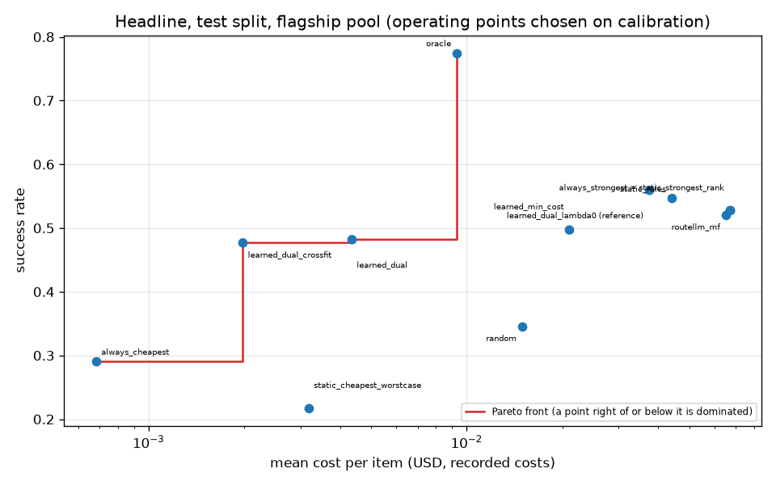

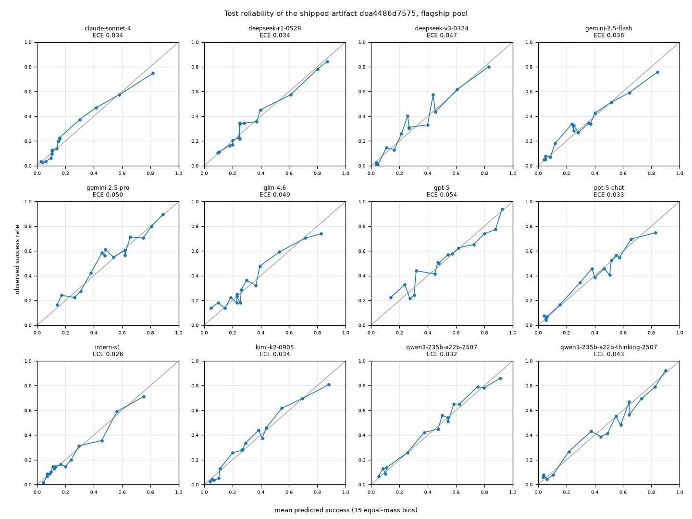

### Run [`20261028T203239Z-028d6b4`](../bench/results/headline/20261028T203239Z-028d6b4/)

Status: also. Mixed pool (flagship plus four small models), sensitivity only. The small models' costs are fitted from their recorded costs.

Run facts: commit 028d6b4, started 2026-10-28T20:32:39Z, AMD Ryzen 9 7900X 12-Core Processor (24 threads), 31.2 GB RAM, Windows-11-10.0.26300-SP0, go1.27.2. Command: `python bench/scripts/headline.py --pool mixed`.

**Labels:** sensitivity pool; the four small models' costs are fitted from their recorded costs and applied to their recorded token counts (7B costs fitted from recorded costs); flagship costs are recorded; no latency is measured or simulated in this experiment; operating points (lambda, the floor, the RouteLLM threshold) are chosen on the calibration split only; the test split is read once per reported point; the calibrators and lower-bound tables of the learned policy were fitted on the calibration split, so the learned policy's calibration success is in-sample and optimistic; oracle looks at the recorded outcomes: an upper bound, not a policy; the lambda = 0 dual row is a reference, not an operating point.

Pool mixed, artifact `15201d82e792`. Calibration items 382, test items 361. Best Single gpt-5, cheapest Llama-3.1-Nemotron-Nano-8B-v1. Intervals: percentile bootstrap over items, 1000 resamples, alpha 0.05, seed 0.

Lambda of the dual mode (tune): 0.7028. It is chosen on the calibration split, where Best Single succeeds on 86.6% of the items; the calibration target is Best Single's calibration success minus a margin of 1 point, 85.6%. At lambda 0 the calibration success is 86.6%; at the tuned lambda it is 85.9%.

#### Operating points on the test split, against Best Single

| policy | parameter | n | success [CI] | mean cost USD [CI] | success vs Best Single, points [CI] | cost reduction vs Best Single [CI] | cost reduction >= 25% | success within 1 point | both targets |
|---|---|---|---|---|---|---|---|---|---|
| Best Single (always) | none | 361 | 83.7% [79.8%, 87.3%] | 0.04785 [0.04138, 0.05437] | 0.00 [0.00, 0.00] | 0.0% [0.0%, 0.0%] | n/a | n/a | n/a |
| learned dual | lambda = 0.7028 | 361 | 83.7% [80.1%, 87.3%] | 0.0364 [0.03026, 0.0427] | 0.00 [-3.32, +3.05] | 23.9% [17.4%, 30.7%] | not met | met | not met |
| learned min_cost | floor = 0.8 | 361 | 80.3% [76.2%, 84.2%] | 0.03532 [0.02852, 0.04259] | -3.32 [-7.20, +0.84] | 26.2% [15.2%, 37.0%] | met | not met | not met |
| RouteLLM MF baseline | threshold = 0.4 | 361 | 83.4% [79.5%, 87.0%] | 0.04721 [0.04071, 0.05365] | -0.28 [-0.83, 0.00] | 1.3% [0.0%, 4.2%] | not met | met | not met |
| learned dual, lambda 0 (reference) | lambda = 0 | 361 | 85.0% [81.4%, 88.6%] | 0.04019 [0.03376, 0.04684] | +1.39 [-1.94, +4.16] | 16.0% [8.9%, 23.2%] | reference | reference | reference |

#### Were the targets met? (the run's own statements)

- learned dual (spec operating point): cost reduction 23.9% (misses the 25% target), success +0.00 points against always_strongest (within the 1 point target): targets NOT met.
- learned min_cost: cost reduction 26.2% (meets the 25% target), success -3.32 points against always_strongest (outside the 1 point target): targets NOT met.
- RouteLLM MF: cost reduction 1.3% (misses the 25% target), success -0.28 points against always_strongest (within the 1 point target): targets NOT met.

#### Static baselines on the test split

| policy | n | success [CI] | mean cost USD [CI] | success vs Best Single, points [CI] | cost reduction vs Best Single [CI] |
|---|---|---|---|---|---|
| always_strongest | 361 | 83.7% [79.8%, 87.3%] | 0.04785 [0.04138, 0.05437] | 0.00 [0.00, 0.00] | 0.0% [0.0%, 0.0%] |
| always_cheapest | 361 | 28.5% [23.8%, 33.0%] | 0.0001053 [9.935e-05, 0.0001116] | -55.12 [-60.39, -49.58] | 99.8% [99.7%, 99.8%] |
| random | 361 | 65.1% [60.4%, 70.1%] | 0.02156 [0.01632, 0.02709] | -18.56 [-23.82, -13.57] | 54.9% [43.8%, 65.0%] |
| static_rules | 361 | 83.7% [79.8%, 87.3%] | 0.04785 [0.04138, 0.05437] | 0.00 [0.00, 0.00] | 0.0% [0.0%, 0.0%] |
| oracle | 361 | 94.7% [92.5%, 97.0%] | 0.007578 [0.004134, 0.01187] | +11.08 [+8.03, +14.68] | 84.2% [76.3%, 90.7%] |
| static_strongest_rank | 361 | 83.7% [79.8%, 87.3%] | 0.04785 [0.04138, 0.05437] | 0.00 [0.00, 0.00] | 0.0% [0.0%, 0.0%] |
| static_cheapest_worstcase | 361 | 28.5% [23.8%, 33.0%] | 0.0001053 [9.935e-05, 0.0001116] | -55.12 [-60.39, -49.58] | 99.8% [99.7%, 99.8%] |

#### Per dataset on the test split

| dataset | n | always strongest success | always strongest cost USD | learned dual success | learned dual cost USD | learned dual success delta | learned dual cost reduction |
|---|---|---|---|---|---|---|---|
| aime | 14 | 0.6429 | 0.1203 | 0.6429 | 0.07833 | 0 | 0.349 |
| arenahard_creative_writing | 51 | 0.9412 | 0.0328 | 0.9608 | 0.003808 | 0.01961 | 0.8839 |
| arenahard_math | 58 | 0.6379 | 0.03915 | 0.6552 | 0.01424 | 0.01724 | 0.6362 |
| gpqa | 33 | 0.7576 | 0.04637 | 0.7273 | 0.04129 | -0.0303 | 0.1095 |
| livecodebench | 205 | 0.8927 | 0.04935 | 0.8878 | 0.04712 | -0.004878 | 0.04504 |

#### Calibration quality of the shipped artifact on the test split

| scope | n | base rate | mean p | ece mass | ece width | brier | log loss |
|---|---|---|---|---|---|---|---|
| pooled | 5776 | 0.6562 | 0.6582 | 0.01433 | 0.01782 | 0.1788 | 0.536 |
| DeepSeek-R1-0528-Qwen3-8B | 361 | 0.5623 | 0.5274 | 0.07336 | 0.05925 | 0.2207 | 0.631 |
| Llama-3.1-Nemotron-Nano-8B-v1 | 361 | 0.2853 | 0.3304 | 0.0696 | 0.06052 | 0.1379 | 0.4203 |
| NVIDIA-Nemotron-Nano-9B-v2 | 361 | 0.4848 | 0.4906 | 0.06455 | 0.0548 | 0.1925 | 0.5659 |
| Qwen3-8B | 361 | 0.5679 | 0.5616 | 0.06592 | 0.05857 | 0.2064 | 0.6012 |
| claude-sonnet-4 | 361 | 0.6177 | 0.6044 | 0.06153 | 0.07193 | 0.2101 | 0.6112 |
| deepseek-r1-0528 | 361 | 0.7479 | 0.784 | 0.06715 | 0.04745 | 0.161 | 0.4932 |
| deepseek-v3-0324 | 361 | 0.6731 | 0.6612 | 0.04284 | 0.02962 | 0.2021 | 0.5913 |
| gemini-2.5-flash | 361 | 0.626 | 0.673 | 0.09663 | 0.06475 | 0.2135 | 0.6174 |
| gemini-2.5-pro | 361 | 0.8255 | 0.8132 | 0.05383 | 0.05655 | 0.1425 | 0.4574 |
| glm-4.6 | 361 | 0.6981 | 0.7018 | 0.07608 | 0.0417 | 0.1933 | 0.5718 |
| gpt-5 | 361 | 0.8366 | 0.8661 | 0.05087 | 0.04233 | 0.1344 | 0.4333 |
| gpt-5-chat | 361 | 0.7064 | 0.6829 | 0.0652 | 0.04826 | 0.1885 | 0.5596 |
| intern-s1 | 361 | 0.5789 | 0.6147 | 0.07226 | 0.05674 | 0.1975 | 0.5837 |
| kimi-k2-0905 | 361 | 0.7452 | 0.7177 | 0.08385 | 0.06992 | 0.1657 | 0.5042 |
| qwen3-235b-a22b-2507 | 361 | 0.7258 | 0.6958 | 0.08436 | 0.07152 | 0.1608 | 0.4996 |
| qwen3-235b-a22b-thinking-2507 | 361 | 0.8172 | 0.8067 | 0.05768 | 0.0349 | 0.1334 | 0.4355 |

Python against Go predictor: 361 items compared, 0 skipped, largest absolute difference 3.331e-16.

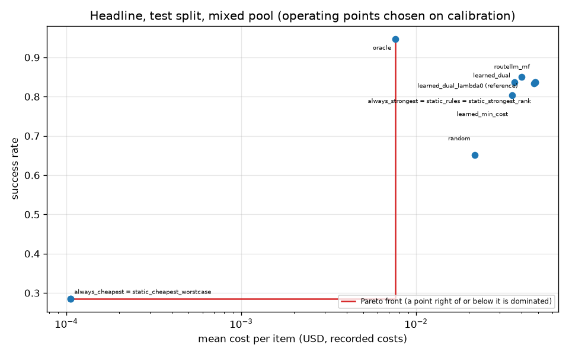

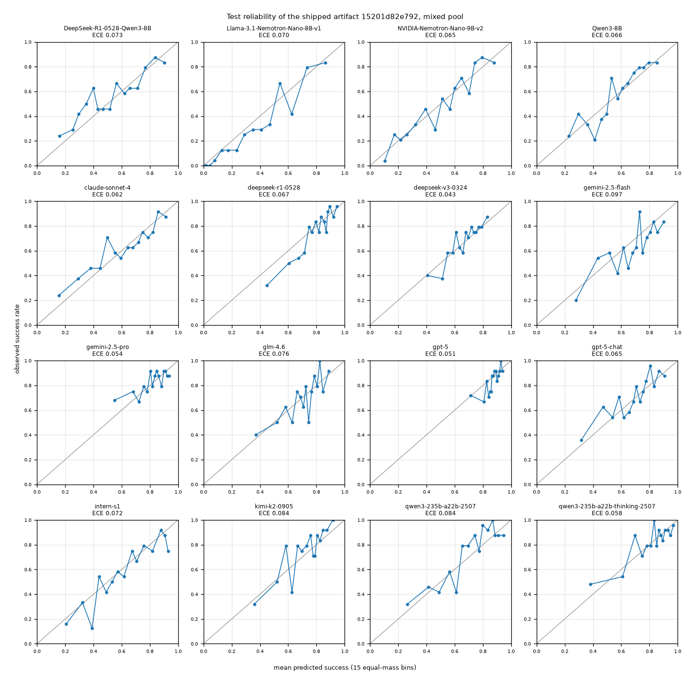

## Calibration study

### Run [`20261028T203251Z-028d6b4`](../bench/results/calibration/20261028T203251Z-028d6b4/)

Run facts: commit 028d6b4, started 2026-10-28T20:32:51Z, AMD Ryzen 9 7900X 12-Core Processor (24 threads), 31.2 GB RAM, Windows-11-10.0.26300-SP0, go1.27.2. Command: `python bench/scripts/calibration_study.py --pool flagship`.

**Labels:** no latency, price or cost is involved in this experiment; the quality weights are those of the shipped artifact; raw scores are recomputed in Python from its float32 weights; test ECE uses 15 equal-mass bins; every configuration is reported and none is chosen from the test numbers; histogram binning is an experiment only and is never exported; calibration items are subsampled without replacement; the 'all' rows use the whole calibration split for every seed, so their spread is zero.

Pool flagship, artifact `dea4486d7575`. Methods platt, isotonic, histogram, switch, 20 seeds per size, 15 ECE bins, isotonic from 1000 samples in the `switch` rule.

#### Pooled test ECE by calibration size (mean +/- std over seeds)

| calibration items | platt | isotonic | histogram | switch |
|---|---|---|---|---|
| 50 | 0.0384 +/- 0.0175 | 0.0768 +/- 0.0184 | 0.1455 +/- 0.0130 | 0.0384 +/- 0.0175 |
| 100 | 0.0297 +/- 0.0097 | 0.0606 +/- 0.0115 | 0.0822 +/- 0.0090 | 0.0297 +/- 0.0097 |
| 200 | 0.0244 +/- 0.0095 | 0.0425 +/- 0.0085 | 0.0498 +/- 0.0077 | 0.0244 +/- 0.0095 |
| 500 | 0.0165 +/- 0.0056 | 0.0259 +/- 0.0063 | 0.0259 +/- 0.0058 | 0.0165 +/- 0.0056 |
| 1000 | 0.0123 +/- 0.0021 | 0.0204 +/- 0.0037 | 0.0184 +/- 0.0027 | 0.0204 +/- 0.0037 |
| all | 0.0115 +/- 0.0000 | 0.0160 +/- 0.0000 | 0.0129 +/- 0.0000 | 0.0160 +/- 0.0000 |

Size 2000 skipped: 2000 is not below the 1773 calibration items; 'all' is the full split.

The shipped artifact (calibrators: isotonic) has pooled test ECE 0.0160.

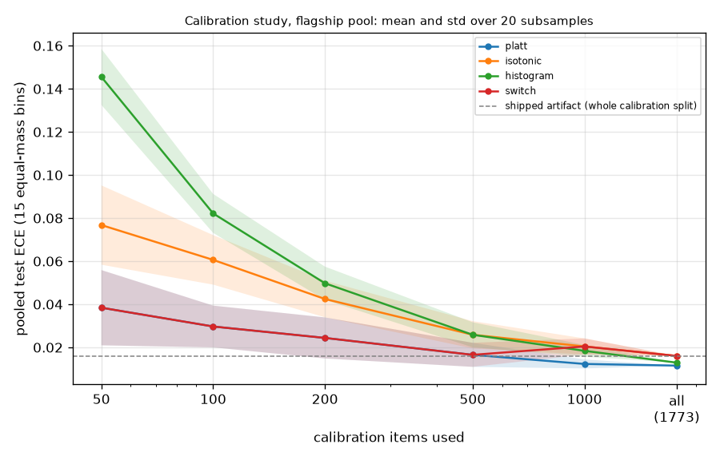

## Lower confidence bound against point estimate

### Run [`20261028T203321Z-028d6b4`](../bench/results/lcb_vs_point/20261028T203321Z-028d6b4/)

Run facts: commit 028d6b4, started 2026-10-28T20:33:21Z, AMD Ryzen 9 7900X 12-Core Processor (24 threads), 31.2 GB RAM, Windows-11-10.0.26300-SP0, go1.27.2. Command: `python bench/scripts/lcb_vs_point.py --pool flagship`.

**Labels:** no latency is measured or simulated in this experiment; costs are the recorded costs of each model on each item; the floors are fixed in advance and nothing is chosen from these results; a decision whose floor the router relaxed made no promise and is left out of the realized success; the calibration rows are in-sample for the calibrators and lower-bound tables, so only the test rows are evidence of compliance; the point arm is an experiment switch (--floor-on point); the gateway always compares the lower confidence bound.

Pool flagship, artifact `dea4486d7575`, arms: lcb, point. Policy versions: lcb `dea4486d7575+de8069d4`, point `dea4486d7575+de8069d4+floor-point`. A floor is met when the realized success among the requests whose floor was not relaxed is at least the floor.

#### Floor compliance and cost per floor, test split

| floor | LCB realized success | LCB met | LCB relaxed share | LCB mean cost USD | point realized success | point met | point relaxed share | point mean cost USD |
|---|---|---|---|---|---|---|---|---|
| 0.05 | 46.3% | met | 0.0% | 0.007817 | 44.3% | met | 0.1% | 0.001106 |
| 0.10 | 48.0% | met | 0.0% | 0.01341 | 46.3% | met | 1.2% | 0.006419 |
| 0.15 | 51.2% | met | 6.3% | 0.01723 | 47.4% | met | 1.2% | 0.01265 |
| 0.20 | 54.1% | met | 14.1% | 0.021 | 48.6% | met | 2.3% | 0.01376 |
| 0.25 | 59.4% | met | 23.4% | 0.02516 | 51.5% | met | 8.2% | 0.01785 |
| 0.30 | 60.5% | met | 24.5% | 0.0258 | 54.8% | met | 14.6% | 0.02246 |
| 0.35 | 62.7% | met | 26.8% | 0.02655 | 58.8% | met | 23.0% | 0.02452 |
| 0.40 | 63.4% | met | 37.0% | 0.02762 | 60.5% | met | 25.1% | 0.02569 |
| 0.45 | 67.6% | met | 47.6% | 0.02826 | 62.0% | met | 26.5% | 0.02636 |
| 0.50 | 71.3% | met | 59.4% | 0.03016 | 65.2% | met | 36.3% | 0.02753 |
| 0.55 | 75.0% | met | 69.5% | 0.03175 | 67.2% | met | 43.4% | 0.02897 |
| 0.60 | 74.6% | met | 69.6% | 0.03197 | 69.3% | met | 50.4% | 0.02973 |

Floors met: lcb 12 of 12; point 12 of 12.

#### Floor compliance and cost per floor, calib split (in-sample, for reference)

| floor | LCB realized success | LCB met | LCB relaxed share | LCB mean cost USD | point realized success | point met | point relaxed share | point mean cost USD |
|---|---|---|---|---|---|---|---|---|
| 0.05 | 45.0% | met | 0.0% | 0.008304 | 43.4% | met | 0.0% | 0.001004 |
| 0.10 | 46.4% | met | 0.0% | 0.01284 | 45.2% | met | 0.9% | 0.007627 |
| 0.15 | 50.4% | met | 6.1% | 0.01825 | 46.8% | met | 1.0% | 0.01329 |
| 0.20 | 52.8% | met | 13.9% | 0.0224 | 47.6% | met | 2.1% | 0.01363 |
| 0.25 | 57.0% | met | 22.7% | 0.02513 | 51.2% | met | 8.5% | 0.01918 |
| 0.30 | 58.4% | met | 24.2% | 0.02611 | 53.5% | met | 14.4% | 0.02397 |
| 0.35 | 58.5% | met | 27.0% | 0.02712 | 56.3% | met | 22.6% | 0.0249 |
| 0.40 | 62.2% | met | 36.7% | 0.02821 | 58.3% | met | 25.0% | 0.0259 |
| 0.45 | 66.5% | met | 47.5% | 0.02936 | 59.1% | met | 26.3% | 0.02678 |
| 0.50 | 71.5% | met | 59.2% | 0.03153 | 63.4% | met | 36.4% | 0.02816 |
| 0.55 | 75.9% | met | 70.1% | 0.03374 | 66.0% | met | 44.3% | 0.02973 |
| 0.60 | 77.0% | met | 70.1% | 0.03386 | 69.0% | met | 51.0% | 0.03106 |

Floors met: lcb 12 of 12; point 12 of 12.

#### Test split: realized success per decile of L, pooled over the floors

| decile | n | LCB mean L | LCB realized success | point mean L | point realized success |
|---|---|---|---|---|---|
| 1 | 1426 | 0.135 | 19.7% | 0.082 | 14.2% |
| 2 | 1426 | 0.250 | 37.9% | 0.197 | 28.4% |
| 3 | 1426 | 0.342 | 47.5% | 0.297 | 44.0% |
| 4 | 1426 | 0.396 | 54.7% | 0.373 | 52.2% |
| 5 | 1426 | 0.424 | 60.0% | 0.396 | 54.8% |
| 6 | 1425 | 0.484 | 62.9% | 0.437 | 63.4% |
| 7 | 1426 | 0.515 | 63.8% | 0.488 | 63.8% |
| 8 | 1426 | 0.546 | 72.1% | 0.526 | 65.4% |
| 9 | 1426 | 0.679 | 79.4% | 0.579 | 75.2% |
| 10 | 1426 | 0.784 | 80.8% | 0.772 | 84.6% |

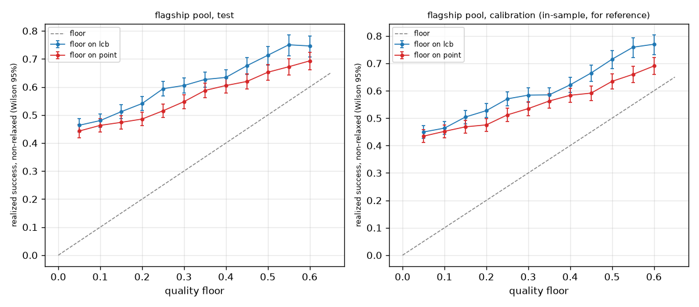

## Distribution shift and out-of-distribution detection

### Run [`20261028T210636Z-86f6519`](../bench/results/shift_ood/20261028T210636Z-86f6519/)

Run facts: commit 86f6519, started 2026-10-28T21:06:36Z, AMD Ryzen 9 7900X 12-Core Processor (24 threads), 31.2 GB RAM, Windows-11-10.0.26300-SP0, go1.27.2. Command: `python bench/scripts/shift_ood.py --pool flagship`.

**Labels:** held-out datasets were fixed before training (Task 3) and appear only in the shift and OOD experiments; the OOD threshold comes from calibration; no latency is measured or simulated in this experiment; costs are the recorded costs of each model on each item; shipped is the policy config's OOD action (conservative); off makes the optimizer ignore the OOD verdict, an experiment switch (--ood off) the gateway never uses; the OOD verdict and score are request-level and computed by the artifact, so they are the same in every arm; the off arm computes them and does not act on them; the test split is replayed once, only for its OOD scores (the negatives of the AUROC); floor compliance counts only the decisions whose floor was not relaxed (Ruling V1-R5).

Pool flagship, artifact `dea4486d7575`. Held-out datasets arenahard_coding (253 items), livemathbench (121 items), mmlupro (3000 items); 3374 held-out items against 1735 test items. Floor 0.3, lambda 6.72, OOD action `conservative`. Intervals: percentile bootstrap over items, 1000 resamples, alpha 0.05, seed 0.

#### Held-out split: each arm against Best Single (paired on the same items)

| policy | n | success [CI] | mean cost USD [CI] | success vs Best Single, points [CI] | cost reduction vs Best Single [CI] | OOD flag rate | relaxed share |
|---|---|---|---|---|---|---|---|
| always_strongest (gemini-2.5-pro) | 3374 | 84.5% [83.2%, 85.6%] | 0.04168 [0.0403, 0.04307] | 0.00 [0.00, 0.00] | 0.0% [0.0%, 0.0%] | n/a | n/a |
| dual/shipped | 3374 | 83.1% [81.8%, 84.4%] | 0.006225 [0.005796, 0.006744] | -1.36 [-2.52, -0.18] | 85.1% [83.9%, 86.0%] | 0.06% | 0.00% |
| dual/off | 3374 | 83.1% [81.8%, 84.4%] | 0.006221 [0.005793, 0.006739] | -1.36 [-2.52, -0.18] | 85.1% [84.0%, 86.0%] | 0.06% | 0.00% |
| min_cost/shipped | 3374 | 81.4% [80.0%, 82.7%] | 0.0009448 [0.0008242, 0.001088] | -3.05 [-4.36, -1.75] | 97.7% [97.4%, 98.0%] | 0.06% | 0.59% |
| min_cost/off | 3374 | 81.4% [80.0%, 82.7%] | 0.0009443 [0.0008237, 0.001088] | -3.05 [-4.36, -1.75] | 97.7% [97.4%, 98.0%] | 0.06% | 0.59% |

#### OOD action effect (shipped against off, paired on the same held-out items)

| mode | n | success change, points [CI] | cost reduction change [CI] | items changed |
|---|---|---|---|---|
| dual | 3374 | 0.00 [0.00, 0.00] | -0.07% [-0.22%, 0.00%] | 1 |
| min_cost | 3374 | 0.00 [0.00, 0.00] | -0.05% [-0.14%, 0.00%] | 2 |

#### OOD detection: held-out items as positives, test items as negatives

| quantity | value |
|---|---|
| AUROC [CI] | 0.5572 [0.539, 0.5768] |
| positives (held-out) / negatives (test) | 3374 / 1735 |
| threshold (from calibration) | 0.9593 |
| flag rate on test | 1.27% |
| flag rate on held-out | 0.06% |
| score on test (mean / median / p05 / p95) | 0.4746 / 0.4641 / 0.1661 / 0.7821 |
| score on held-out (mean / median / p05 / p95) | 0.5031 / 0.4873 / 0.3749 / 0.7197 |

#### OOD detection per held-out dataset

| dataset | n | AUROC [CI] | flag rate |
|---|---|---|---|
| arenahard_coding | 253 | 0.9192 [0.9076, 0.9304] | 0.79% |
| livemathbench | 121 | 0.4373 [0.4119, 0.4635] | 0.00% |
| mmlupro | 3000 | 0.5315 [0.513, 0.5523] | 0.00% |

#### Per held-out dataset: each arm against Best Single

| dataset | arm | n | success rate | mean cost usd | ood flag rate | success delta vs strongest | success delta ci | cost reduction vs strongest |
|---|---|---|---|---|---|---|---|---|
| arenahard_coding | always_strongest | 253 | 0.8656 | 0.04937 | n/a | n/a | n/a | n/a |
| arenahard_coding | dual/shipped | 253 | 0.8182 | 0.005687 | 0.007905 | -0.04743 | [-0.1028, 0.01976] | 0.8848 |
| arenahard_coding | dual/off | 253 | 0.8182 | 0.005631 | 0.007905 | -0.04743 | [-0.1028, 0.01976] | 0.886 |
| arenahard_coding | min_cost/shipped | 253 | 0.7945 | 0.003285 | 0.007905 | -0.07115 | [-0.1344, -0.007905] | 0.9335 |
| arenahard_coding | min_cost/off | 253 | 0.7945 | 0.003278 | 0.007905 | -0.07115 | [-0.1344, -0.007905] | 0.9336 |
| livemathbench | always_strongest | 121 | 0.5041 | 0.09056 | n/a | n/a | n/a | n/a |
| livemathbench | dual/shipped | 121 | 0.7603 | 0.008775 | 0 | 0.2562 | [0.1653, 0.3388] | 0.9031 |
| livemathbench | dual/off | 121 | 0.7603 | 0.008775 | 0 | 0.2562 | [0.1653, 0.3388] | 0.9031 |
| livemathbench | min_cost/shipped | 121 | 0.6777 | 0.001555 | 0 | 0.1736 | [0.08264, 0.2562] | 0.9828 |
| livemathbench | min_cost/off | 121 | 0.6777 | 0.001555 | 0 | 0.1736 | [0.08264, 0.2562] | 0.9828 |
| mmlupro | always_strongest | 3000 | 0.8567 | 0.03906 | n/a | n/a | n/a | n/a |
| mmlupro | dual/shipped | 3000 | 0.835 | 0.006168 | 0 | -0.02167 | [-0.03401, -0.009667] | 0.8421 |
| mmlupro | dual/off | 3000 | 0.835 | 0.006168 | 0 | -0.02167 | [-0.03401, -0.009667] | 0.8421 |
| mmlupro | min_cost/shipped | 3000 | 0.8213 | 0.0007228 | 0 | -0.03533 | [-0.047, -0.02332] | 0.9815 |
| mmlupro | min_cost/off | 3000 | 0.8213 | 0.0007228 | 0 | -0.03533 | [-0.047, -0.02332] | 0.9815 |

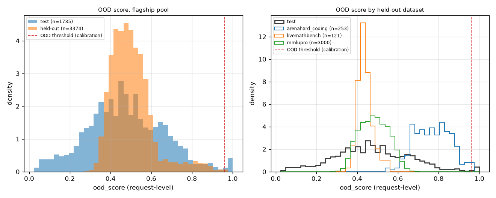

## Off-policy evaluation validation

### Run [`20261028T210706Z-86f6519`](../bench/results/ope_validation/20261028T210706Z-86f6519/)

Run facts: commit 86f6519, started 2026-10-28T21:07:06Z, AMD Ryzen 9 7900X 12-Core Processor (24 threads), 31.2 GB RAM, Windows-11-10.0.26300-SP0, go1.27.2. Command: `python bench/scripts/ope_validation.py --pool flagship`.

**Labels:** no latency is measured or simulated in this experiment; costs are the recorded costs of each model on each item; the true value of a target policy is its own deterministic full-information replay on the same test items the estimators see (success rate and mean recorded cost); each interval is a 95% percentile bootstrap with 500 bootstrap resamples of the items, seeded by the logging seed; the SNIPS interval resamples the weighted ratio; the logging seed changes only the exploration draws: the test items are fixed, so the spread across seeds is exploration noise while each interval also resamples the items and is wider than that spread; coverage is measured against the in-sample true value; Ruling V1-R36: the learned target is min_cost at floor 0.3; the plan's 0.8 relaxes nearly every flagship decision to quality; support coverage is the share of items where the target's action had positive logging propensity; epsilon exploration covers only the safe set and a decision that relaxed a constraint does not explore, so IPS cannot estimate an action outside it; DR uses one outcome model, the logging policy's own predictions (Ruling V1-R32), so its bias includes that model's calibration error.

Pool flagship, artifact `dea4486d7575`, test split, 1735 items. The logging policy is the dual mode at lambda 6.72 with exploration epsilon 0.1, replayed with 50 logging seeds. The learned target is min_cost at floor 0.3. Bootstrap intervals: 500 resamples, alpha 0.05.

#### Targets: true value, support and importance weights

| target | true success | true cost USD | effective sample size mean [min, max] | matched items mean [min, max] | items used (min) | items excluded | support share |
|---|---|---|---|---|---|---|---|
| always_strongest | 0.5274 | 0.06706 | 15.85 [6.558, 28.28] | 140.5 [127, 152] | 1735 | 0 | 100.0% |
| always_cheapest | 0.2905 | 0.0006826 | 15.17 [8.138, 25.15] | 74.88 [66, 86] | 1735 | 0 | 100.0% |
| static_rules | 0.5464 | 0.04397 | 15.95 [8.018, 22.91] | 163.1 [151, 174] | 1735 | 0 | 100.0% |
| learned_min_cost | 0.5118 | 0.0258 | 25.3 [22.68, 29.67] | 651.2 [629, 665] | 1735 | 0 | 100.0% |

#### Success: bias, RMSE and CI coverage over the logging seeds

| target | estimator | mean estimate | bias | RMSE | CI coverage | mean CI width |
|---|---|---|---|---|---|---|
| always_strongest | ips | 0.4983 | -0.02908 | 0.1534 | 0.94 | 0.661 |
| always_strongest | snips | 0.5005 | -0.02685 | 0.1167 | 0.94 | 0.5007 |
| always_strongest | dr | 0.4949 | -0.03247 | 0.1056 | 0.96 | 0.4433 |
| always_cheapest | ips | 0.2887 | -0.001764 | 0.1317 | 0.90 | 0.5059 |
| always_cheapest | snips | 0.2874 | -0.003063 | 0.1101 | 0.94 | 0.4539 |
| always_cheapest | dr | 0.2955 | 0.004962 | 0.09465 | 0.94 | 0.4048 |
| static_rules | ips | 0.5193 | -0.02713 | 0.1539 | 0.90 | 0.6898 |
| static_rules | snips | 0.5239 | -0.02246 | 0.1196 | 0.94 | 0.4878 |
| static_rules | dr | 0.5233 | -0.0231 | 0.1055 | 0.96 | 0.441 |
| learned_min_cost | ips | 0.5661 | 0.05425 | 0.1749 | 0.84 | 0.5356 |
| learned_min_cost | snips | 0.525 | 0.01317 | 0.1139 | 0.88 | 0.3563 |
| learned_min_cost | dr | 0.5512 | 0.03937 | 0.1221 | 0.86 | 0.3883 |

#### Cost (USD per item): bias, RMSE and CI coverage over the logging seeds

| target | estimator | mean estimate | bias | RMSE | CI coverage | mean CI width |
|---|---|---|---|---|---|---|
| always_strongest | ips | 0.06644 | -0.0006195 | 0.0296 | 0.86 | 0.1057 |
| always_strongest | snips | 0.06675 | -0.0003173 | 0.02733 | 0.92 | 0.08768 |
| always_strongest | dr | 0.06416 | -0.002908 | 0.0162 | 0.88 | 0.06329 |
| always_cheapest | ips | 0.0005899 | -9.263e-05 | 0.0002665 | 0.82 | 0.0009368 |
| always_cheapest | snips | 0.0005933 | -8.924e-05 | 0.0002445 | 0.78 | 0.0007951 |
| always_cheapest | dr | 0.0006293 | -5.326e-05 | 0.0001785 | 0.70 | 0.0005225 |
| static_rules | ips | 0.04087 | -0.003103 | 0.02103 | 0.78 | 0.06689 |
| static_rules | snips | 0.04043 | -0.003536 | 0.01804 | 0.76 | 0.05593 |
| static_rules | dr | 0.03974 | -0.004228 | 0.01642 | 0.88 | 0.04816 |
| learned_min_cost | ips | 0.0273 | 0.001499 | 0.01705 | 0.88 | 0.05766 |
| learned_min_cost | snips | 0.02459 | -0.00121 | 0.01391 | 0.86 | 0.04561 |
| learned_min_cost | dr | 0.02238 | -0.003423 | 0.01408 | 0.92 | 0.0455 |

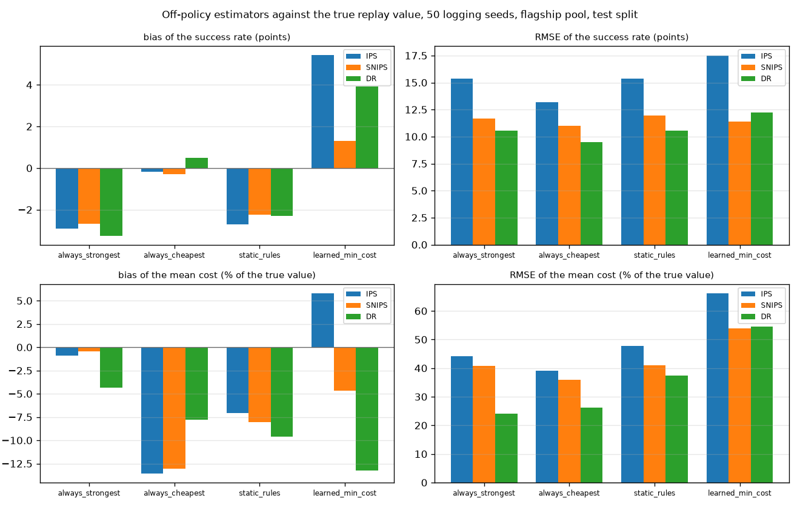

## Contextual bandits

### Run [`20261028T223648Z-1dadba6`](../bench/results/bandits/20261028T223648Z-1dadba6/)

Run facts: commit 1dadba6, started 2026-10-28T22:36:48Z, AMD Ryzen 9 7900X 12-Core Processor (24 threads), 31.2 GB RAM, Windows-11-10.0.26300-SP0, go1.27.2. Command: `python bench/scripts/bandits.py --pool flagship`.

**Labels:** costs are the recorded costs of each model on each item; no latency is measured or simulated in this experiment; reward = success - lambda * cost_usd with lambda = 6.719579687342048 per USD, the supervised policy's own lambda from the policy config; the bandits see only the reward of the arm they play, while the supervised policy was fitted on the train split with the outcomes of all models on every item; alpha and v are chosen on the calibration split (warm-up on train, random order, seed 0); the test split is read after, once per learner, order and seed; the supervised policy's calibrators were fitted on the calibration split, and its lambda was tuned there, before the test split was replayed; oracle by reward looks at the recorded outcomes: an upper bound, not a policy; the best single arm is an extra reference chosen on train and calibration rewards.

Pool flagship, artifact `dea4486d7575`, lambda 6.72, 10 seeds. Each bandit sees one reward per item (success minus lambda times cost) on a stream of the test split; the supervised policy was trained on full information. Context: 141 numbers (128 SVD components explaining 40.4% of the variance, 12 dense features).

#### Hyperparameter choice (warm-up on train, evaluation on calibration)

| learner | parameter | grid | chosen |
|---|---|---|---|
| linucb | alpha | 0.1, 0.5, 1, 2 | 0.1 |
| linear_ts | v | 0.05, 0.1, 0.5, 1 | 0.05 |

#### Test split, random order: mean reward per item (seed mean [min, max])

| policy | mean reward | success | mean cost USD | cumulative regret | paired difference to supervised [CI] | seeds above supervised |
|---|---|---|---|---|---|---|
| LinUCB (alpha = 0.1) | 0.4401 [0.4253, 0.4586] | 46.8% [44.8%, 48.4%] | 0.00418 [0.002891, 0.00529] | 493.3 [461.2, 519.0] | -0.0126 [-0.02521, 0.000353] | 2 of 10 |
| LinearTS (v = 0.05) | 0.4295 [0.3717, 0.4627] | 46.2% [41.3%, 49.7%] | 0.004785 [0.003878, 0.006096] | 511.7 [454.1, 611.9] | -0.02324 [-0.03607, -0.01057] | 2 of 10 |
| supervised | 0.4527 | 48.2% | 0.004337 | 471.4 | reference | n/a |
| always_strongest | 0.07673 | 52.7% | 0.06706 | 1123.7 | reference | n/a |
| best_constant | 0.4537 | 45.9% | 0.0008446 | 469.7 | reference | n/a |
| oracle | 0.7244 | 75.2% | 0.004047 | 0.0 | reference | n/a |

#### Test split, shift order: mean reward per item (seed mean [min, max])

| policy | mean reward | success | mean cost USD | cumulative regret | paired difference to supervised [CI] | seeds above supervised |
|---|---|---|---|---|---|---|
| LinUCB (alpha = 0.1) | 0.441 [0.4238, 0.4585] | 47.0% [44.4%, 48.5%] | 0.004299 [0.003058, 0.005331] | 491.7 [461.3, 521.5] | -0.01173 [-0.02482, 0.001083] | 2 of 10 |
| LinearTS (v = 0.05) | 0.4286 [0.3678, 0.4629] | 46.1% [40.9%, 49.0%] | 0.004769 [0.003974, 0.00608] | 513.2 [453.6, 618.7] | -0.02411 [-0.03697, -0.0115] | 2 of 10 |
| supervised | 0.4527 | 48.2% | 0.004337 | 471.4 | reference | n/a |
| always_strongest | 0.07673 | 52.7% | 0.06706 | 1123.7 | reference | n/a |
| best_constant | 0.4537 | 45.9% | 0.0008446 | 469.7 | reference | n/a |
| oracle | 0.7244 | 75.2% | 0.004047 | 0.0 | reference | n/a |

#### The run's own statements against the supervised policy

- LinUCB (alpha = 0.1), random order: does NOT consistently beat the supervised learned policy (mean reward per item 0.4401, seeds 0.4253 to 0.4586, against 0.4527; above it on 2 of 10 seeds; paired difference -0.0126 [-0.0252, +0.0004]).
- LinUCB (alpha = 0.1), shift order: does NOT consistently beat the supervised learned policy (mean reward per item 0.4410, seeds 0.4238 to 0.4585, against 0.4527; above it on 2 of 10 seeds; paired difference -0.0117 [-0.0248, +0.0011]).
- LinearTS (v = 0.05), random order: does NOT consistently beat the supervised learned policy (mean reward per item 0.4295, seeds 0.3717 to 0.4627, against 0.4527; above it on 2 of 10 seeds; paired difference -0.0232 [-0.0361, -0.0106]).
- LinearTS (v = 0.05), shift order: does NOT consistently beat the supervised learned policy (mean reward per item 0.4286, seeds 0.3678 to 0.4629, against 0.4527; above it on 2 of 10 seeds; paired difference -0.0241 [-0.0370, -0.0115]).

#### The run's own statements against the best single arm by reward

- LinUCB (alpha = 0.1), random order: does NOT consistently beat the best single arm by reward (extra reference) (mean reward per item 0.4401, seeds 0.4253 to 0.4586, against 0.4537; above it on 1 of 10 seeds; paired difference -0.0136 [-0.0253, -0.0015]).
- LinUCB (alpha = 0.1), shift order: does NOT consistently beat the best single arm by reward (extra reference) (mean reward per item 0.4410, seeds 0.4238 to 0.4585, against 0.4537; above it on 2 of 10 seeds; paired difference -0.0127 [-0.0243, -0.0005]).
- LinearTS (v = 0.05), random order: does NOT consistently beat the best single arm by reward (extra reference) (mean reward per item 0.4295, seeds 0.3717 to 0.4627, against 0.4537; above it on 2 of 10 seeds; paired difference -0.0242 [-0.0358, -0.0118]).
- LinearTS (v = 0.05), shift order: does NOT consistently beat the best single arm by reward (extra reference) (mean reward per item 0.4286, seeds 0.3678 to 0.4629, against 0.4537; above it on 2 of 10 seeds; paired difference -0.0251 [-0.0363, -0.0130]).

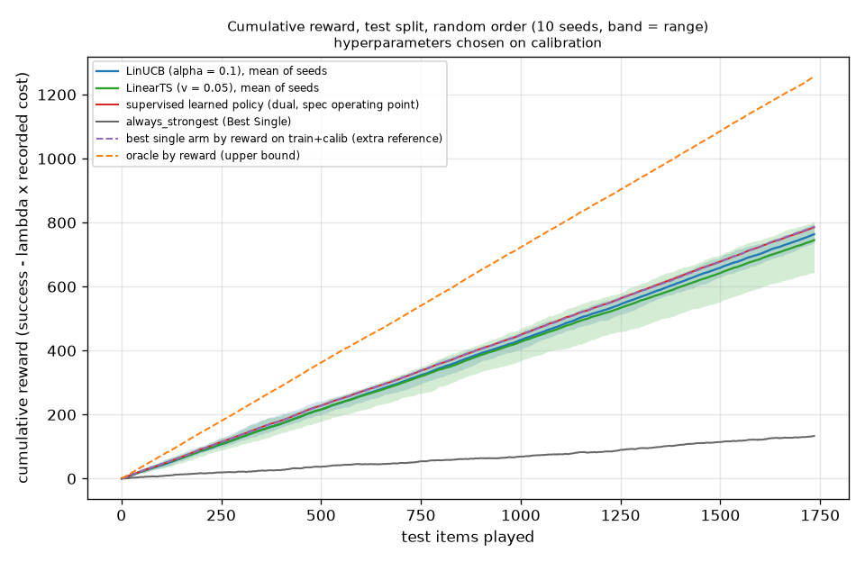

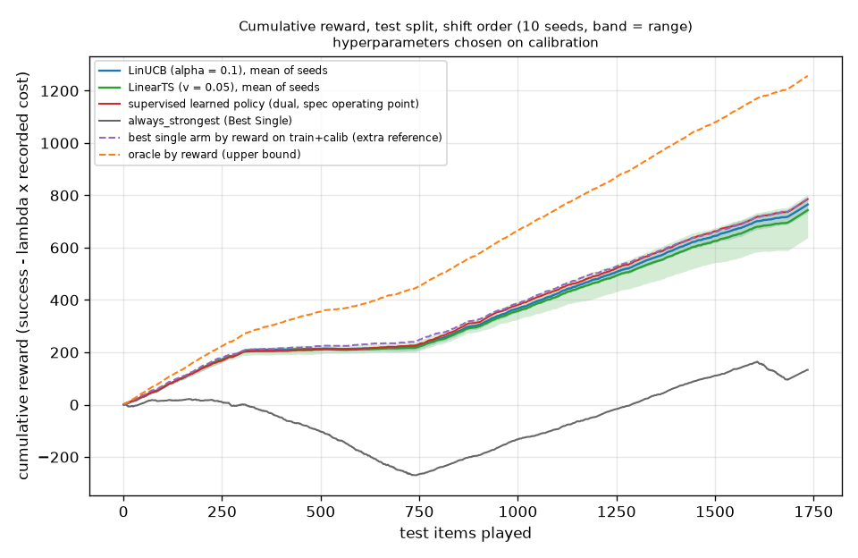

## Ablations

### Run [`20261028T221525Z-1dadba6`](../bench/results/ablations/20261028T221525Z-1dadba6/)

Run facts: commit 1dadba6, started 2026-10-28T22:15:25Z, AMD Ryzen 9 7900X 12-Core Processor (24 threads), 31.2 GB RAM, Windows-11-10.0.26300-SP0, go1.27.2. Command: `python bench/scripts/ablations.py --pool flagship`.

**Labels:** costs are the recorded costs of each model on each item; no latency is measured or simulated in this experiment; lambda of the dual mode is retuned on the calibration split for each artifact with the same rule as the headline (the largest value whose calibration success reaches Best Single's minus 0.01); the test split is replayed once per artifact; calibration success is in-sample for the calibrators and lower-bound tables of every artifact (fitted on the same split lambda is tuned on); because every operating point is retuned to the same calibration target, test success differs little by construction; the cost, the paired intervals and the pooled test ECE carry the comparison; better or worse means the paired 95% bootstrap interval against the shipped configuration lies wholly above or below zero; ECE is compared by its point estimate; pooled test ECE: 15 equal-mass bins over all models' test forecasts, recomputed in Python from the exported weights; training wall time is one run per artifact on this machine, measured around the whole fit and export; the shipped artifact was not retrained, its time is that of the committed train run; ablation artifacts are written under bench/scratch/ablations and are not committed.

Pool flagship, shipped artifact `dea4486d7575`, Best Single gemini-2.5-pro. Every variant is retrained on the train split, its dual operating point is retuned on calibration, and the test split is read once. Intervals: percentile bootstrap over items, 1000 resamples, alpha 0.05, seed 0.

#### Variants on the test split, against Best Single

| variant | group | success [CI] | mean cost USD [CI] | success vs Best Single, points [CI] | cost reduction vs Best Single [CI] | retuned lambda |
|---|---|---|---|---|---|---|
| both features, dim 2^14 | dimension | 48.2% [46.0%, 50.7%] | 0.004981 [0.004313, 0.005689] | -4.55 [-6.86, -2.25] | 92.6% [91.5%, 93.5%] | 6.266 |
| both features, dim 2^16 (shipped) | features | 48.2% [46.0%, 50.6%] | 0.004337 [0.003778, 0.0049] | -4.55 [-6.97, -2.25] | 93.5% [92.6%, 94.4%] | 6.72 |
| both features, dim 2^18 | dimension | 48.3% [46.0%, 50.8%] | 0.00469 [0.004154, 0.005214] | -4.44 [-6.80, -2.25] | 93.0% [92.1%, 93.8%] | 6.04 |
| hashed features only, dim 2^16 | features | 47.8% [45.6%, 50.3%] | 0.005781 [0.00504, 0.006492] | -4.90 [-7.09, -2.59] | 91.4% [90.2%, 92.5%] | 5.179 |
| dense features only, dim 2^16 | features | 48.7% [46.5%, 51.0%] | 0.009687 [0.00828, 0.01124] | -4.03 [-6.40, -1.61] | 85.6% [83.3%, 87.5%] | 3.337 |
| every model Platt, dim 2^16 | calibrator | 50.6% [48.4%, 53.0%] | 0.007124 [0.006282, 0.008144] | -2.13 [-4.44, 0.00] | 89.4% [87.8%, 90.6%] | 4.715 |
| every model isotonic, dim 2^16 | calibrator | 48.2% [46.0%, 50.6%] | 0.004337 [0.003778, 0.0049] | -4.55 [-6.97, -2.25] | 93.5% [92.6%, 94.4%] | 6.72 |

#### Against the shipped configuration (paired by test item)

| variant | success change, points [CI] | cost reduction change [CI] | pooled test ECE |
|---|---|---|---|
| both features, dim 2^14 | 0.00 [-1.15, +1.15] | -14.8% [-30.3%, -2.1%] | 0.0223 |
| both features, dim 2^16 (shipped) | 0.00 [0.00, 0.00] | 0.0% [0.0%, 0.0%] | 0.0160 |
| both features, dim 2^18 | +0.12 [-0.92, +1.10] | -8.1% [-20.3%, 3.1%] | 0.0158 |
| hashed features only, dim 2^16 | -0.35 [-1.79, +0.98] | -33.3% [-54.7%, -14.9%] | 0.0146 |
| dense features only, dim 2^16 | +0.52 [-1.10, +2.19] | -123.3% [-164.9%, -86.6%] | 0.0186 |
| every model Platt, dim 2^16 | +2.42 [+1.27, +3.63] | -64.2% [-87.4%, -45.8%] | 0.0115 |
| every model isotonic, dim 2^16 | 0.00 [0.00, 0.00] | 0.0% [0.0%, 0.0%] | 0.0160 |

#### Artifacts: training wall time and weights size

| variant | artifact version | training wall time s | time source | weights.bin bytes | calibrators |
|---|---|---|---|---|---|
| both features, dim 2^14 | ddd10a23e170 | 124.7 | this run | 1697280 | isotonic: 12 |
| both features, dim 2^16 (shipped) | dea4486d7575 | 134.1 | bench/results/train/20261028T021252Z-7802bb3 | 6407616 | isotonic: 12 |
| both features, dim 2^18 | c23573da8a94 | 228.0 | this run | 25281768 | isotonic: 12 |
| hashed features only, dim 2^16 | 0918854c06eb | 63.8 | this run | 6407616 | isotonic: 12 |
| dense features only, dim 2^16 | 681f33285c5a | 5.9 | this run | 6407616 | isotonic: 12 |
| every model Platt, dim 2^16 | b4ac853617ee | 140.2 | this run | 6407616 | platt: 12 |
| every model isotonic, dim 2^16 | 188f9804ce15 | 139.0 | this run | 6407616 | isotonic: 12 |

#### The run's own statements

- both features, dim 2^14: test success +0.00 points against the shipped one (no clear difference), mean cost 14.8% dearer (worse); pooled test ECE 0.0223 against 0.0160 for the shipped one (higher).
- both features, dim 2^18: test success +0.12 points against the shipped one (no clear difference), mean cost 8.1% dearer (no clear difference); pooled test ECE 0.0158 against 0.0160 for the shipped one (lower).
- hashed features only, dim 2^16: test success -0.35 points against the shipped one (no clear difference), mean cost 33.3% dearer (worse); pooled test ECE 0.0146 against 0.0160 for the shipped one (lower).
- dense features only, dim 2^16: test success +0.52 points against the shipped one (no clear difference), mean cost 123.3% dearer (worse); pooled test ECE 0.0186 against 0.0160 for the shipped one (higher).
- every model Platt, dim 2^16: test success +2.42 points against the shipped one (better), mean cost 64.2% dearer (worse); pooled test ECE 0.0115 against 0.0160 for the shipped one (lower).
- every model isotonic, dim 2^16: test success +0.00 points against the shipped one (no clear difference), mean cost 0.0% cheaper (no clear difference); pooled test ECE 0.0160 against 0.0160 for the shipped one (equal).

Not run: a PyTorch MLP on local embeddings. It is listed in the known limitations.

## Failure analysis

### Run [`20261029T015809Z-00deb40`](../bench/results/failure_analysis/20261029T015809Z-00deb40/)

Run facts: commit 00deb40, started 2026-10-29T01:58:09Z, AMD Ryzen 9 7900X 12-Core Processor (24 threads), 31.2 GB RAM, Windows-11-10.0.26300-SP0, go1.27.2. Command: `python bench/scripts/failure_analysis.py`.

**Labels:** costs are the recorded costs of each model on each item; latency is not used anywhere in this analysis; the learned point is the one the headline reports: lambda tuned on the calibration split; a loss is an item Best Single got right and the routed model got wrong; a gain is the reverse; the test split is read once per replay; nothing is chosen on it; no prompt text is in this report.

Pool flagship, test split, artifact `dea4486d7575`, lambda 6.72, Best Single gemini-2.5-pro. Items are referenced by item ID only; no prompt text is in this run. A loss is an item the Best Single answered right and the routed model answered wrong.

#### Overall

| quantity | value |
|---|---|
| items | 1735 |
| Best Single success | 52.7% |
| routed success | 48.2% |
| success change, points [CI] | -4.55 [-6.97, -2.25] |
| Best Single mean cost USD | 0.06706 |
| routed mean cost USD | 0.004337 |
| cost reduction [CI] | 93.5% [92.6%, 94.4%] |
| both right / both wrong | 663 / 647 |
| losses / gains / net | 252 / 173 / -79 |

#### By dataset (worst success change first)

| dataset | n | best success | routed success | success delta | best cost usd | routed cost usd | cost reduction | both right | both wrong | losses | gains | net |
|---|---|---|---|---|---|---|---|---|---|---|---|---|
| arc-agi | 78 | 0.4615 | 0.2564 | -0.2051 | 0.1998 | 0.003102 | 0.9845 | 16 | 38 | 20 | 4 | -16 |
| hle | 432 | 0.2153 | 0.09028 | -0.125 | 0.1245 | 0.005342 | 0.9571 | 23 | 323 | 70 | 16 | -54 |
| gpqa | 33 | 0.8182 | 0.697 | -0.1212 | 0.1058 | 0.009196 | 0.9131 | 20 | 3 | 7 | 3 | -4 |
| livecodebench | 205 | 0.8098 | 0.7024 | -0.1073 | 0.1371 | 0.006819 | 0.9503 | 134 | 29 | 32 | 10 | -22 |
| aime | 14 | 0.7143 | 0.6429 | -0.07143 | 0.1751 | 0.00795 | 0.9546 | 8 | 3 | 2 | 1 | -1 |
| arenahard_math | 58 | 0.7931 | 0.7586 | -0.03448 | 0.05522 | 0.01113 | 0.7985 | 38 | 6 | 8 | 6 | -2 |
| arenahard_creative_writing | 51 | 0.9608 | 0.9804 | 0.01961 | 0.03208 | 0.002294 | 0.9285 | 48 | 0 | 1 | 2 | 1 |
| simpleqa | 864 | 0.5648 | 0.5868 | 0.02199 | 0.009356 | 0.002778 | 0.703 | 376 | 245 | 112 | 131 | 19 |

#### By the model the policy chose (worst success change first)

| chosen | n | best success | routed success | success delta | best cost usd | routed cost usd | cost reduction | both right | both wrong | losses | gains | net |
|---|---|---|---|---|---|---|---|---|---|---|---|---|
| gemini-2.5-flash | 12 | 0.8333 | 0.3333 | -0.5 | 0.1329 | 0.005088 | 0.9617 | 4 | 2 | 6 | 0 | -6 |
| claude-sonnet-4 | 3 | 0.6667 | 0.3333 | -0.3333 | 0.1383 | 0.01547 | 0.8882 | 1 | 1 | 1 | 0 | -1 |
| intern-s1 | 56 | 0.3214 | 0.125 | -0.1964 | 0.1115 | 0.005166 | 0.9537 | 5 | 36 | 13 | 2 | -11 |
| deepseek-v3-0324 | 67 | 0.5672 | 0.4179 | -0.1493 | 0.135 | 0.001217 | 0.991 | 26 | 27 | 12 | 2 | -10 |
| kimi-k2-0905 | 153 | 0.634 | 0.5033 | -0.1307 | 0.1245 | 0.002243 | 0.982 | 68 | 47 | 29 | 9 | -20 |
| gpt-5-chat | 98 | 0.6224 | 0.5 | -0.1224 | 0.02083 | 0.001625 | 0.922 | 43 | 31 | 18 | 6 | -12 |
| qwen3-235b-a22b-thinking-2507 | 19 | 0.5263 | 0.4211 | -0.1053 | 0.1376 | 0.009464 | 0.9312 | 7 | 8 | 3 | 1 | -2 |
| glm-4.6 | 33 | 0.3939 | 0.3333 | -0.06061 | 0.1076 | 0.01836 | 0.8294 | 10 | 19 | 3 | 1 | -2 |
| deepseek-r1-0528 | 62 | 0.4516 | 0.4355 | -0.01613 | 0.1056 | 0.02123 | 0.7989 | 22 | 29 | 6 | 5 | -1 |
| qwen3-235b-a22b-2507 | 966 | 0.501 | 0.4855 | -0.01553 | 0.06228 | 0.0009519 | 0.9847 | 337 | 350 | 147 | 132 | -15 |
| gemini-2.5-pro | 140 | 0.55 | 0.55 | 0 | 0.01074 | 0.01074 | 0 | 77 | 63 | 0 | 0 | 0 |
| gpt-5 | 126 | 0.6111 | 0.619 | 0.007937 | 0.02852 | 0.01602 | 0.4382 | 63 | 34 | 14 | 15 | 1 |

#### Out of distribution or not

| ood label | n | best success | routed success | success delta | best cost usd | routed cost usd | cost reduction | both right | both wrong | losses | gains | net |
|---|---|---|---|---|---|---|---|---|---|---|---|---|
| in distribution | 1713 | 0.5225 | 0.4769 | -0.04553 | 0.06755 | 0.004386 | 0.9351 | 646 | 647 | 249 | 171 | -78 |
| out of distribution | 22 | 0.9091 | 0.8636 | -0.04545 | 0.02933 | 0.0005553 | 0.9811 | 17 | 0 | 3 | 2 | -1 |

#### The 20 largest losses (of 252)

| rank | item id | dataset | chosen |
|---|---|---|---|
| 1 | arenahard_math/299 | arenahard_math | qwen3-235b-a22b-2507 |
| 2 | arenahard_math/411 | arenahard_math | qwen3-235b-a22b-2507 |
| 3 | livecodebench/491 | livecodebench | gemini-2.5-flash |
| 4 | livecodebench/862 | livecodebench | kimi-k2-0905 |
| 5 | simpleqa/2073 | simpleqa | qwen3-235b-a22b-2507 |
| 6 | simpleqa/2078 | simpleqa | qwen3-235b-a22b-2507 |
| 7 | aime/30 | aime | gpt-5 |
| 8 | livecodebench/435 | livecodebench | gpt-5 |
| 9 | livecodebench/1006 | livecodebench | deepseek-v3-0324 |
| 10 | livecodebench/826 | livecodebench | deepseek-v3-0324 |
| 11 | livecodebench/884 | livecodebench | deepseek-v3-0324 |
| 12 | livecodebench/912 | livecodebench | deepseek-v3-0324 |
| 13 | gpqa/141 | gpqa | kimi-k2-0905 |
| 14 | gpqa/193 | gpqa | kimi-k2-0905 |
| 15 | livecodebench/179 | livecodebench | kimi-k2-0905 |
| 16 | livecodebench/823 | livecodebench | kimi-k2-0905 |
| 17 | gpqa/106 | gpqa | kimi-k2-0905 |
| 18 | gpqa/94 | gpqa | kimi-k2-0905 |
| 19 | livecodebench/1009 | livecodebench | kimi-k2-0905 |
| 20 | livecodebench/146 | livecodebench | kimi-k2-0905 |

## Failover against injected failures

### Run [`20261029T010235Z-f5ff91d`](../bench/results/failover/20261029T010235Z-f5ff91d/)

Status: current. The mock cuts a share of A's streams after the first content chunk, so the mid-stream arm tests the no-second-call rule on many streams.

Run facts: commit f5ff91d, started 2026-10-29T01:02:35Z, AMD Ryzen 9 7900X 12-Core Processor (24 threads), 31.2 GB RAM, Windows-11-10.0.26300-SP0, go1.27.2. Command: `python bench/scripts/failover.py`.

Labels: real local measurement, nothing simulated. Machine: AMD Ryzen 9 7900X 12-Core Processor (24 threads), 31.2 GB RAM, Windows-11-10.0.26300-SP0, go1.27.2. The load generator (rp-load), the gateway (routepilot serve) and the two mocks (rp-mock) share one machine and talk over loopback. The mocks' delays are configured constants (time to first token 20 ms, 1 ms per output token, 16 output tokens). The experiment measures counts, not time; the latency columns are the client's view and carry the Retry-After waits.

Counts, not time. Maximum attempts per request 3; recovery target 99% of the requests whose first attempt failed eligibly. All integrity checks passed: yes.

#### Pre-stream arm: failures injected on deployment A

10000 non-streaming requests at 100 requests per second. Deployment A injects http500 10%, http429 5%, reset 5% of its requests; deployment B injects nothing.

| quantity | value |
|---|---|
| requests | 10000 |
| requests started on A / on B | 8679 / 1321 |
| first attempt failed eligibly | 1749 |
| recovered (answered on B) | 1749 (1749 on B) |
| per-request recovery rate | 100.00% |
| target | met |
| attempts by deployment and outcome | deployment-a: ok: 6930, http_500: 875, connect: 472, http_429: 402, deployment-b: ok: 3070 |
| attempts per request | 1: 8251, 2: 1749 |
| responses by status | 200: 10000 |
| requests that failed overall | 0 |
| breaker of A opened (polled) | 1 |

5 of 5 checks passed.

| check | result | detail |
|---|---|---|
| schedule: the generator scheduled exactly 10000 requests | pass | scheduled 10000 |
| decision log: one record per scheduled request and none dropped | pass | 10000 records for 10000 requests, 0 dropped by the writer |
| drops: the generator dropped no arrival | pass | dropped 0 |
| mock counts: each mock received the attempts the log shows for its deployment | pass | mock A 8679 vs log 8679; mock B 3070 vs log 3070 |
| client errors: the generator's error count equals the requests that failed overall | pass | generator 0, decision log 0 |

#### Mid-stream arm: deployment A cuts a share of its streams after the commit

2000 streaming requests at 50 requests per second. Deployment A cuts 20% of its streams after the first content chunk. Rule under test: after the first byte the gateway makes no second upstream call.

| quantity | value |
|---|---|
| requests / attempts | 2000 / 2000 |
| attempts per request | 1: 2000 |
| requests started on A / on B | 2000 / 0 |
| streams cut after the commit (decision log) | 411 |
| requests with attempts on both deployments | 0 |
| requests the mocks received (A, B) | 2000, 0 |
| breaker of A opened (polled) | 0 |
| client-side errors | 411 |

11 of 11 checks passed.

| check | result | detail |
|---|---|---|
| schedule: the generator scheduled exactly 2000 requests | pass | scheduled 2000 |
| decision log: one record per scheduled request and none dropped | pass | 2000 records for 2000 requests, 0 dropped by the writer |
| drops: the generator dropped no arrival | pass | dropped 0 |
| one attempt: every request made exactly one attempt | pass | attempts per request {'1': 2000} |
| both: no request attempted both deployments | pass | 0 requests |
| mock counts: the mocks together received one request per client request, each the ones the log shows | pass | mock A 2000 vs log 2000; mock B 0 vs log 0; sum 2000 vs 2000 records |
| cut count: the streams A's mock says it cut are the streams the log shows broken after the commit | pass | mock A: 2000 received - 1589 completed - 0 canceled = 411; decision log: 411 |
| committed: every failed attempt on A was a stream that broke after the commit | pass | 411 failed attempts on A, 411 streams broken after the commit |
| cuts: at least one stream was cut after the commit, so the rule was exercised | pass | 411 streams cut after the commit |
| client errors: the generator's error count equals the streams that broke after commit | pass | generator 411, decision log 411 |
| breaker: B received requests only if A's breaker opened | pass | B received 0 requests, A's breaker opened 0 times |

#### Client-side latency (ms, real measurement on this machine)

| arm | completed | errors | p50 | p90 | p95 | p99 | max |
|---|---|---|---|---|---|---|---|
| pre-stream | 10000 | 0 | 36.90 | 65.73 | 84.03 | 1037.82 | 1038.85 |
| mid-stream | 1589 | 411 | 42.69 | 44.03 | 44.32 | 44.93 | 47.77 |

#### Limitations of the measurement (copied from the run's report)

- One run per arm, no repetitions: the failures are drawn from a seeded random number generator, but the order in which concurrent requests reach it varies, so another run has the same rates and different individual failures.
- The mocks are deterministic and fast; real providers fail in correlated ways (a whole region, a deploy) that independent per-request failures do not model.
- Deployment B never fails here, so recovery can only fail through the retry limit, the deadline or a breaker on B; it says nothing about the case where both deployments fail.
- Windows loopback on one shared machine. The numbers are counts and do not depend on the timer resolution.

Older runs, listed and not shown:

- [`20261028T233539Z-ee7619a`](../bench/results/failover/20261028T233539Z-ee7619a/): Superseded. Its mid-stream arm used a mock directive that cut every stream on A, so A's breaker opened after a few cuts and almost no stream tested the rule. (started 2026-10-28T23:35:39Z)

## Quota correctness under concurrent clients

### Run [`20261029T010202Z-f5ff91d`](../bench/results/quota_correctness/20261029T010202Z-f5ff91d/)

Status: current. Usage-ledger rows are written in batches off the request path, and the mock caps each answer at the request's max_tokens.

Run facts: commit f5ff91d, started 2026-10-29T01:02:02Z, AMD Ryzen 9 7900X 12-Core Processor (24 threads), 31.2 GB RAM, Windows-11-10.0.26300-SP0, go1.27.2. Command: `python bench/scripts/quota_correctness.py`.

Labels: real local measurement, nothing simulated. Machine: AMD Ryzen 9 7900X 12-Core Processor (24 threads), 31.2 GB RAM, Windows-11-10.0.26300-SP0, go1.27.2. The load clients, the gateway (routepilot serve), the mock (rp-mock) and Redis share one machine and talk over loopback. The experiment measures counts and money, not time.

Money and counts, not time. 64 clients race on one tenant with a total budget of 0.05 USD; each sends requests with a random `max_tokens` in [8, 512] until the gateway has refused it 20 times in a row. The model costs 1 USD per million input tokens and 2 USD per million output tokens. Money is integer picodollars (1e-12 USD); the table shows USD.

| quantity | memory | redis |
|---|---|---|
| requests sent | 1388 | 1385 |
| admitted (200) | 96 | 95 |
| rejected (429 insufficient_quota) | 1292 | 1290 |
| spend recomputed from the tokens the clients saw (USD) | 0.049904 | 0.049894 |
| spend per the usage ledger (USD) | 0.049904 | 0.049894 |
| budget limit (USD) | 0.050000 | 0.050000 |
| unused budget at the end (USD) | 0.000096 | 0.000106 |
| budget overshoot counter (picodollars) | 0 | 0 |
| usage ledger rows (ok rows) | 96 (96) | 95 (95) |
| usage ledger write errors | 0 | 0 |
| requests the mock received | 96 | 95 |
| reconcile exit code | 2 | 0 |
| wall time (s) | 4.6 | 1.5 |

#### Checks, backend memory

9 of 9 checks passed.

| check | result | detail |
|---|---|---|
| ledger: the committed spend (sum of cost_actual) is within the limit | pass | 0.049904 USD against a limit of 0.05 USD |
| spend: the spend recomputed from the tokens the clients saw is within the limit | pass | 0.049904 USD against a limit of 0.05 USD |
| overshoot: rp_budget_overshoot_picousd_total is 0 | pass | 0 picodollars |
| reconcile: refuses the memory backend by design (exit 2) | pass | exit 2 |
| unexpected responses: every answer was a 200 or a 429 insufficient_quota | pass | other responses: none |
| rows: the ledger has one row per admitted request | pass | 96 rows (96 ok) for 96 admitted requests |
| mock: the provider received exactly the admitted requests | pass | mock received 96, admitted 96 |
| rate limit: no RPM, TPM or concurrency limit fired | pass | rejections by kind: {'concurrency': 0, 'rpm': 0, 'tpm': 0, 'upstream': 0} |
| cost: the ledger sum equals the cost recomputed from the tokens the clients saw | pass | ledger 49904000000, recomputed 49904000000 picodollars |

#### Checks, backend redis

10 of 10 checks passed.

| check | result | detail |
|---|---|---|
| ledger: the committed spend (sum of cost_actual) is within the limit | pass | 0.049894 USD against a limit of 0.05 USD |
| spend: the spend recomputed from the tokens the clients saw is within the limit | pass | 0.049894 USD against a limit of 0.05 USD |
| overshoot: rp_budget_overshoot_picousd_total is 0 | pass | 0 picodollars |
| counter: the Redis budget counter equals the spend recomputed from the tokens the clients saw | pass | counter ['0.049894'] USD, recomputed 0.049894 USD |
| reconcile: the usage ledger and the Redis budget counter agree (exit 0) | pass | exit 0: quota-redis-20261029t010202z ledger 0.049894 counter 0.049894 diff 0 |
| unexpected responses: every answer was a 200 or a 429 insufficient_quota | pass | other responses: none |
| rows: the ledger has one row per admitted request | pass | 95 rows (95 ok) for 95 admitted requests |
| mock: the provider received exactly the admitted requests | pass | mock received 95, admitted 95 |
| rate limit: no RPM, TPM or concurrency limit fired | pass | rejections by kind: {'concurrency': 0, 'rpm': 0, 'tpm': 0, 'upstream': 0} |
| cost: the ledger sum equals the cost recomputed from the tokens the clients saw | pass | ledger 49894000000, recomputed 49894000000 picodollars |

#### Limitations of the measurement (copied from the run's report)

- One run per backend and one seed: the clients race, so the interleaving (and with it which requests are admitted) differs between runs. The checks do not depend on it.
- The mock's answer has exactly max_tokens completion tokens, the most a request allows, so the output cost is always the full reservation; the prompt part of the reservation is an upper bound that the actual prompt count stays below. A real provider often stops short of max_tokens, which would leave more of the budget unused.
- The 20-in-a-row stop rule ends a client while budget may remain that only a smaller max_tokens could use; the unused budget above is what was left when the last client stopped.
- A single Redis instance on the same machine: no network latency, no failover, no cluster.

Older runs, listed and not shown:

- [`20261028T233917Z-ee7619a`](../bench/results/quota_correctness/20261028T233917Z-ee7619a/): Superseded. First run with 64 clients, made before the usage ledger was written in batches; ledger rows were lost and the ledger checks failed. (started 2026-10-28T23:39:17Z)
- [`20261028T234039Z-ee7619a`](../bench/results/quota_correctness/20261028T234039Z-ee7619a/): Superseded. Control run of the same early code with fewer clients, made to see whether the lost ledger rows depended on concurrency. (started 2026-10-28T23:40:39Z)

## Input-token bound (in_upper)

### Run [`20261028T012056Z-1212012`](../bench/results/inupper/20261028T012056Z-1212012/)

Status: current. Newest run, with the prompt overhead fitted on train and calibration and checked on test and held-out records.

Run facts: commit 1212012, started 2026-10-28T01:20:56Z, AMD Ryzen 9 7900X 12-Core Processor (24 threads), 31.2 GB RAM, Windows-11-10.0.26300-SP0, go1.27.2. Command: `python bench/scripts/inupper.py`.

**Labels:** in_upper is the router's upper bound on prompt tokens, computed from the prompt bytes; prompt_tokens are the counts recorded in the dataset; nothing here is simulated; prompt_overhead_tokens are fitted on train and calib records only, so the test and heldout rows are an out-of-sample check.

`in_upper` is the router's upper bound on the prompt tokens of a request, computed from its bytes. Each record is the ratio of the prompt tokens the dataset recorded to that bound; a ratio above 1 means the bound was too low. The largest ratio over all records is 5.093. A per-model `prompt_overhead_tokens` is fitted on train and calibration records only, so the test and held-out splits are an out-of-sample check of the adjusted bound.

#### Pool flagship: raw bound over all records

| records | max ratio | median | p99 | p99.9 | records above 1 |
|---|---|---|---|---|---|
| 142926 | 5.093 | 0.2673 | 1.798 | 2.5 | 4319 |

Fitted `prompt_overhead_tokens` (models not listed: 0): intern-s1 124.

#### Pool flagship: adjusted bound (in_upper plus the fitted overhead) per split

| split | records | max ratio | median | p99.9 | records above 1 | coverage | recording anomalies |
|---|---|---|---|---|---|---|---|
| train | 61268 | 1 | 0.2637 | 0.9587 | 0 | 100.000% | 0 |
| calib | 20952 | 0.9884 | 0.2646 | 0.9446 | 0 | 100.000% | 0 |
| test | 20518 | 1.045 | 0.2635 | 0.958 | 3 | 99.985% | 0 |
| heldout | 40188 | 5.093 | 0.2821 | 0.6741 | 1 | 99.998% | 1 |

#### Pool flagship: records still above 1 after the overhead (worst first)

| item id | split | model | prompt tokens | bound | ratio | recording anomaly |
|---|---|---|---|---|---|---|
| livemathbench/7 | heldout | gpt-5 | 3295 | 647 | 5.093 | yes |
| arenahard_math/365 | test | intern-s1 | 186 | 178 | 1.045 | no |
| arenahard_math/311 | test | intern-s1 | 177 | 174 | 1.017 | no |
| arenahard_math/287 | test | intern-s1 | 164 | 163 | 1.006 | no |

#### Pool flagship: largest raw ratios

| item id | dataset | model | prompt tokens | in upper | ratio |
|---|---|---|---|---|---|
| livemathbench/7 | livemathbench | gpt-5 | 3295 | 647 | 5.093 |
| arenahard_math/287 | arenahard_math | intern-s1 | 164 | 39 | 4.205 |
| arenahard_creative_writing/523 | arenahard_creative_writing | intern-s1 | 162 | 41 | 3.951 |
| arenahard_creative_writing/668 | arenahard_creative_writing | intern-s1 | 162 | 43 | 3.767 |
| arenahard_math/333 | arenahard_math | intern-s1 | 171 | 48 | 3.562 |

#### Pool mixed: raw bound over all records

| records | max ratio | median | p99 | p99.9 | records above 1 |
|---|---|---|---|---|---|
| 50521 | 5.093 | 0.2827 | 0.7172 | 2.005 | 238 |

Fitted `prompt_overhead_tokens` (models not listed: 0): intern-s1 124.

#### Pool mixed: adjusted bound (in_upper plus the fitted overhead) per split

| split | records | max ratio | median | p99.9 | records above 1 | coverage | recording anomalies |
|---|---|---|---|---|---|---|---|
| train | 16904 | 1 | 0.2849 | 0.8685 | 0 | 100.000% | 0 |
| calib | 6050 | 0.9884 | 0.2893 | 0.9074 | 0 | 100.000% | 0 |
| test | 5724 | 1.045 | 0.2868 | 0.9254 | 3 | 99.948% | 0 |
| heldout | 21843 | 5.093 | 0.2718 | 0.7337 | 1 | 99.995% | 1 |

#### Pool mixed: records still above 1 after the overhead (worst first)

| item id | split | model | prompt tokens | bound | ratio | recording anomaly |
|---|---|---|---|---|---|---|
| livemathbench/7 | heldout | gpt-5 | 3295 | 647 | 5.093 | yes |
| arenahard_math/365 | test | intern-s1 | 186 | 178 | 1.045 | no |
| arenahard_math/311 | test | intern-s1 | 177 | 174 | 1.017 | no |
| arenahard_math/287 | test | intern-s1 | 164 | 163 | 1.006 | no |

#### Pool mixed: largest raw ratios

| item id | dataset | model | prompt tokens | in upper | ratio |
|---|---|---|---|---|---|
| livemathbench/7 | livemathbench | gpt-5 | 3295 | 647 | 5.093 |
| arenahard_math/287 | arenahard_math | intern-s1 | 164 | 39 | 4.205 |
| arenahard_creative_writing/523 | arenahard_creative_writing | intern-s1 | 162 | 41 | 3.951 |
| arenahard_creative_writing/668 | arenahard_creative_writing | intern-s1 | 162 | 43 | 3.767 |
| arenahard_math/333 | arenahard_math | intern-s1 | 171 | 48 | 3.562 |

Anomaly rule: prompt_tokens above 3 times the median prompt_tokens of the other models on the same item and more than 1000 tokens above it. Image parts are not in this dataset; they get a fixed allowance in the gateway.

Older runs, listed and not shown:

- [`20261028T011427Z-7753c32`](../bench/results/inupper/20261028T011427Z-7753c32/): Superseded. An intermediate fit of the prompt overhead; the fitted value for intern-s1 differed from its refit without the anomaly exclusion, which the newest run settles. (started 2026-10-28T01:14:27Z)
- [`20261028T004946Z-bec7b21`](../bench/results/inupper/20261028T004946Z-bec7b21/): Superseded. It reports the raw bound only, before the prompt overhead was fitted and checked out of sample. (started 2026-10-28T00:49:46Z)

## Live collection on local models

### Run [`20261029T042250Z-6ecd7f2`](../bench/results/live_collect/20261029T042250Z-6ecd7f2/)

Status: current. Answer-only-user protocol, the one the live runs below use. The instruction is appended to the user message and there is no system message.

Run facts: commit 6ecd7f2, started 2026-10-29T04:22:50Z, AMD Ryzen 9 7900X 12-Core Processor (24 threads), 31.2 GB RAM, Windows-11-10.0.26300-SP0, go1.27.2. Command: `python bench/scripts/live_collect.py collect --protocol answer-only-user --budget-minutes 15 --live-dir data/derived/live-user`.

**Labels:** latency and token counts are measured on this machine through RoutePilot (decision log); prices are an ASSUMPTION (Ruling V1-R42): proportional to the parameter count, 0.02 USD per million input tokens and 0.06 per million output tokens per billion parameters; answers are graded by the last standalone option letter after an answer cue, else the last standalone option letter, against the ground truth of the release; no prompt text and no model output is in this report.

| setting | value |
|---|---|
| models | qwen2.5-0.5b, qwen2.5-1.5b, qwen2.5-3b |
| protocol | answer-only-user |
| system message | none |
| user message suffix | "\n\nReply with only the letter of the correct option." |
| max tokens | 16 |
| mmlupro items used / gpqa items | 600 / 198 |
| items every model answered | 798 |
| by dataset | gpqa: 198, mmlupro: 600 |
| request time s / wall time s | 288.5 / 309.0 |
| stopped by the time budget | no |
| decision records missing | 0 |

#### Per model (latency measured through the gateway, cost assumed)

| model | requests | failed | accuracy | hit max tokens | graded by cue / last letter / none | completion tokens mean | TTFT ms p50 / p95 | e2e ms p50 / p95 | mean cost USD (assumed) |
|---|---|---|---|---|---|---|---|---|---|
| qwen2.5-0.5b | 798 | 0 | 12.3% | 191 | 498 / 136 / 164 | 6.73 | 35 / 52 | 58 / 133 | 3.059e-06 |
| qwen2.5-1.5b | 798 | 0 | 18.4% | 140 | 122 / 550 / 126 | 4.99 | 64 / 103 | 87 / 219 | 9.022e-06 |
| qwen2.5-3b | 798 | 0 | 22.8% | 144 | 99 / 561 / 138 | 5.09 | 81 / 146 | 114 / 256 | 1.806e-05 |

Assumed prices (USD per million tokens, input / output): qwen2.5-0.5b 0.01 / 0.03; qwen2.5-1.5b 0.03 / 0.09; qwen2.5-3b 0.06 / 0.18.

#### Accuracy per model and dataset

| model | dataset | n | accuracy |
|---|---|---|---|
| qwen2.5-0.5b | gpqa | 198 | 4.0% |
| qwen2.5-0.5b | mmlupro | 600 | 15.0% |
| qwen2.5-1.5b | gpqa | 198 | 10.6% |
| qwen2.5-1.5b | mmlupro | 600 | 21.0% |
| qwen2.5-3b | gpqa | 198 | 9.1% |
| qwen2.5-3b | mmlupro | 600 | 27.3% |

### Run [`20261029T015819Z-00deb40`](../bench/results/live_collect/20261029T015819Z-00deb40/)

Status: also. Speed measurement straight on Ollama that chose the candidate models. It is not a collection.

Run facts: commit 00deb40, started 2026-10-29T01:58:19Z, AMD Ryzen 9 7900X 12-Core Processor (24 threads), 31.2 GB RAM, Windows-11-10.0.26300-SP0, go1.27.2. Command: `python bench/scripts/live_collect.py measure`.

**Labels:** speeds and times are measured on this machine by sending requests straight to Ollama, not through RoutePilot; the three measurement prompts are invented, not dataset items; no prompt text and no model output is in this report.

Speed measurement straight on Ollama 0.34.2, 3 invented prompts per model, `max_tokens` 256. Used to choose the candidate models and plan the collection; the numbers are measured, not simulated.

| model | parameters | quantization | TTFT ms (mean) | output tokens/s (mean) | output tokens (mean) | answers right of runs | worst-case request s | load s |
|---|---|---|---|---|---|---|---|---|
| qwen2.5:0.5b | 494.03M | Q4_K_M | 36.8 | 174.9 | 223.0 | 2 of 3 | 2.23 | 2.51 |
| qwen2.5:1.5b | 1.5B | Q4_K_M | 50.6 | 97.1 | 71.3 | 3 of 3 | 4.01 | 2.61 |
| qwen2.5:3b | 3.1B | Q4_K_M | 55.2 | 77.8 | 153.0 | 3 of 3 | 4.99 | 3.63 |
| llama3.2:3b | 3.2B | Q4_K_M | 50.6 | 73.4 | 128.0 | 3 of 3 | 5.28 | 4.18 |

### Run [`20261029T015906Z-00deb40`](../bench/results/live_collect/20261029T015906Z-00deb40/)

Status: also. First collection, protocol as written. The dataset prompt is sent unchanged and long answers are allowed.

Run facts: commit 00deb40, started 2026-10-29T01:59:06Z, AMD Ryzen 9 7900X 12-Core Processor (24 threads), 31.2 GB RAM, Windows-11-10.0.26300-SP0, go1.27.2. Command: `python bench/scripts/live_collect.py collect`.

**Labels:** latency and token counts are measured on this machine through RoutePilot (decision log); prices are an ASSUMPTION (Ruling V1-R42): proportional to the parameter count, 0.02 USD per million input tokens and 0.06 per million output tokens per billion parameters; answers are graded by the last standalone option letter after an answer cue, else the last standalone option letter, against the ground truth of the release; no prompt text and no model output is in this report.

| setting | value |
|---|---|
| models | qwen2.5-0.5b, qwen2.5-1.5b, qwen2.5-3b |
| protocol | as written (dataset prompt, no instruction added) |
| system message | none |
| user message suffix | none |
| max tokens | 384 |
| mmlupro items used / gpqa items | 281 / 198 |
| items every model answered | 478 |
| by dataset | gpqa: 198, mmlupro: 280 |
| request time s / wall time s | 4583.3 / 4618.6 |
| stopped by the time budget | no |
| decision records missing | 0 |

#### Per model (latency measured through the gateway, cost assumed)

| model | requests | failed | accuracy | hit max tokens | graded by cue / last letter / none | completion tokens mean | TTFT ms p50 / p95 | e2e ms p50 / p95 | mean cost USD (assumed) |
|---|---|---|---|---|---|---|---|---|---|
| qwen2.5-0.5b | 479 | 1 | 10.3% | 386 | 77 / 240 / 161 | 367.16 | 35 / 54 | 2168 / 2618 | 1.377e-05 |
| qwen2.5-1.5b | 479 | 0 | 18.0% | 276 | 199 / 157 / 123 | 333.39 | 57 / 90 | 2540 / 3808 | 3.825e-05 |
| qwen2.5-3b | 479 | 0 | 19.2% | 353 | 124 / 220 / 135 | 361.97 | 96 / 185 | 4089 / 8198 | 8.165e-05 |

Assumed prices (USD per million tokens, input / output): qwen2.5-0.5b 0.01 / 0.03; qwen2.5-1.5b 0.03 / 0.09; qwen2.5-3b 0.06 / 0.18.

#### Accuracy per model and dataset

| model | dataset | n | accuracy |
|---|---|---|---|
| qwen2.5-0.5b | gpqa | 198 | 9.6% |
| qwen2.5-0.5b | mmlupro | 280 | 10.7% |
| qwen2.5-1.5b | gpqa | 198 | 16.2% |
| qwen2.5-1.5b | mmlupro | 281 | 19.2% |
| qwen2.5-3b | gpqa | 198 | 16.7% |
| qwen2.5-3b | mmlupro | 281 | 21.0% |

### Run [`20261029T033743Z-766a3b8`](../bench/results/live_collect/20261029T033743Z-766a3b8/)

Status: also. Answer-only protocol. The instruction is a system message.

Run facts: commit 766a3b8, started 2026-10-29T03:37:43Z, AMD Ryzen 9 7900X 12-Core Processor (24 threads), 31.2 GB RAM, Windows-11-10.0.26300-SP0, go1.27.2. Command: `python bench/scripts/live_collect.py collect --protocol answer-only --budget-minutes 30`.

**Labels:** latency and token counts are measured on this machine through RoutePilot (decision log); prices are an ASSUMPTION (Ruling V1-R42): proportional to the parameter count, 0.02 USD per million input tokens and 0.06 per million output tokens per billion parameters; answers are graded by the last standalone option letter after an answer cue, else the last standalone option letter, against the ground truth of the release; no prompt text and no model output is in this report.

| setting | value |
|---|---|
| models | qwen2.5-0.5b, qwen2.5-1.5b, qwen2.5-3b |
| protocol | answer-only |
| system message | Reply with only the letter of the correct option. |
| user message suffix | none |
| max tokens | 16 |
| mmlupro items used / gpqa items | 600 / 198 |
| items every model answered | 798 |
| by dataset | gpqa: 198, mmlupro: 600 |
| request time s / wall time s | 329.9 / 351.9 |
| stopped by the time budget | no |
| decision records missing | 0 |

#### Per model (latency measured through the gateway, cost assumed)

| model | requests | failed | accuracy | hit max tokens | graded by cue / last letter / none | completion tokens mean | TTFT ms p50 / p95 | e2e ms p50 / p95 | mean cost USD (assumed) |
|---|---|---|---|---|---|---|---|---|---|
| qwen2.5-0.5b | 798 | 0 | 10.7% | 223 | 541 / 51 / 206 | 7.42 | 34 / 51 | 60 / 135 | 2.918e-06 |
| qwen2.5-1.5b | 798 | 0 | 16.7% | 202 | 577 / 19 / 202 | 7.07 | 61 / 100 | 100 / 221 | 8.723e-06 |
| qwen2.5-3b | 798 | 0 | 19.7% | 336 | 413 / 90 / 295 | 9.44 | 77 / 141 | 166 / 277 | 1.787e-05 |

Assumed prices (USD per million tokens, input / output): qwen2.5-0.5b 0.01 / 0.03; qwen2.5-1.5b 0.03 / 0.09; qwen2.5-3b 0.06 / 0.18.

#### Accuracy per model and dataset

| model | dataset | n | accuracy |
|---|---|---|---|
| qwen2.5-0.5b | gpqa | 198 | 3.0% |
| qwen2.5-0.5b | mmlupro | 600 | 13.2% |
| qwen2.5-1.5b | gpqa | 198 | 8.6% |
| qwen2.5-1.5b | mmlupro | 600 | 19.3% |
| qwen2.5-3b | gpqa | 198 | 4.5% |
| qwen2.5-3b | mmlupro | 600 | 24.7% |

## Live replay: training and offline replay

### Run [`20261029T043015Z-6ecd7f2`](../bench/results/live_train/20261029T043015Z-6ecd7f2/)

Status: current. Trained on the answer-only-user collection.

Run facts: commit 6ecd7f2, started 2026-10-29T04:30:15Z, AMD Ryzen 9 7900X 12-Core Processor (24 threads), 31.2 GB RAM, Windows-11-10.0.26300-SP0, go1.27.2. Command: `python bench/scripts/live_train.py`.

**Labels:** prices are an ASSUMPTION (Ruling V1-R42): proportional to the parameter count, 0.02 USD per million input tokens and 0.06 per million output tokens per billion parameters; latency is measured through RoutePilot on this machine (the decision log), never simulated or assumed; the learned rows' floors are 0, the median and the 90th percentile of the best lower bound over the calibration items (chosen from the trained artifact before the test split is replayed); the test split is replayed once per row and nothing is chosen on it; the test split is small, so the intervals are wide; no prompt text and no model output is in this report.

Models qwen2.5-0.5b, qwen2.5-1.5b, qwen2.5-3b on gpqa, mmlupro; collection protocol `answer-only-user`, `max_tokens` 16. Items every model answered: 798, split train: 500, calib: 150, test: 148. Best Single qwen2.5-3b, cheapest qwen2.5-0.5b. Artifact `21183f8ab3fe`, 515941 bytes, calibrator rule `switch`. Policy mode `min_cost` with quality floors 0, 0.166, 0.221 (0, the median and the 90th percentile (rounded down to 3 decimals) of best_L(x), the largest lower bound across the models). Latency profiles measured on AMD Ryzen 9 7900X 12-Core Processor (24 threads) and AMD Radeon RX 9060 XT.

#### Prices (ASSUMED, proportional to parameter count) and measured latency profiles

| model | input USD/Mtok (assumed) | output USD/Mtok (assumed) | profile requests | TTFT median ms (measured) | TPOT median ms (measured) |
|---|---|---|---|---|---|
| qwen2.5-0.5b | 0.01 | 0.03 | 650 | 35 | 5 |
| qwen2.5-1.5b | 0.03 | 0.09 | 650 | 64 | 5.5 |
| qwen2.5-3b | 0.06 | 0.18 | 650 | 81 | 6 |

#### Test split (148 items): offline replay on recorded outcomes, measured latency

| policy | n | success [CI] | mean cost USD (assumed) [CI] | e2e ms p50 (measured) | e2e ms p95 (measured) | relaxed share | OOD share | model mix |
|---|---|---|---|---|---|---|---|---|
| always_strongest | 148 | 18.9% [12.8%, 25.0%] | 1.836e-05 [1.715e-05, 1.95e-05] | 115 | 250 | 0.0% | 0.0% | qwen2.5-3b: 148 |
| always_cheapest | 148 | 8.8% [4.1%, 13.5%] | 3.11e-06 [2.91e-06, 3.306e-06] | 57 | 133 | 0.0% | 0.0% | qwen2.5-0.5b: 148 |
| random | 148 | 16.2% [10.8%, 23.0%] | 8.118e-06 [7.168e-06, 9.121e-06] | 82 | 218 | 0.0% | 0.0% | qwen2.5-0.5b: 65, qwen2.5-1.5b: 54, qwen2.5-3b: 29 |
| static_rules | 148 | 18.9% [12.8%, 25.0%] | 1.836e-05 [1.715e-05, 1.95e-05] | 115 | 250 | 0.0% | 0.0% | qwen2.5-3b: 148 |
| oracle | 148 | 31.1% [24.3%, 38.5%] | 5.105e-06 [4.28e-06, 6.137e-06] | 66 | 135 | 0.0% | 0.0% | qwen2.5-0.5b: 115, qwen2.5-1.5b: 24, qwen2.5-3b: 9 |
| static_strongest_rank | 148 | 18.9% [12.8%, 25.0%] | 1.836e-05 [1.715e-05, 1.95e-05] | 115 | 250 | 0.0% | 0.0% | qwen2.5-3b: 148 |
| static_cheapest_worstcase | 148 | 8.8% [4.1%, 13.5%] | 3.11e-06 [2.91e-06, 3.306e-06] | 57 | 133 | 0.0% | 0.0% | qwen2.5-0.5b: 148 |
| learned_min_cost_floor_0 | 148 | 8.8% [4.1%, 13.5%] | 3.11e-06 [2.91e-06, 3.306e-06] | 57 | 133 | 0.0% | 1.4% | qwen2.5-0.5b: 148 |
| learned_min_cost_floor_0.166 | 148 | 14.9% [9.5%, 20.3%] | 9.808e-06 [8.615e-06, 1.108e-05] | 86 | 176 | 45.9% | 1.4% | qwen2.5-0.5b: 47, qwen2.5-1.5b: 61, qwen2.5-3b: 40 |
| learned_min_cost_floor_0.221 | 148 | 14.2% [8.8%, 19.6%] | 1.145e-05 [1.004e-05, 1.288e-05] | 95 | 188 | 79.7% | 1.4% | qwen2.5-0.5b: 47, qwen2.5-1.5b: 37, qwen2.5-3b: 64 |

#### Per-model fit (calibration columns are in-sample for the calibrator)

| model | calibrator | C | alpha | cv log loss | calib ece | calib brier | calib success rate | lcb bins |
|---|---|---|---|---|---|---|---|---|
| qwen2.5-0.5b | platt | 1 | 0.1 | 0.3824 | 0.09315 | 0.1155 | 0.1333 | 5 |
| qwen2.5-1.5b | platt | 0.1 | 0.1 | 0.4772 | 0.0912 | 0.141 | 0.18 | 5 |
| qwen2.5-3b | platt | 10 | 0.1 | 0.5166 | 0.07655 | 0.1701 | 0.2333 | 5 |

Older runs, listed and not shown:

- [`20261029T034651Z-766a3b8`](../bench/results/live_train/20261029T034651Z-766a3b8/): Superseded. Trained on the answer-only collection with the instruction as a system message; its artifact is no longer in the tree. (pool live-ollama; protocol answer-only; started 2026-10-29T03:46:51Z)

## Live demo through the gateway

### Run [`20261029T043138Z-6ecd7f2`](../bench/results/live_demo/20261029T043138Z-6ecd7f2/)

Status: current. Uses the answer-only-user artifact.

Run facts: commit 6ecd7f2, started 2026-10-29T04:31:38Z, AMD Ryzen 9 7900X 12-Core Processor (24 threads), 31.2 GB RAM, Windows-11-10.0.26300-SP0, go1.27.2. Command: `python bench/scripts/live_demo.py`.

**Labels:** latency is measured through RoutePilot on this machine (the decision log), never simulated; prices are an ASSUMPTION (Ruling V1-R42); the policy chooses on its own predictions; the tight SLO is the fastest model's measured p50 end-to-end time and the loose SLO the slowest model's measured p95, both over the train and calibration requests; the quality floors are 0, the median and the 90th percentile of the best lower bound over the calibration items (rounded down to 3 decimals), the same floors the live replay used; the gateway's online latency estimator starts from the measured profiles and learns from the demo's own traffic, so later rounds are not independent of earlier ones; realized success is graded against the release's ground truth; a round has a few dozen items, so its intervals are wide; no prompt text and no model output is in this report.

Requests sent through the gateway with the live artifact `21183f8ab3fe`, protocol `answer-only-user`, 120 test items per round, 1080 requests in all. Quality floors 0, 0.166, 0.221. SLO bounds on end-to-end time: tight 58 ms (p50 of qwen2.5-0.5b), loose 258 ms (p95 of qwen2.5-3b). Served model differed from the policy's pick 0 times; decision records missing 0. Latency is measured, prices are assumed.

#### Rounds (quality floor x end-to-end SLO), measured through the gateway

| round | floor | SLO ms | n (failed) | model mix | relaxed any / latency / quality | success [Wilson CI] | success when not relaxed (n) | e2e ms p50 / p95 | SLO met (share) | p95 within SLO |
|---|---|---|---|---|---|---|---|---|---|---|
| q0-none | 0 | none | 120 (0) | qwen2.5-0.5b: 120 | 0 / 0 / 0 | 6.7% [3.4%, 12.6%] | 6.7% (120) | 58 / 132 | no SLO | no SLO |
| q0-tight | 0 | 58 | 120 (0) | qwen2.5-0.5b: 120 | 120 / 120 / 0 | 5.8% [2.9%, 11.6%] | n/a (0) | 50 / 126 | 74.2% | not met |
| q0-loose | 0 | 258 | 120 (0) | qwen2.5-0.5b: 120 | 0 / 0 / 0 | 6.7% [3.4%, 12.6%] | 6.7% (120) | 50 / 124 | 100.0% | met |
| q0.166-none | 0.166 | none | 120 (0) | qwen2.5-0.5b: 42, qwen2.5-1.5b: 46, qwen2.5-3b: 32 | 60 / 0 / 60 | 15.0% [9.7%, 22.5%] | 21.7% (60) | 98 / 189 | no SLO | no SLO |
| q0.166-tight | 0.166 | 58 | 120 (0) | qwen2.5-0.5b: 42, qwen2.5-1.5b: 46, qwen2.5-3b: 32 | 120 / 120 / 60 | 15.8% [10.4%, 23.4%] | n/a (0) | 62 / 155 | 44.2% | not met |
| q0.166-loose | 0.166 | 258 | 120 (0) | qwen2.5-0.5b: 42, qwen2.5-1.5b: 46, qwen2.5-3b: 32 | 75 / 75 / 60 | 15.8% [10.4%, 23.4%] | 24.4% (45) | 54 / 154 | 100.0% | met |
| q0.221-none | 0.221 | none | 120 (0) | qwen2.5-0.5b: 42, qwen2.5-1.5b: 30, qwen2.5-3b: 48 | 99 / 0 / 99 | 14.2% [9.0%, 21.5%] | 9.5% (21) | 66 / 172 | no SLO | no SLO |
| q0.221-tight | 0.221 | 58 | 120 (0) | qwen2.5-0.5b: 42, qwen2.5-1.5b: 30, qwen2.5-3b: 48 | 120 / 120 / 99 | 14.2% [9.0%, 21.5%] | n/a (0) | 62 / 127 | 42.5% | not met |
| q0.221-loose | 0.221 | 258 | 120 (0) | qwen2.5-0.5b: 42, qwen2.5-1.5b: 30, qwen2.5-3b: 48 | 118 / 118 / 99 | 14.2% [9.0%, 21.5%] | 0.0% (2) | 61 / 123 | 100.0% | met |

#### Median end-to-end bound the policy used, per model and round (ms)

| round | qwen2.5-0.5b | qwen2.5-1.5b | qwen2.5-3b |
|---|---|---|---|
| q0-tight | 162.2 | 199.4 | 223.8 |
| q0-loose | 158.5 | 199.4 | 223.8 |
| q0.166-tight | 155.4 | 205.8 | 315.8 |
| q0.166-loose | 155.4 | 204.5 | 342.4 |
| q0.221-tight | 149.3 | 193.1 | 307.8 |
| q0.221-loose | 149.3 | 191.9 | 290.7 |

Older runs, listed and not shown:

- [`20261029T034751Z-766a3b8`](../bench/results/live_demo/20261029T034751Z-766a3b8/): Superseded. Used the answer-only artifact with the instruction as a system message; that artifact is no longer in the tree. (protocol answer-only; started 2026-10-29T03:47:51Z)
